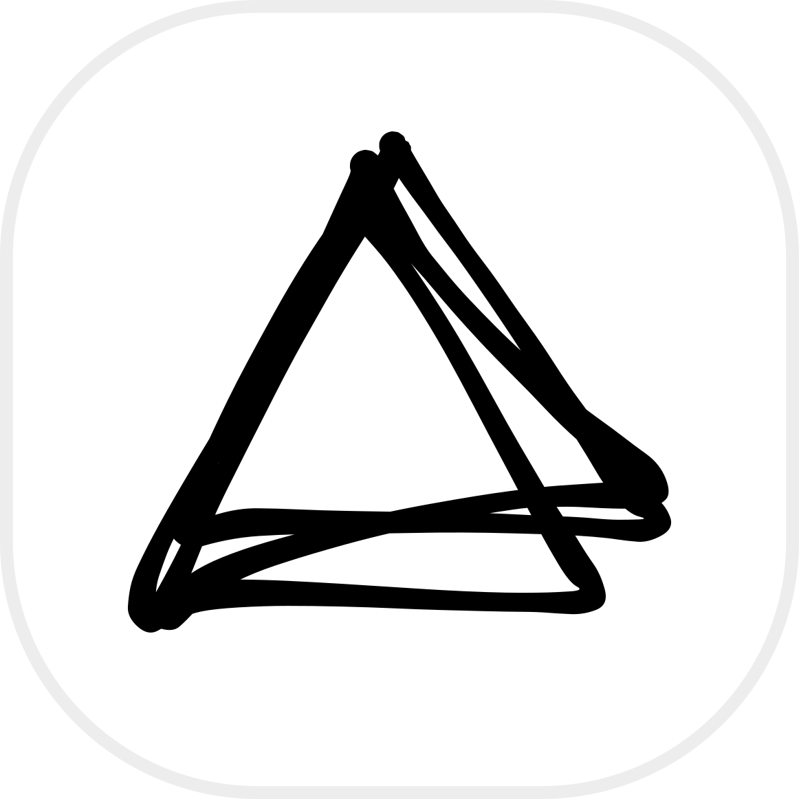

 
 

 

<h3 align="center">Updraw</h3>

The Infinite Canvas Development Kit

<a href="https://updraw.io">Website</a>&nbsp;&nbsp;·&nbsp;&nbsp;<a href="https://app.updraw.io">Live Demo</a>&nbsp;&nbsp;·&nbsp;&nbsp;<a href="https://www.npmjs.com/package/@updraw/engine">NPM</a>

 
 

# Overview

Updraw is an open-source toolkit for building infinite-canvas experiences such as whiteboards, visual planning tools, knowledge maps, and collaborative spatial workspaces.

It gives you a framework-neutral whiteboard foundation for creating interactive, browser-based canvases with objects, tools, navigation, and editing workflows without locking you into a specific UI stack.

## What you can build

- Whiteboards and brainstorming surfaces
- Visual planning and diagram tools
- Spatial knowledge and idea maps
- Collaborative content workspaces
- Agentic canvases

## Quick Start

- [Angular](https://updraw.io/docs/angular/getting-started/quick-start)
- [React](https://updraw.io/docs/react/getting-started/quick-start)
- [Vue](https://updraw.io/docs/vue/getting-started/quick-start)

## Support us

Updraw is an MIT-licensed open source project. If you like the idea of a framework-agnostic infinite canvas library and want to support our work, please consider becoming a [sponsor](https://github.com/sponsors/kasual1).
