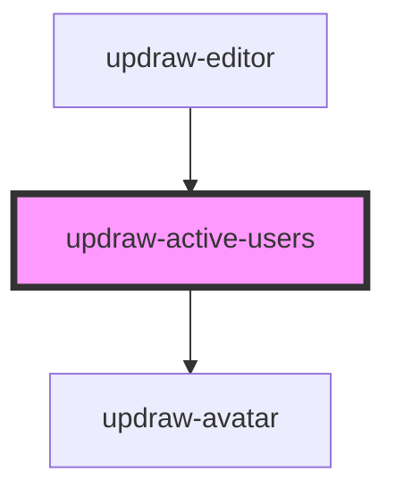

# updraw-active-users

<!-- Auto Generated Below -->

## Properties

| Property     | Attribute     | Description                                                                                                                                                  | Type                                                   | Default |
| ------------ | ------------- | ------------------------------------------------------------------------------------------------------------------------------------------------------------ | ------------------------------------------------------ | ------- |
| `agents`     | --            | Agents to display after the users: local agents and agents of collaborators. Shown with a bot badge, a ring while they work and their status in the tooltip. | `(UpdrawAgentPresence \| UpdrawRemoteAgentPresence)[]` | `[]`    |
| `avatarSize` | `avatar-size` | Avatar size in pixels                                                                                                                                        | `number`                                               | `40`    |
| `maxVisible` | `max-visible` | Maximum number of avatars to show before overflow text                                                                                                       | `number`                                               | `3`     |
| `overlap`    | `overlap`     | Overlap offset in pixels (negative margin between avatars)                                                                                                   | `number`                                               | `20`    |
| `users`      | --            | Array of active users to display                                                                                                                             | `IUpdrawUser[]`                                        | `[]`    |

## Dependencies

### Used by

 - [updraw-editor](../updraw-editor)

### Depends on

- [updraw-avatar](../updraw-avatar)

### Graph

----------------------------------------------

*Built with [StencilJS](https://stenciljs.com/)*
