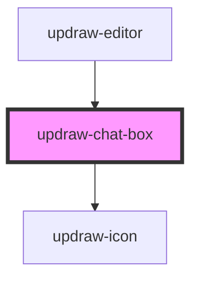

# updraw-chat-box

The focused input grows with typed or wrapped text up to five visible rows.
Starting with the sixth row, its height stays capped and vertical scrolling is enabled.
The active typing row stays above the bottom padding, leaving a gap below the caret even while scrolling.
While the input grows, text stays top-aligned without temporary internal scrolling.
Press Ctrl+I to focus the input; press it again while focused to blur and collapse it without clearing the text.

Set `loading` to `true` to show a circulating border stroke in the submit button's theme color.
The button becomes an enabled stop control while loading and emits `chatStop` when clicked.
Set it back to `false` to restore submission; while not loading, submission requires non-empty text.
Loading does not disable typing. Use `disabled` to disable the box and its button.
Reduced-motion preferences show a stationary stroke instead. The button uses the registered `arrowUp`
icon normally and the registered `square` icon while loading.

Set `chips` to show chips above the box, for example the object or element the next prompt refers to.
Each chip shows an optional registered `icon`, its bold `label`, an optional `› detail` and an optional muted `hint`.
Its remove button emits `chatChipRemove` with the chip. The box never changes `chips`, so pass a new array without the
chip, or with a changed one. At most three chips share one row as wide as the box, shortening long texts with an
ellipsis; further chips are summarized as "+N more". The space around them lets pointer input through to the canvas.

<!-- Auto Generated Below -->

## Properties

| Property      | Attribute     | Description                                                                                                                                                                                                                                                                                                   | Type                                                                                                                                                                                                                                                                                                                                                                                                                                                                                                                                                                                                                                                                                                                                                                                                                                                                                                                                                                                                                                                                                                                                                                                                                                                                                                                                                                                                                                                                                                                                                                                                                                                                                                                                                                                                                                                                                                                                                                                                                                                                                                                                                                                                                                                                                                                                                                                                                                                                                                                                                                                                                                                                                                                                                                                                                                                                                                                                                                                                                                                                                                                                                                                                                                                                                      | Default       |
| ------------- | ------------- | ------------------------------------------------------------------------------------------------------------------------------------------------------------------------------------------------------------------------------------------------------------------------------------------------------------- | ----------------------------------------------------------------------------------------------------------------------------------------------------------------------------------------------------------------------------------------------------------------------------------------------------------------------------------------------------------------------------------------------------------------------------------------------------------------------------------------------------------------------------------------------------------------------------------------------------------------------------------------------------------------------------------------------------------------------------------------------------------------------------------------------------------------------------------------------------------------------------------------------------------------------------------------------------------------------------------------------------------------------------------------------------------------------------------------------------------------------------------------------------------------------------------------------------------------------------------------------------------------------------------------------------------------------------------------------------------------------------------------------------------------------------------------------------------------------------------------------------------------------------------------------------------------------------------------------------------------------------------------------------------------------------------------------------------------------------------------------------------------------------------------------------------------------------------------------------------------------------------------------------------------------------------------------------------------------------------------------------------------------------------------------------------------------------------------------------------------------------------------------------------------------------------------------------------------------------------------------------------------------------------------------------------------------------------------------------------------------------------------------------------------------------------------------------------------------------------------------------------------------------------------------------------------------------------------------------------------------------------------------------------------------------------------------------------------------------------------------------------------------------------------------------------------------------------------------------------------------------------------------------------------------------------------------------------------------------------------------------------------------------------------------------------------------------------------------------------------------------------------------------------------------------------------------------------------------------------------------------------------------------------------- | ------------- |
| `chips`       | --            | Chips shown above the box, e.g. the object or element the next prompt refers to. The first three share one row as wide as the box; the rest are summarized as "+N more". The box never changes this array: pass a new array to add, change or remove chips. Each chip's remove button emits `chatChipRemove`. | `UpdrawChatBoxChip[]`                                                                                                                                                                                                                                                                                                                                                                                                                                                                                                                                                                                                                                                                                                                                                                                                                                                                                                                                                                                                                                                                                                                                                                                                                                                                                                                                                                                                                                                                                                                                                                                                                                                                                                                                                                                                                                                                                                                                                                                                                                                                                                                                                                                                                                                                                                                                                                                                                                                                                                                                                                                                                                                                                                                                                                                                                                                                                                                                                                                                                                                                                                                                                                                                                                                                    | `[]`          |
| `disabled`    | `disabled`    | Whether the chat box is disabled.                                                                                                                                                                                                                                                                             | `boolean`                                                                                                                                                                                                                                                                                                                                                                                                                                                                                                                                                                                                                                                                                                                                                                                                                                                                                                                                                                                                                                                                                                                                                                                                                                                                                                                                                                                                                                                                                                                                                                                                                                                                                                                                                                                                                                                                                                                                                                                                                                                                                                                                                                                                                                                                                                                                                                                                                                                                                                                                                                                                                                                                                                                                                                                                                                                                                                                                                                                                                                                                                                                                                                                                                                                                                 | `false`       |
| `loading`     | `loading`     | Whether to show a circulating progress indicator around the chat box border.                                                                                                                                                                                                                                  | `boolean`                                                                                                                                                                                                                                                                                                                                                                                                                                                                                                                                                                                                                                                                                                                                                                                                                                                                                                                                                                                                                                                                                                                                                                                                                                                                                                                                                                                                                                                                                                                                                                                                                                                                                                                                                                                                                                                                                                                                                                                                                                                                                                                                                                                                                                                                                                                                                                                                                                                                                                                                                                                                                                                                                                                                                                                                                                                                                                                                                                                                                                                                                                                                                                                                                                                                                 | `false`       |
| `mode`        | `mode`        | Display mode. `collapsed` shows a single row and switches to `expanded` automatically while focused once the text no longer fits on one line, collapsing again when focus is lost.                                                                                                                            | `"collapsed" \| "expanded"`                                                                                                                                                                                                                                                                                                                                                                                                                                                                                                                                                                                                                                                                                                                                                                                                                                                                                                                                                                                                                                                                                                                                                                                                                                                                                                                                                                                                                                                                                                                                                                                                                                                                                                                                                                                                                                                                                                                                                                                                                                                                                                                                                                                                                                                                                                                                                                                                                                                                                                                                                                                                                                                                                                                                                                                                                                                                                                                                                                                                                                                                                                                                                                                                                                                               | `'collapsed'` |
| `placeholder` | `placeholder` | Placeholder text shown when the chat box is empty. Falls back to the localized term.                                                                                                                                                                                                                          | `string`                                                                                                                                                                                                                                                                                                                                                                                                                                                                                                                                                                                                                                                                                                                                                                                                                                                                                                                                                                                                                                                                                                                                                                                                                                                                                                                                                                                                                                                                                                                                                                                                                                                                                                                                                                                                                                                                                                                                                                                                                                                                                                                                                                                                                                                                                                                                                                                                                                                                                                                                                                                                                                                                                                                                                                                                                                                                                                                                                                                                                                                                                                                                                                                                                                                                                  | `undefined`   |
| `terms`       | --            | Resolved localized strings keyed by term key, supplied by the editor.                                                                                                                                                                                                                                         | `"backToContent.label" \| "chatBox.moreChips" \| "chatBox.placeholder" \| "chatBox.removeChip" \| "chatBox.stop" \| "chatBox.submit" \| "currentUser.dialogTitle" \| "export.dialogTitle" \| "export.exportButton" \| "export.filename.label" \| "export.filename.placeholder" \| "export.format.label" \| "export.tabs.viewport" \| "export.tabs.workspace" \| "login.dialogTitle" \| "menu.align" \| "menu.alignBottom" \| "menu.alignCenterHorizontal" \| "menu.alignCenterVertical" \| "menu.alignLeft" \| "menu.alignRight" \| "menu.alignTop" \| "menu.bringToFront" \| "menu.copy" \| "menu.cut" \| "menu.delete" \| "menu.export" \| "menu.exportAsPng" \| "menu.exportAsSvg" \| "menu.group" \| "menu.import" \| "menu.logout" \| "menu.moveDown" \| "menu.moveUp" \| "menu.order" \| "menu.paste" \| "menu.selectAll" \| "menu.sendToBack" \| "menu.settings" \| "menu.share" \| "menu.ungroup" \| "moreMenu.ariaLabel" \| "objectType.dynamic" \| "objectType.group" \| "objectType.iframe" \| "objectType.image" \| "objectType.line" \| "objectType.object" \| "objectType.path" \| "objectType.shape" \| "objectType.text" \| "settings.about.description" \| "settings.about.title" \| "settings.categories.about" \| "settings.categories.developer" \| "settings.categories.general" \| "settings.categories.shortcuts" \| "settings.categories.viewport" \| "settings.developer.showMigrationInfo.description" \| "settings.developer.showMigrationInfo.label" \| "settings.developer.showObjectInfo.description" \| "settings.developer.showObjectInfo.label" \| "settings.developer.showSyncProviderInfo.description" \| "settings.developer.showSyncProviderInfo.label" \| "settings.developer.showViewportInfo.description" \| "settings.developer.showViewportInfo.label" \| "settings.developer.title" \| "settings.dialogTitle" \| "settings.general.language.description" \| "settings.general.language.label" \| "settings.general.lockDrawingScale.description" \| "settings.general.lockDrawingScale.label" \| "settings.general.theme.description" \| "settings.general.theme.label" \| "settings.general.title" \| "settings.shortcuts.title" \| "settings.viewport.boundaryBottom.description" \| "settings.viewport.boundaryBottom.label" \| "settings.viewport.boundaryLeft.description" \| "settings.viewport.boundaryLeft.label" \| "settings.viewport.boundaryPlaceholder" \| "settings.viewport.boundaryRight.description" \| "settings.viewport.boundaryRight.label" \| "settings.viewport.boundaryTop.description" \| "settings.viewport.boundaryTop.label" \| "settings.viewport.maxZoom.description" \| "settings.viewport.maxZoom.label" \| "settings.viewport.minZoom.description" \| "settings.viewport.minZoom.label" \| "settings.viewport.title" \| "share.copyLink.copied" \| "share.copyLink.title" \| "share.dialogTitle" \| "share.linkSharing.disabledDescription" \| "share.linkSharing.enabledDescription" \| "share.linkSharing.label" \| "share.linkSharing.toggleLabel" \| "toolConfig.collapse" \| "toolConfig.expand" \| "utility.delete" \| "utility.redo" \| "utility.undo" \| "watermark.poweredBy" \| "workspace.delete" \| "workspace.rename" \| "workspace.sharedTooltip" \| "zoom.zoomIn" \| "zoom.zoomOut" \| string` | `{}`          |
| `value`       | `value`       | Current text value of the chat box.                                                                                                                                                                                                                                                                           | `string`                                                                                                                                                                                                                                                                                                                                                                                                                                                                                                                                                                                                                                                                                                                                                                                                                                                                                                                                                                                                                                                                                                                                                                                                                                                                                                                                                                                                                                                                                                                                                                                                                                                                                                                                                                                                                                                                                                                                                                                                                                                                                                                                                                                                                                                                                                                                                                                                                                                                                                                                                                                                                                                                                                                                                                                                                                                                                                                                                                                                                                                                                                                                                                                                                                                                                  | `''`          |

## Events

| Event            | Description                                                                                                       | Type                                     |
| ---------------- | ----------------------------------------------------------------------------------------------------------------- | ---------------------------------------- |
| `chatChipRemove` | Emitted with the chip whose remove button the user activated. The chip stays until `chips` no longer contains it. | `CustomEvent<UpdrawChatBoxChip>`        |
| `chatStop`       | Emitted when the user stops the current response.                                                                 | `CustomEvent<void>`                      |
| `chatSubmit`     | Emitted with the current text when the user submits the chat box.                                                 | `CustomEvent<string>`                    |
| `modeChange`     | Emitted when the mode changes, including automatic expansion.                                                     | `CustomEvent<"collapsed" \| "expanded">` |

## Dependencies

### Used by

 - [updraw-editor](../updraw-editor)

### Depends on

- updraw-icon

### Graph

----------------------------------------------

*Built with [StencilJS](https://stenciljs.com/)*
