| `objectContextMenuItems`    | --                             |                                                                                                                                                                    | `ContextMenuItem[]`                         | `[     { label: 'menu.copy', icon: 'copy', group: 'clipboard', action: () => this.engineRef.copy() },     { label: 'menu.cut', icon: 'cut', group: 'clipboard', action: () => this.engineRef.cut() },     {       label: 'menu.paste',       icon: 'paste',       group: 'clipboard',       action: (menu, _) => this.engineRef.paste(menu.x, menu.y),     },     {       label: 'menu.export',       icon: 'upload',       group: 'clipboard',       isVisible: (_, objects) => this.canExportObjects(objects),       action: (_, objects) => {         const format = this.getPreferredExportFormat(objects);         if (!format) {           return;         }          void this.engineRef.exportSelectedObject(format);       },     },     {       label: 'menu.order',       icon: 'ordering',       group: 'other',       children: [         { label: 'menu.bringToFront', icon: 'bringToFront', action: () => this.engineRef.bringToFront() },         { label: 'menu.sendToBack', icon: 'sendToBack', action: () => this.engineRef.sendToBack() },         { label: 'menu.moveUp', icon: 'arrowUpFromDot', action: () => this.engineRef.bringForward() },         { label: 'menu.moveDown', icon: 'arrowDownFromDot', action: () => this.engineRef.sendBackward() },       ],     },     {       label: 'menu.align',       icon: 'align',       group: 'other',       children: [         { label: 'menu.alignLeft', icon: 'alignStartVertical', action: () => this.engineRef.alignObjects(UpdrawAlignment.StartHorizontal) },         { label: 'menu.alignCenterHorizontal', icon: 'alignCenterHorizontal', action: () => this.engineRef.alignObjects(UpdrawAlignment.CenterHorizontal) },         { label: 'menu.alignRight', icon: 'alignEndVertical', action: () => this.engineRef.alignObjects(UpdrawAlignment.EndHorizontal) },         { label: 'menu.alignTop', icon: 'alignStartHorizontal', action: () => this.engineRef.alignObjects(UpdrawAlignment.StartVertical) },         { label: 'menu.alignCenterVertical', icon: 'alignCenterVertical', action: () => this.engineRef.alignObjects(UpdrawAlignment.CenterVertical) },         { label: 'menu.alignBottom', icon: 'alignEndHorizontal', action: () => this.engineRef.alignObjects(UpdrawAlignment.EndVertical) },       ],     },     { label: 'menu.group', icon: 'group', group: 'other', action: () => this.engineRef.groupSelectedObjects() },     { label: 'menu.ungroup', icon: 'ungroup', group: 'other', action: () => this.engineRef.ungroupSelectedObjects() },     { label: 'menu.delete', icon: 'delete', group: 'destructive', action: () => this.engineRef.delete() },   ]` |
# updraw-edito
<!-- Auto Generated Below -->

## Properties

| Property                    | Attribute                      | Description                                                                                                                                                                                                                                                                                                  | Type                                                                                                                                                                                                                                                                                                                                                                                                                                                                                                                                                                                                                                                                                                                                                                                                                                                                                                                                                                                                                                                                | Default                                                                                                                                                                                                                                                                                                                                                                                                                                                                                                                                                                                                                                                                                                                                                                                                                                                                                                                                                                                                                                                                                                                                                                                                                                                                                                                                                                                                                                                                                                                                                                                                                                                                                                                                                                                                                                                                                                                                                                                                                                                                                                                                                                                                                                                                                                                                                                                                                                                                                                                                                                                                                                                                                                                                                                                                                                                                                                                                                                                                                                                                                                                                                                                                                                                                                                                                                                                                                                                                                                                                                                                                         |
| --------------------------- | ------------------------------ | ------------------------------------------------------------------------------------------------------------------------------------------------------------------------------------------------------------------------------------------------------------------------------------------------------------ | ------------------------------------------------------------------------------------------------------------------------------------------------------------------------------------------------------------------------------------------------------------------------------------------------------------------------------------------------------------------------------------------------------------------------------------------------------------------------------------------------------------------------------------------------------------------------------------------------------------------------------------------------------------------------------------------------------------------------------------------------------------------------------------------------------------------------------------------------------------------------------------------------------------------------------------------------------------------------------------------------------------------------------------------------------------------- | --------------------------------------------------------------------------------------------------------------------------------------------------------------------------------------------------------------------------------------------------------------------------------------------------------------------------------------------------------------------------------------------------------------------------------------------------------------------------------------------------------------------------------------------------------------------------------------------------------------------------------------------------------------------------------------------------------------------------------------------------------------------------------------------------------------------------------------------------------------------------------------------------------------------------------------------------------------------------------------------------------------------------------------------------------------------------------------------------------------------------------------------------------------------------------------------------------------------------------------------------------------------------------------------------------------------------------------------------------------------------------------------------------------------------------------------------------------------------------------------------------------------------------------------------------------------------------------------------------------------------------------------------------------------------------------------------------------------------------------------------------------------------------------------------------------------------------------------------------------------------------------------------------------------------------------------------------------------------------------------------------------------------------------------------------------------------------------------------------------------------------------------------------------------------------------------------------------------------------------------------------------------------------------------------------------------------------------------------------------------------------------------------------------------------------------------------------------------------------------------------------------------------------------------------------------------------------------------------------------------------------------------------------------------------------------------------------------------------------------------------------------------------------------------------------------------------------------------------------------------------------------------------------------------------------------------------------------------------------------------------------------------------------------------------------------------------------------------------------------------------------------------------------------------------------------------------------------------------------------------------------------------------------------------------------------------------------------------------------------------------------------------------------------------------------------------------------------------------------------------------------------------------------------------------------------------------------------------------------------- |
| `activeUsers`               | --                             |                                                                                                                                                                                                                                                                                                              | `IUpdrawUser[]`                                                                                                                                                                                                                                                                                                                                                                                                                                                                                                                                                                                                                                                                                                                                                                                                                                                                                                                                                                                                                                                    | `undefined`                                                                                                                                                                                                                                                                                                                                                                                                                                                                                                                                                                                                                                                                                                                                                                                                                                                                                                                                                                                                                                                                                                                                                                                                                                                                                                                                                                                                                                                                                                                                                                                                                                                                                                                                                                                                                                                                                                                                                                                                                                                                                                                                                                                                                                                                                                                                                                                                                                                                                                                                                                                                                                                                                                                                                                                                                                                                                                                                                                                                                                                                                                                                                                                                                                                                                                                                                                                                                                                                                                                                                                                                     |
| `activeWorkspaceId`         | `active-workspace-id`          | Optional workspace ID to set as active. If provided, the editor will automatically activate the workspace with this ID.                                                                                                                                                                                      | `string`                                                                                                                                                                                                                                                                                                                                                                                                                                                                                                                                                                                                                                                                                                                                                                                                                                                                                                                                                                                                                                                            | `undefined`                                                                                                                                                                                                                                                                                                                                                                                                                                                                                                                                                                                                                                                                                                                                                                                                                                                                                                                                                                                                                                                                                                                                                                                                                                                                                                                                                                                                                                                                                                                                                                                                                                                                                                                                                                                                                                                                                                                                                                                                                                                                                                                                                                                                                                                                                                                                                                                                                                                                                                                                                                                                                                                                                                                                                                                                                                                                                                                                                                                                                                                                                                                                                                                                                                                                                                                                                                                                                                                                                                                                                                                                     |
| `assetStorageConfig`        | --                             |                                                                                                                                                                                                                                                                                                              | `UpdrawAssetStorageConfig`                                                                                                                                                                                                                                                                                                                                                                                                                                                                                                                                                                                                                                                                                                                                                                                                                                                                                                                                                                                                                                         | `DEFAULT_ASSET_STORAGE_CONFIG`                                                                                                                                                                                                                                                                                                                                                                                                                                                                                                                                                                                                                                                                                                                                                                                                                                                                                                                                                                                                                                                                                                                                                                                                                                                                                                                                                                                                                                                                                                                                                                                                                                                                                                                                                                                                                                                                                                                                                                                                                                                                                                                                                                                                                                                                                                                                                                                                                                                                                                                                                                                                                                                                                                                                                                                                                                                                                                                                                                                                                                                                                                                                                                                                                                                                                                                                                                                                                                                                                                                                                                                  |
| `chatBoxChips`              | --                             | Chips shown above the chat box, e.g. the selected object or the element the next prompt refers to. Up to three share one row as wide as the box; the rest are summarized as "+N more". Pass a new array to change them. The editor never removes chips itself: update the array when `chatChipRemove` fires. | `UpdrawChatBoxChip[]`                                                                                                                                                                                                                                                                                                                                                                                                                                                                                                                                                                                                                                                                                                                                                                                                                                                                                                                                                                                                                                              | `[]`                                                                                                                                                                                                                                                                                                                                                                                                                                                                                                                                                                                                                                                                                                                                                                                                                                                                                                                                                                                                                                                                                                                                                                                                                                                                                                                                                                                                                                                                                                                                                                                                                                                                                                                                                                                                                                                                                                                                                                                                                                                                                                                                                                                                                                                                                                                                                                                                                                                                                                                                                                                                                                                                                                                                                                                                                                                                                                                                                                                                                                                                                                                                                                                                                                                                                                                                                                                                                                                                                                                                                                                                            |
| `chatBoxMode`               | `chat-box-mode`                | Initial chat box mode. A collapsed chat box expands automatically when its text overflows one row.                                                                                                                                                                                                           | `"collapsed" \| "expanded"`                                                                                                                                                                                                                                                                                                                                                                                                                                                                                                                                                                                                                                                                                                                                                                                                                                                                                                                                                                                                                                         | `"collapsed"`                                                                                                                                                                                                                                                                                                                                                                                                                                                                                                                                                                                                                                                                                                                                                                                                                                                                                                                                                                                                                                                                                                                                                                                                                                                                                                                                                                                                                                                                                                                                                                                                                                                                                                                                                                                                                                                                                                                                                                                                                                                                                                                                                                                                                                                                                                                                                                                                                                                                                                                                                                                                                                                                                                                                                                                                                                                                                                                                                                                                                                                                                                                                                                                                                                                                                                                                                                                                                                                                                                                                                                                                   |
| `chatSession`               | --                             | A chat session the chat box sends its prompts to, with `chatBoxChips` as what they refer to. While it runs, the chat box shows its progress and the stop button stops it. Call `preventDefault()` on `chatSubmit` to send a prompt yourself.                                                                 | `UpdrawChatSession`                                                                                                                                                                                                                                                                                                                                                                                                                                                                                                                                                                                                                                                                                                                                                                                                                                                                                                                                                                                                                                                | `undefined`                                                                                                                                                                                                                                                                                                                                                                                                                                                                                                                                                                                                                                                                                                                                                                                                                                                                                                                                                                                                                                                                                                                                                                                                                                                                                                                                                                                                                                                                                                                                                                                                                                                                                                                                                                                                                                                                                                                                                                                                                                                                                                                                                                                                                                                                                                                                                                                                                                                                                                                                                                                                                                                                                                                                                                                                                                                                                                                                                                                                                                                                                                                                                                                                                                                                                                                                                                                                                                                                                                                                                                                                     |
| `cursorTarget`              | --                             | The element to use as the target for the cursor. Defaults to the editor container if not set.                                                                                                                                                                                                                | `HTMLElement`                                                                                                                                                                                                                                                                                                                                                                                                                                                                                                                                                                                                                                                                                                                                                                                                                                                                                                                                                                                                                                                       | `undefined`                                                                                                                                                                                                                                                                                                                                                                                                                                                                                                                                                                                                                                                                                                                                                                                                                                                                                                                                                                                                                                                                                                                                                                                                                                                                                                                                                                                                                                                                                                                                                                                                                                                                                                                                                                                                                                                                                                                                                                                                                                                                                                                                                                                                                                                                                                                                                                                                                                                                                                                                                                                                                                                                                                                                                                                                                                                                                                                                                                                                                                                                                                                                                                                                                                                                                                                                                                                                                                                                                                                                                                                                     |
| `customFonts`               | --                             | Registers fonts for runtime usage (for example custom object rendering). Text-tool config tooltip options are controlled via toolbarItems[].config.availableFonts.                                                                                                                                           | `{ [x: string]: UpdrawFontRegistration; }`                                                                                                                                                                                                                                                                                                                                                                                                                                                                                                                                                                                                                                                                                                                                                                                                                                                                                                                                                                                                                         | `{}`                                                                                                                                                                                                                                                                                                                                                                                                                                                                                                                                                                                                                                                                                                                                                                                                                                                                                                                                                                                                                                                                                                                                                                                                                                                                                                                                                                                                                                                                                                                                                                                                                                                                                                                                                                                                                                                                                                                                                                                                                                                                                                                                                                                                                                                                                                                                                                                                                                                                                                                                                                                                                                                                                                                                                                                                                                                                                                                                                                                                                                                                                                                                                                                                                                                                                                                                                                                                                                                                                                                                                                                                            |
| `customSvgIcons`            | --                             |                                                                                                                                                                                                                                                                                                              | `Partial<Record<"info" \| "type" \| "image" \| "download" \| "command" \| "cursor" \| "square" \| "x" \| "copy" \| "check" \| "arrowUp" \| "pen" \| "arrow" \| "arrowUpFromDot" \| "arrowDownFromDot" \| "highlighter" \| "eraser" \| "shapes" \| "shapeRectangle" \| "shapeEllipse" \| "shapeTriangle" \| "imageOff" \| "chevronDown" \| "chevronUp" \| "chevronLeft" \| "chevronRight" \| "chevronsLeft" \| "paste" \| "cut" \| "delete" \| "bringToFront" \| "sendToBack" \| "selectAll" \| "upload" \| "undo" \| "redo" \| "plus" \| "play" \| "minus" \| "ellipsisVertical" \| "group" \| "ungroup" \| "moveVertical" \| "hand" \| "handGrab" \| "mousePointer" \| "pointer" \| "settings" \| "share" \| "palette" \| "ordering" \| "layoutTemplate" \| "align" \| "alignStartHorizontal" \| "alignCenterHorizontal" \| "alignEndHorizontal" \| "alignStartVertical" \| "alignCenterVertical" \| "alignEndVertical" \| "viewport" \| "logOut" \| "usersRound" \| "google" \| "facebook" \| "github" \| "braces" \| "heart", string>> & Record<string, string>` | `{}`                                                                                                                                                                                                                                                                                                                                                                                                                                                                                                                                                                                                                                                                                                                                                                                                                                                                                                                                                                                                                                                                                                                                                                                                                                                                                                                                                                                                                                                                                                                                                                                                                                                                                                                                                                                                                                                                                                                                                                                                                                                                                                                                                                                                                                                                                                                                                                                                                                                                                                                                                                                                                                                                                                                                                                                                                                                                                                                                                                                                                                                                                                                                                                                                                                                                                                                                                                                                                                                                                                                                                                                                            |
| `debugInfo`                 | --                             |                                                                                                                                                                                                                                                                                                              | `UpdrawDebugInfo`                                                                                                                                                                                                                                                                                                                                                                                                                                                                                                                                                                                                                                                                                                                                                                                                                                                                                                                                                                                                                                                  | `{     showViewportInfo: false,     showObjectInfo: false,     showSyncProviderInfo: true,     showMigrationInfo: true,     showAssetResolverInfo: false,   }`                                                                                                                                                                                                                                                                                                                                                                                                                                                                                                                                                                                                                                                                                                                                                                                                                                                                                                                                                                                                                                                                                                                                                                                                                                                                                                                                                                                                                                                                                                                                                                                                                                                                                                                                                                                                                                                                                                                                                                                                                                                                                                                                                                                                                                                                                                                                                                                                                                                                                                                                                                                                                                                                                                                                                                                                                                                                                                                                                                                                                                                                                                                                                                                                                                                                                                                                                                                                                                                  |
| `editorId`                  | `editor-id`                    | Optional unique identifier for namespacing storage keys across multiple editor instances.                                                                                                                                                                                                                    | `string`                                                                                                                                                                                                                                                                                                                                                                                                                                                                                                                                                                                                                                                                                                                                                                                                                                                                                                                                                                                                                                                            | `undefined`                                                                                                                                                                                                                                                                                                                                                                                                                                                                                                                                                                                                                                                                                                                                                                                                                                                                                                                                                                                                                                                                                                                                                                                                                                                                                                                                                                                                                                                                                                                                                                                                                                                                                                                                                                                                                                                                                                                                                                                                                                                                                                                                                                                                                                                                                                                                                                                                                                                                                                                                                                                                                                                                                                                                                                                                                                                                                                                                                                                                                                                                                                                                                                                                                                                                                                                                                                                                                                                                                                                                                                                                     |
| `fallbackLocale`            | `fallback-locale`              | The locale used to resolve terms missing from the active locale.                                                                                                                                                                                                                                             | `"de" \| "en" \| "fr" \| string & {}`                                                                                                                                                                                                                                                                                                                                                                                                                                                                                                                                                                                                                                                                                                                                                                                                                                                                                                                                                                                                                               | `"en"`                                                                                                                                                                                                                                                                                                                                                                                                                                                                                                                                                                                                                                                                                                                                                                                                                                                                                                                                                                                                                                                                                                                                                                                                                                                                                                                                                                                                                                                                                                                                                                                                                                                                                                                                                                                                                                                                                                                                                                                                                                                                                                                                                                                                                                                                                                                                                                                                                                                                                                                                                                                                                                                                                                                                                                                                                                                                                                                                                                                                                                                                                                                                                                                                                                                                                                                                                                                                                                                                                                                                                                                                          |
| `globalContextMenuItems`    | --                             |                                                                                                                                                                                                                                                                                                              | `ContextMenuItem[]`                                                                                                                                                                                                                                                                                                                                                                                                                                                                                                                                                                                                                                                                                                                                                                                                                                                                                                                                                                                                                                                 | `[     {       label: "menu.paste",       icon: "paste",       action: (menu) => this.engineRef.paste(menu.x, menu.y),     },     {       label: "menu.selectAll",       icon: "selectAll",       action: () => this.selectAllObjectsInViewport(),     },   ]`                                                                                                                                                                                                                                                                                                                                                                                                                                                                                                                                                                                                                                                                                                                                                                                                                                                                                                                                                                                                                                                                                                                                                                                                                                                                                                                                                                                                                                                                                                                                                                                                                                                                                                                                                                                                                                                                                                                                                                                                                                                                                                                                                                                                                                                                                                                                                                                                                                                                                                                                                                                                                                                                                                                                                                                                                                                                                                                                                                                                                                                                                                                                                                                                                                                                                                                                                  |
| `isAgentAvatarsVisible`     | `is-agent-avatars-visible`     | Whether the avatar stack shows agents (local ones and those of collaborators) after the active users.                                                                                                                                                                                                        | `boolean`                                                                                                                                                                                                                                                                                                                                                                                                                                                                                                                                                                                                                                                                                                                                                                                                                                                                                                                                                                                                                                                           | `true`                                                                                                                                                                                                                                                                                                                                                                                                                                                                                                                                                                                                                                                                                                                                                                                                                                                                                                                                                                                                                                                                                                                                                                                                                                                                                                                                                                                                                                                                                                                                                                                                                                                                                                                                                                                                                                                                                                                                                                                                                                                                                                                                                                                                                                                                                                                                                                                                                                                                                                                                                                                                                                                                                                                                                                                                                                                                                                                                                                                                                                                                                                                                                                                                                                                                                                                                                                                                                                                                                                                                                                                                          |
| `isChatBoxLoading`          | `is-chat-box-loading`          | Whether the chat box shows its progress ring and turns its send button into a stop button.                                                                                                                                                                                                                   | `boolean`                                                                                                                                                                                                                                                                                                                                                                                                                                                                                                                                                                                                                                                                                                                                                                                                                                                                                                                                                                                                                                                           | `false`                                                                                                                                                                                                                                                                                                                                                                                                                                                                                                                                                                                                                                                                                                                                                                                                                                                                                                                                                                                                                                                                                                                                                                                                                                                                                                                                                                                                                                                                                                                                                                                                                                                                                                                                                                                                                                                                                                                                                                                                                                                                                                                                                                                                                                                                                                                                                                                                                                                                                                                                                                                                                                                                                                                                                                                                                                                                                                                                                                                                                                                                                                                                                                                                                                                                                                                                                                                                                                                                                                                                                                                                         |
| `isChatBoxVisible`          | `is-chat-box-visible`          |                                                                                                                                                                                                                                                                                                              | `boolean`                                                                                                                                                                                                                                                                                                                                                                                                                                                                                                                                                                                                                                                                                                                                                                                                                                                                                                                                                                                                                                                           | `false`                                                                                                                                                                                                                                                                                                                                                                                                                                                                                                                                                                                                                                                                                                                                                                                                                                                                                                                                                                                                                                                                                                                                                                                                                                                                                                                                                                                                                                                                                                                                                                                                                                                                                                                                                                                                                                                                                                                                                                                                                                                                                                                                                                                                                                                                                                                                                                                                                                                                                                                                                                                                                                                                                                                                                                                                                                                                                                                                                                                                                                                                                                                                                                                                                                                                                                                                                                                                                                                                                                                                                                                                         |
| `isMoreMenuVisible`         | `is-more-menu-visible`         |                                                                                                                                                                                                                                                                                                              | `boolean`                                                                                                                                                                                                                                                                                                                                                                                                                                                                                                                                                                                                                                                                                                                                                                                                                                                                                                                                                                                                                                                           | `true`                                                                                                                                                                                                                                                                                                                                                                                                                                                                                                                                                                                                                                                                                                                                                                                                                                                                                                                                                                                                                                                                                                                                                                                                                                                                                                                                                                                                                                                                                                                                                                                                                                                                                                                                                                                                                                                                                                                                                                                                                                                                                                                                                                                                                                                                                                                                                                                                                                                                                                                                                                                                                                                                                                                                                                                                                                                                                                                                                                                                                                                                                                                                                                                                                                                                                                                                                                                                                                                                                                                                                                                                          |
| `isPanningEnabled`          | `is-panning-enabled`           |                                                                                                                                                                                                                                                                                                              | `boolean`                                                                                                                                                                                                                                                                                                                                                                                                                                                                                                                                                                                                                                                                                                                                                                                                                                                                                                                                                                                                                                                           | `true`                                                                                                                                                                                                                                                                                                                                                                                                                                                                                                                                                                                                                                                                                                                                                                                                                                                                                                                                                                                                                                                                                                                                                                                                                                                                                                                                                                                                                                                                                                                                                                                                                                                                                                                                                                                                                                                                                                                                                                                                                                                                                                                                                                                                                                                                                                                                                                                                                                                                                                                                                                                                                                                                                                                                                                                                                                                                                                                                                                                                                                                                                                                                                                                                                                                                                                                                                                                                                                                                                                                                                                                                          |
| `isToolbarVisible`          | `is-toolbar-visible`           |                                                                                                                                                                                                                                                                                                              | `boolean`                                                                                                                                                                                                                                                                                                                                                                                                                                                                                                                                                                                                                                                                                                                                                                                                                                                                                                                                                                                                                                                           | `true`                                                                                                                                                                                                                                                                                                                                                                                                                                                                                                                                                                                                                                                                                                                                                                                                                                                                                                                                                                                                                                                                                                                                                                                                                                                                                                                                                                                                                                                                                                                                                                                                                                                                                                                                                                                                                                                                                                                                                                                                                                                                                                                                                                                                                                                                                                                                                                                                                                                                                                                                                                                                                                                                                                                                                                                                                                                                                                                                                                                                                                                                                                                                                                                                                                                                                                                                                                                                                                                                                                                                                                                                          |
| `isUtilityPanelVisible`     | `is-utility-panel-visible`     |                                                                                                                                                                                                                                                                                                              | `boolean`                                                                                                                                                                                                                                                                                                                                                                                                                                                                                                                                                                                                                                                                                                                                                                                                                                                                                                                                                                                                                                                           | `true`                                                                                                                                                                                                                                                                                                                                                                                                                                                                                                                                                                                                                                                                                                                                                                                                                                                                                                                                                                                                                                                                                                                                                                                                                                                                                                                                                                                                                                                                                                                                                                                                                                                                                                                                                                                                                                                                                                                                                                                                                                                                                                                                                                                                                                                                                                                                                                                                                                                                                                                                                                                                                                                                                                                                                                                                                                                                                                                                                                                                                                                                                                                                                                                                                                                                                                                                                                                                                                                                                                                                                                                                          |
| `isWatermarkVisible`        | `is-watermark-visible`         | Whether the "Powered by Updraw" watermark is shown. Keeping it visible helps support the project.                                                                                                                                                                                                           | `boolean`                                                                                                                                                                                                                                                                                                                                                                                                                                                                                                                                                                                                                                                                                                                                                                                                                                                                                                                                                                                                                                                           | `true`                                                                                                                                                                                                                                                                                                                                                                                                                                                                                                                                                                                                                                                                                                                                                                                                                                                                                                                                                                                                                                                                                                                                                                                                                                                                                                                                                                                                                                                                                                                                                                                                                                                                                                                                                                                                                                                                                                                                                                                                                                                                                                                                                                                                                                                                                                                                                                                                                                                                                                                                                                                                                                                                                                                                                                                                                                                                                                                                                                                                                                                                                                                                                                                                                                                                                                                                                                                                                                                                                                                                                                                                          |
| `isWorkspaceManagerVisible` | `is-workspace-manager-visible` |                                                                                                                                                                                                                                                                                                              | `boolean`                                                                                                                                                                                                                                                                                                                                                                                                                                                                                                                                                                                                                                                                                                                                                                                                                                                                                                                                                                                                                                                           | `true`                                                                                                                                                                                                                                                                                                                                                                                                                                                                                                                                                                                                                                                                                                                                                                                                                                                                                                                                                                                                                                                                                                                                                                                                                                                                                                                                                                                                                                                                                                                                                                                                                                                                                                                                                                                                                                                                                                                                                                                                                                                                                                                                                                                                                                                                                                                                                                                                                                                                                                                                                                                                                                                                                                                                                                                                                                                                                                                                                                                                                                                                                                                                                                                                                                                                                                                                                                                                                                                                                                                                                                                                          |
| `isZoomPanelVisible`        | `is-zoom-panel-visible`        |                                                                                                                                                                                                                                                                                                              | `boolean`                                                                                                                                                                                                                                                                                                                                                                                                                                                                                                                                                                                                                                                                                                                                                                                                                                                                                                                                                                                                                                                           | `true`                                                                                                                                                                                                                                                                                                                                                                                                                                                                                                                                                                                                                                                                                                                                                                                                                                                                                                                                                                                                                                                                                                                                                                                                                                                                                                                                                                                                                                                                                                                                                                                                                                                                                                                                                                                                                                                                                                                                                                                                                                                                                                                                                                                                                                                                                                                                                                                                                                                                                                                                                                                                                                                                                                                                                                                                                                                                                                                                                                                                                                                                                                                                                                                                                                                                                                                                                                                                                                                                                                                                                                                                          |
| `isZoomingEnabled`          | `is-zooming-enabled`           |                                                                                                                                                                                                                                                                                                              | `boolean`                                                                                                                                                                                                                                                                                                                                                                                                                                                                                                                                                                                                                                                                                                                                                                                                                                                                                                                                                                                                                                                           | `true`                                                                                                                                                                                                                                                                                                                                                                                                                                                                                                                                                                                                                                                                                                                                                                                                                                                                                                                                                                                                                                                                                                                                                                                                                                                                                                                                                                                                                                                                                                                                                                                                                                                                                                                                                                                                                                                                                                                                                                                                                                                                                                                                                                                                                                                                                                                                                                                                                                                                                                                                                                                                                                                                                                                                                                                                                                                                                                                                                                                                                                                                                                                                                                                                                                                                                                                                                                                                                                                                                                                                                                                                          |
| `locale`                    | `locale`                       | The current locale (language) code applied to the editor, e.g. 'en', 'de', 'fr'.                                                                                                                                                                                                                             | `"de" \| "en" \| "fr" \| string & {}`                                                                                                                                                                                                                                                                                                                                                                                                                                                                                                                                                                                                                                                                                                                                                                                                                                                                                                                                                                                                                               | `"en"`                                                                                                                                                                                                                                                                                                                                                                                                                                                                                                                                                                                                                                                                                                                                                                                                                                                                                                                                                                                                                                                                                                                                                                                                                                                                                                                                                                                                                                                                                                                                                                                                                                                                                                                                                                                                                                                                                                                                                                                                                                                                                                                                                                                                                                                                                                                                                                                                                                                                                                                                                                                                                                                                                                                                                                                                                                                                                                                                                                                                                                                                                                                                                                                                                                                                                                                                                                                                                                                                                                                                                                                                          |
| `locales`                   | --                             | An array of available locale definitions (with optional partial term overrides).                                                                                                                                                                                                                             | `UpdrawLocale[]`                                                                                                                                                                                                                                                                                                                                                                                                                                                                                                                                                                                                                                                                                                                                                                                                                                                                                                                                                                                                                                                   | `undefined`                                                                                                                                                                                                                                                                                                                                                                                                                                                                                                                                                                                                                                                                                                                                                                                                                                                                                                                                                                                                                                                                                                                                                                                                                                                                                                                                                                                                                                                                                                                                                                                                                                                                                                                                                                                                                                                                                                                                                                                                                                                                                                                                                                                                                                                                                                                                                                                                                                                                                                                                                                                                                                                                                                                                                                                                                                                                                                                                                                                                                                                                                                                                                                                                                                                                                                                                                                                                                                                                                                                                                                                                     |
| `lockDrawingScale`          | `lock-drawing-scale`           |                                                                                                                                                                                                                                                                                                              | `boolean`                                                                                                                                                                                                                                                                                                                                                                                                                                                                                                                                                                                                                                                                                                                                                                                                                                                                                                                                                                                                                                                           | `true`                                                                                                                                                                                                                                                                                                                                                                                                                                                                                                                                                                                                                                                                                                                                                                                                                                                                                                                                                                                                                                                                                                                                                                                                                                                                                                                                                                                                                                                                                                                                                                                                                                                                                                                                                                                                                                                                                                                                                                                                                                                                                                                                                                                                                                                                                                                                                                                                                                                                                                                                                                                                                                                                                                                                                                                                                                                                                                                                                                                                                                                                                                                                                                                                                                                                                                                                                                                                                                                                                                                                                                                                          |
| `loginConfig`               | --                             | Optional login configuration. When provided, a "Sign in" button is shown that opens a login dialog with the configured providers.                                                                                                                                                                            | `UpdrawLoginConfig`                                                                                                                                                                                                                                                                                                                                                                                                                                                                                                                                                                                                                                                                                                                                                                                                                                                                                                                                                                                                                                                | `undefined`                                                                                                                                                                                                                                                                                                                                                                                                                                                                                                                                                                                                                                                                                                                                                                                                                                                                                                                                                                                                                                                                                                                                                                                                                                                                                                                                                                                                                                                                                                                                                                                                                                                                                                                                                                                                                                                                                                                                                                                                                                                                                                                                                                                                                                                                                                                                                                                                                                                                                                                                                                                                                                                                                                                                                                                                                                                                                                                                                                                                                                                                                                                                                                                                                                                                                                                                                                                                                                                                                                                                                                                                     |
| `moreMenuItems`             | --                             |                                                                                                                                                                                                                                                                                                              | `IUpdrawMenuItem<any>[]`                                                                                                                                                                                                                                                                                                                                                                                                                                                                                                                                                                                                                                                                                                                                                                                                                                                                                                                                                                                                                                           | `[     {       id: "share",       label: "menu.share",       icon: "share",       isVisible: async () => hasRemoteSyncProvider(this.syncConfig),       action: () => {         if (!this.isLoggedIn && this.loginConfig) {           this.openLoginDialog();           return;         }         this.shareDialogRef.open();       },     },     {       id: "export",       label: "menu.export",       icon: "upload",       action: async () => {         const preview = await this.engineRef.getScreenshot("png");         this.exportRef.open(preview ?? undefined);       },     },     {       id: "import",       label: "menu.import",       icon: "download",       action: () => this.engineRef.importFromFile(),     },     {       id: "settings",       label: "menu.settings",       icon: "settings",       action: () => this.settingsRef.open(),     },   ]`                                                                                                                                                                                                                                                                                                                                                                                                                                                                                                                                                                                                                                                                                                                                                                                                                                                                                                                                                                                                                                                                                                                                                                                                                                                                                                                                                                                                                                                                                                                                                                                                                                                                                                                                                                                                                                                                                                                                                                                                                                                                                                                                                                                                                                                                                                                                                                                                                                                                                                                                                                                                                                                                                                                                 |
| `objectConfig`              | --                             | Configures how objects behave, in one place for all objects: which objects get a titlebar, and which can be rotated or resized. Each option is a boolean or a function of the object.                                                                                                                        | `UpdrawObjectConfig`                                                                                                                                                                                                                                                                                                                                                                                                                                                                                                                                                                                                                                                                                                                                                                                                                                                                                                                                                                                                                                               | `undefined`                                                                                                                                                                                                                                                                                                                                                                                                                                                                                                                                                                                                                                                                                                                                                                                                                                                                                                                                                                                                                                                                                                                                                                                                                                                                                                                                                                                                                                                                                                                                                                                                                                                                                                                                                                                                                                                                                                                                                                                                                                                                                                                                                                                                                                                                                                                                                                                                                                                                                                                                                                                                                                                                                                                                                                                                                                                                                                                                                                                                                                                                                                                                                                                                                                                                                                                                                                                                                                                                                                                                                                                                     |
| `objectContextMenuItems`    | --                             |                                                                                                                                                                                                                                                                                                              | `ContextMenuItem[]`                                                                                                                                                                                                                                                                                                                                                                                                                                                                                                                                                                                                                                                                                                                                                                                                                                                                                                                                                                                                                                                 | `[     {       label: "menu.copy",       icon: "copy",       group: "clipboard",       action: () => this.engineRef.copy(),     },     {       label: "menu.cut",       icon: "cut",       group: "clipboard",       action: () => this.engineRef.cut(),     },     {       label: "menu.paste",       icon: "paste",       group: "clipboard",       action: (menu, _) => this.engineRef.paste(menu.x, menu.y),     },     {       label: "menu.export",       icon: "upload",       group: "clipboard",       isVisible: (_, objects) => this.canExportObjects(objects),       action: (_, objects) => {         const format = this.getPreferredExportFormat(objects);         if (!format) {           return;         }          void this.engineRef.exportSelectedObject(format);       },     },     {       label: "menu.order",       icon: "ordering",       group: "other",       children: [         {           label: "menu.bringToFront",           icon: "bringToFront",           action: () => this.engineRef.bringToFront(),         },         {           label: "menu.sendToBack",           icon: "sendToBack",           action: () => this.engineRef.sendToBack(),         },         {           label: "menu.moveUp",           icon: "arrowUpFromDot",           action: () => this.engineRef.bringForward(),         },         {           label: "menu.moveDown",           icon: "arrowDownFromDot",           action: () => this.engineRef.sendBackward(),         },       ],     },     {       label: "menu.align",       icon: "align",       group: "other",       children: [         {           label: "menu.alignLeft",           icon: "alignStartVertical",           action: () =>             this.engineRef.alignObjects(UpdrawAlignment.StartHorizontal),         },         {           label: "menu.alignCenterHorizontal",           icon: "alignCenterHorizontal",           action: () =>             this.engineRef.alignObjects(UpdrawAlignment.CenterHorizontal),         },         {           label: "menu.alignRight",           icon: "alignEndVertical",           action: () =>             this.engineRef.alignObjects(UpdrawAlignment.EndHorizontal),         },         {           label: "menu.alignTop",           icon: "alignStartHorizontal",           action: () =>             this.engineRef.alignObjects(UpdrawAlignment.StartVertical),         },         {           label: "menu.alignCenterVertical",           icon: "alignCenterVertical",           action: () =>             this.engineRef.alignObjects(UpdrawAlignment.CenterVertical),         },         {           label: "menu.alignBottom",           icon: "alignEndHorizontal",           action: () =>             this.engineRef.alignObjects(UpdrawAlignment.EndVertical),         },       ],     },     {       label: "menu.group",       icon: "group",       group: "other",       children: [         {           label: "menu.group",           icon: "group",           action: (_, objects) => this.engineRef.group(objects),         },         {           label: "menu.ungroup",           icon: "ungroup",           action: (_, objects) => {             const groups = objects.filter(               (object): object is UpdrawGroup =>                 object.__class__ === "UpdrawGroup",             );             this.engineRef.ungroup(groups);           },         },       ],     },     {       label: "menu.delete",       icon: "delete",       group: "edit",       action: () => this.engineRef.delete(),     },   ]` |
| `objectTitlebar`            | --                             | Content of the titlebar rendered above every object for which `objectConfig.hasTitlebar` is true. The same configuration applies to all objects. Leave unset to disable titlebars.                                                                                                                           | `UpdrawObjectTitlebarConfig`                                                                                                                                                                                                                                                                                                                                                                                                                                                                                                                                                                                                                                                                                                                                                                                                                                                                                                                                                                                                                                       | `undefined`                                                                                                                                                                                                                                                                                                                                                                                                                                                                                                                                                                                                                                                                                                                                                                                                                                                                                                                                                                                                                                                                                                                                                                                                                                                                                                                                                                                                                                                                                                                                                                                                                                                                                                                                                                                                                                                                                                                                                                                                                                                                                                                                                                                                                                                                                                                                                                                                                                                                                                                                                                                                                                                                                                                                                                                                                                                                                                                                                                                                                                                                                                                                                                                                                                                                                                                                                                                                                                                                                                                                                                                                     |
| `scaleMax`                  | `scale-max`                    |                                                                                                                                                                                                                                                                                                              | `number`                                                                                                                                                                                                                                                                                                                                                                                                                                                                                                                                                                                                                                                                                                                                                                                                                                                                                                                                                                                                                                                            | `1000`                                                                                                                                                                                                                                                                                                                                                                                                                                                                                                                                                                                                                                                                                                                                                                                                                                                                                                                                                                                                                                                                                                                                                                                                                                                                                                                                                                                                                                                                                                                                                                                                                                                                                                                                                                                                                                                                                                                                                                                                                                                                                                                                                                                                                                                                                                                                                                                                                                                                                                                                                                                                                                                                                                                                                                                                                                                                                                                                                                                                                                                                                                                                                                                                                                                                                                                                                                                                                                                                                                                                                                                                          |
| `scaleMin`                  | `scale-min`                    |                                                                                                                                                                                                                                                                                                              | `number`                                                                                                                                                                                                                                                                                                                                                                                                                                                                                                                                                                                                                                                                                                                                                                                                                                                                                                                                                                                                                                                            | `0.0001`                                                                                                                                                                                                                                                                                                                                                                                                                                                                                                                                                                                                                                                                                                                                                                                                                                                                                                                                                                                                                                                                                                                                                                                                                                                                                                                                                                                                                                                                                                                                                                                                                                                                                                                                                                                                                                                                                                                                                                                                                                                                                                                                                                                                                                                                                                                                                                                                                                                                                                                                                                                                                                                                                                                                                                                                                                                                                                                                                                                                                                                                                                                                                                                                                                                                                                                                                                                                                                                                                                                                                                                                        |
| `syncConfig`                | --                             |                                                                                                                                                                                                                                                                                                              | `UpdrawSyncConfig`                                                                                                                                                                                                                                                                                                                                                                                                                                                                                                                                                                                                                                                                                                                                                                                                                                                                                                                                                                                                                                                 | `DEFAULT_SYNC_CONFIG`                                                                                                                                                                                                                                                                                                                                                                                                                                                                                                                                                                                                                                                                                                                                                                                                                                                                                                                                                                                                                                                                                                                                                                                                                                                                                                                                                                                                                                                                                                                                                                                                                                                                                                                                                                                                                                                                                                                                                                                                                                                                                                                                                                                                                                                                                                                                                                                                                                                                                                                                                                                                                                                                                                                                                                                                                                                                                                                                                                                                                                                                                                                                                                                                                                                                                                                                                                                                                                                                                                                                                                                           |
| `theme`                     | `theme`                        |                                                                                                                                                                                                                                                                                                              | `"dark" \| "light" \| string & {}`                                                                                                                                                                                                                                                                                                                                                                                                                                                                                                                                                                                                                                                                                                                                                                                                                                                                                                                                                                                                                                  | `"light"`                                                                                                                                                                                                                                                                                                                                                                                                                                                                                                                                                                                                                                                                                                                                                                                                                                                                                                                                                                                                                                                                                                                                                                                                                                                                                                                                                                                                                                                                                                                                                                                                                                                                                                                                                                                                                                                                                                                                                                                                                                                                                                                                                                                                                                                                                                                                                                                                                                                                                                                                                                                                                                                                                                                                                                                                                                                                                                                                                                                                                                                                                                                                                                                                                                                                                                                                                                                                                                                                                                                                                                                                       |
| `themes`                    | --                             |                                                                                                                                                                                                                                                                                                              | `UpdrawTheme[]`                                                                                                                                                                                                                                                                                                                                                                                                                                                                                                                                                                                                                                                                                                                                                                                                                                                                                                                                                                                                                                                    | `undefined`                                                                                                                                                                                                                                                                                                                                                                                                                                                                                                                                                                                                                                                                                                                                                                                                                                                                                                                                                                                                                                                                                                                                                                                                                                                                                                                                                                                                                                                                                                                                                                                                                                                                                                                                                                                                                                                                                                                                                                                                                                                                                                                                                                                                                                                                                                                                                                                                                                                                                                                                                                                                                                                                                                                                                                                                                                                                                                                                                                                                                                                                                                                                                                                                                                                                                                                                                                                                                                                                                                                                                                                                     |
| `toolbarItems`              | --                             |                                                                                                                                                                                                                                                                                                              | `UpdrawToolbarItem[]`                                                                                                                                                                                                                                                                                                                                                                                                                                                                                                                                                                                                                                                                                                                                                                                                                                                                                                                                                                                                                                              | `[     {       name: "selection",       type: "tool",       isDefault: true,       tool: UpdrawSelectionTool,       icon: "cursor",     },     {       name: "brush",       type: "tool",       tool: UpdrawBrushTool,       icon: "pen",       config: DEFAULT_BRUSH_CONFIG,     },     {       name: "eraser",       type: "tool",       tool: UpdrawEraserTool,       icon: "eraser",     },     {       name: "line",       type: "tool",       tool: UpdrawLineTool,       icon: "arrow",       config: DEFAULT_LINE_TOOL_CONFIG,     },     {       name: "shape",       type: "tool",       tool: UpdrawShapeTool,       icon: "shapeRectangle",       config: DEFAULT_SHAPE_CONFIG,       subOptions: [         {           id: "rectangle",           icon: "shapeRectangle",           label: "Rectangle",           value: ShapeType.Rectangle,           toolProperty: "shapeType",         },         {           id: "ellipse",           icon: "shapeEllipse",           label: "Ellipse",           value: ShapeType.Ellipse,           toolProperty: "shapeType",         },         {           id: "triangle",           icon: "shapeTriangle",           label: "Triangle",           value: ShapeType.Triangle,           toolProperty: "shapeType",         },       ],     },     {       name: "text",       type: "tool",       tool: UpdrawTextTool,       icon: "type",       config: DEFAULT_TEXT_CONFIG,     },     {       name: "image",       type: "tool",       tool: UpdrawImageTool,       icon: "image",     },     {       name: "config",       type: "config",     },   ]`                                                                                                                                                                                                                                                                                                                                                                                                                                                                                                                                                                                                                                                                                                                                                                                                                                                                                                                                                                                                                                                                                                                                                                                                                                                                                                                                                                                                                                                                                                                                                                                                                                                                                                                                                                                                                                                                                                                                                                                       |
| `user`                      | --                             |                                                                                                                                                                                                                                                                                                              | `IUpdrawUser`                                                                                                                                                                                                                                                                                                                                                                                                                                                                                                                                                                                                                                                                                                                                                                                                                                                                                                                                                                                                                                                      | `undefined`                                                                                                                                                                                                                                                                                                                                                                                                                                                                                                                                                                                                                                                                                                                                                                                                                                                                                                                                                                                                                                                                                                                                                                                                                                                                                                                                                                                                                                                                                                                                                                                                                                                                                                                                                                                                                                                                                                                                                                                                                                                                                                                                                                                                                                                                                                                                                                                                                                                                                                                                                                                                                                                                                                                                                                                                                                                                                                                                                                                                                                                                                                                                                                                                                                                                                                                                                                                                                                                                                                                                                                                                     |
| `viewportBoundaryBottom`    | `viewport-boundary-bottom`     |                                                                                                                                                                                                                                                                                                              | `number`                                                                                                                                                                                                                                                                                                                                                                                                                                                                                                                                                                                                                                                                                                                                                                                                                                                                                                                                                                                                                                                            | `Infinity`                                                                                                                                                                                                                                                                                                                                                                                                                                                                                                                                                                                                                                                                                                                                                                                                                                                                                                                                                                                                                                                                                                                                                                                                                                                                                                                                                                                                                                                                                                                                                                                                                                                                                                                                                                                                                                                                                                                                                                                                                                                                                                                                                                                                                                                                                                                                                                                                                                                                                                                                                                                                                                                                                                                                                                                                                                                                                                                                                                                                                                                                                                                                                                                                                                                                                                                                                                                                                                                                                                                                                                                                      |
| `viewportBoundaryLeft`      | `viewport-boundary-left`       |                                                                                                                                                                                                                                                                                                              | `number`                                                                                                                                                                                                                                                                                                                                                                                                                                                                                                                                                                                                                                                                                                                                                                                                                                                                                                                                                                                                                                                            | `-Infinity`                                                                                                                                                                                                                                                                                                                                                                                                                                                                                                                                                                                                                                                                                                                                                                                                                                                                                                                                                                                                                                                                                                                                                                                                                                                                                                                                                                                                                                                                                                                                                                                                                                                                                                                                                                                                                                                                                                                                                                                                                                                                                                                                                                                                                                                                                                                                                                                                                                                                                                                                                                                                                                                                                                                                                                                                                                                                                                                                                                                                                                                                                                                                                                                                                                                                                                                                                                                                                                                                                                                                                                                                     |
| `viewportBoundaryRight`     | `viewport-boundary-right`      |                                                                                                                                                                                                                                                                                                              | `number`                                                                                                                                                                                                                                                                                                                                                                                                                                                                                                                                                                                                                                                                                                                                                                                                                                                                                                                                                                                                                                                            | `Infinity`                                                                                                                                                                                                                                                                                                                                                                                                                                                                                                                                                                                                                                                                                                                                                                                                                                                                                                                                                                                                                                                                                                                                                                                                                                                                                                                                                                                                                                                                                                                                                                                                                                                                                                                                                                                                                                                                                                                                                                                                                                                                                                                                                                                                                                                                                                                                                                                                                                                                                                                                                                                                                                                                                                                                                                                                                                                                                                                                                                                                                                                                                                                                                                                                                                                                                                                                                                                                                                                                                                                                                                                                      |
| `viewportBoundaryTop`       | `viewport-boundary-top`        |                                                                                                                                                                                                                                                                                                              | `number`                                                                                                                                                                                                                                                                                                                                                                                                                                                                                                                                                                                                                                                                                                                                                                                                                                                                                                                                                                                                                                                            | `-Infinity`                                                                                                                                                                                                                                                                                                                                                                                                                                                                                                                                                                                                                                                                                                                                                                                                                                                                                                                                                                                                                                                                                                                                                                                                                                                                                                                                                                                                                                                                                                                                                                                                                                                                                                                                                                                                                                                                                                                                                                                                                                                                                                                                                                                                                                                                                                                                                                                                                                                                                                                                                                                                                                                                                                                                                                                                                                                                                                                                                                                                                                                                                                                                                                                                                                                                                                                                                                                                                                                                                                                                                                                                     |
| `workspaces`                | --                             | Authoritative workspace catalog for this editor instance. When provided, provider-only workspaces are hidden but not deleted.                                                                                                                                                                                | `UpdrawWorkspace[]`                                                                                                                                                                                                                                                                                                                                                                                                                                                                                                                                                                                                                                                                                                                                                                                                                                                                                                                                                                                                                                                | `undefined`                                                                                                                                                                                                                                                                                                                                                                                                                                                                                                                                                                                                                                                                                                                                                                                                                                                                                                                                                                                                                                                                                                                                                                                                                                                                                                                                                                                                                                                                                                                                                                                                                                                                                                                                                                                                                                                                                                                                                                                                                                                                                                                                                                                                                                                                                                                                                                                                                                                                                                                                                                                                                                                                                                                                                                                                                                                                                                                                                                                                                                                                                                                                                                                                                                                                                                                                                                                                                                                                                                                                                                                                     |

## Events

| Event                    | Description                                                                                                                                                                                                                      | Type                                                          |
| ------------------------ | -------------------------------------------------------------------------------------------------------------------------------------------------------------------------------------------------------------------------------- | ------------------------------------------------------------- |
| `activeWorkspaceChange`  |                                                                                                                                                                                                                                  | `CustomEvent<ActiveWorkspaceChangeEvent>`                     |
| `agentsChange`           | Emitted when agents are added or removed, or when what the avatar stack shows of them changes (name, color, avatar, status, visibility, activity). Never emitted for plain cursor motion.                                        | `CustomEvent<UpdrawAgentsChangeEvent>`                       |
| `awarenessChange`        |                                                                                                                                                                                                                                  | `CustomEvent<Map<number, Record<string, any>>>`               |
| `chatChipRemove`         | Emitted with the chat box chip whose remove button the user activated. The chip stays until `chatBoxChips` no longer contains it.                                                                                                | `CustomEvent<UpdrawChatBoxChip>`                             |
| `chatStop`               | Emitted when the user stops the current chat response. A `chatSession` is stopped too.                                                                                                                                           | `CustomEvent<void>`                                           |
| `chatSubmit`             | Emitted with the chat box text when the user submits it. With a `chatSession`, the prompt is sent to it unless a listener calls `preventDefault()`.                                                                              | `CustomEvent<string>`                                         |
| `isPublicChange`         |                                                                                                                                                                                                                                  | `CustomEvent<IUpdrawIsPublicChangeEvent>`                    |
| `isReady`                |                                                                                                                                                                                                                                  | `CustomEvent<EditorIsReadyEvent>`                             |
| `localeChange`           |                                                                                                                                                                                                                                  | `CustomEvent<"de" \| "en" \| "fr" \| string & {}>`            |
| `login`                  |                                                                                                                                                                                                                                  | `CustomEvent<LoginEvent>`                                     |
| `logout`                 |                                                                                                                                                                                                                                  | `CustomEvent<void>`                                           |
| `objectElementClick`     | Emitted when the user clicks an element inside the content of an interactive (selected) object. The click works as usual.                                                                                                        | `CustomEvent<UpdrawObjectElementClickEvent>`                 |
| `objectElementHover`     | Emitted when the pointer moves onto another element inside the content of an interactive (selected) object, such as an iframe object, and with `element: null` when it leaves the content or the object stops being interactive. | `CustomEvent<UpdrawObjectElementHoverEvent>`                 |
| `objectElementPick`      | Emitted when the user picks an element inside an object that is picking elements, see `setObjectElementPicking`.                                                                                                                 | `CustomEvent<UpdrawObjectElementPickEvent>`                  |
| `objectsAdded`           | Emitted when objects are added. `source` is set when an agent made the change.                                                                                                                                                   | `CustomEvent<ObjectsAddedEvent>`                              |
| `objectsChange`          |                                                                                                                                                                                                                                  | `CustomEvent<UpdrawBaseObject<HTMLElement \| SVGElement>[]>` |
| `objectsRemoved`         | Emitted when objects are removed. `source` is set when an agent made the change.                                                                                                                                                 | `CustomEvent<ObjectsRemovedEvent>`                            |
| `objectsSelectionChange` |                                                                                                                                                                                                                                  | `CustomEvent<UpdrawBaseObject<HTMLElement \| SVGElement>[]>` |
| `objectsUpdated`         | Emitted when objects are updated. `source` is set when an agent made the change.                                                                                                                                                 | `CustomEvent<ObjectsUpdatedEvent>`                            |
| `objectTitlebarAction`   | Emitted when a button or a menu item in an object titlebar is clicked.                                                                                                                                                           | `CustomEvent<UpdrawObjectTitlebarActionEvent>`               |
| `themeChange`            |                                                                                                                                                                                                                                  | `CustomEvent<"dark" \| "light" \| string & {}>`               |
| `undoStateChange`        |                                                                                                                                                                                                                                  | `CustomEvent<UpdrawUndoState>`                               |
| `viewportChange`         |                                                                                                                                                                                                                                  | `CustomEvent<UpdrawViewportState>`                           |

## Methods

### `addAgent(agent: UpdrawAgent) => Promise<UpdrawAgent>`

Adds an agent and shows its cursor. Adding the same agent again does nothing. An agent belongs to
one editor at a time; an agent of an editor that was removed from the page moves here.
Call it after the editor emitted `isReady`.

#### Parameters

| Name    | Type           | Description                       |
| ------- | -------------- | --------------------------------- |
| `agent` | `UpdrawAgent` | - A `new UpdrawAgent({ name })`. |

#### Returns

Type: `Promise<UpdrawAgent>`

The same agent.

### `addObject<T extends UpdrawBaseObject>(object: T) => Promise<T | null>`

#### Parameters

| Name     | Type | Description |
| -------- | ---- | ----------- |
| `object` | `T`  |             |

#### Returns

Type: `Promise<T>`

### `addObjects<T extends UpdrawBaseObject>(objects: T[]) => Promise<T[]>`

#### Parameters

| Name      | Type  | Description |
| --------- | ----- | ----------- |
| `objects` | `T[]` |             |

#### Returns

Type: `Promise<T[]>`

### `alignObjects(alignment: UpdrawAlignment) => Promise<void>`

#### Parameters

| Name        | Type               | Description |
| ----------- | ------------------ | ----------- |
| `alignment` | `UpdrawAlignment` |             |

#### Returns

Type: `Promise<void>`

### `backToContent() => Promise<boolean>`

#### Returns

Type: `Promise<boolean>`

### `beginSceneBootstrap() => Promise<void>`

#### Returns

Type: `Promise<void>`

### `bringForward(object?: UpdrawBaseObject<any>) => Promise<void>`

#### Parameters

| Name     | Type                     | Description |
| -------- | ------------------------ | ----------- |
| `object` | `UpdrawBaseObject<any>` |             |

#### Returns

Type: `Promise<void>`

### `bringToFront(object?: UpdrawBaseObject<any>) => Promise<void>`

#### Parameters

| Name     | Type                     | Description |
| -------- | ------------------------ | ----------- |
| `object` | `UpdrawBaseObject<any>` |             |

#### Returns

Type: `Promise<void>`

### `canExportSelectedObjectAs(format: UpdrawObjectExportFormat) => Promise<boolean>`

#### Parameters

| Name     | Type             | Description |
| -------- | ---------------- | ----------- |
| `format` | `"svg" \| "png"` |             |

#### Returns

Type: `Promise<boolean>`

### `centerAllObjects(animate?: boolean) => Promise<boolean>`

#### Parameters

| Name      | Type      | Description |
| --------- | --------- | ----------- |
| `animate` | `boolean` |             |

#### Returns

Type: `Promise<boolean>`

### `centerObjectInViewport(object: UpdrawBaseObject) => Promise<UpdrawBaseObject<HTMLElement | SVGElement>>`

#### Parameters

| Name     | Type                                           | Description |
| -------- | ---------------------------------------------- | ----------- |
| `object` | `UpdrawBaseObject<HTMLElement \| SVGElement>` |             |

#### Returns

Type: `Promise<UpdrawBaseObject<HTMLElement | SVGElement>>`

### `centerObjects(objects: UpdrawBaseObject[], animate?: boolean) => Promise<boolean>`

#### Parameters

| Name      | Type                                             | Description |
| --------- | ------------------------------------------------ | ----------- |
| `objects` | `UpdrawBaseObject<HTMLElement \| SVGElement>[]` |             |
| `animate` | `boolean`                                        |             |

#### Returns

Type: `Promise<boolean>`

### `clearObjectElementHighlights(objectId?: string) => Promise<void>`

Removes element highlights.

#### Parameters

| Name       | Type     | Description                                                                                    |
| ---------- | -------- | ---------------------------------------------------------------------------------------------- |
| `objectId` | `string` | - The object whose highlights are removed. Removes the highlights of all objects when omitted. |

#### Returns

Type: `Promise<void>`

### `clearSelection() => Promise<void>`

#### Returns

Type: `Promise<void>`

### `closeExportDialog() => Promise<void>`

#### Returns

Type: `Promise<void>`

### `closeImportDialog() => Promise<void>`

#### Returns

Type: `Promise<void>`

### `closeLoginDialog() => Promise<void>`

#### Returns

Type: `Promise<void>`

### `closeMoreMenu() => Promise<void>`

#### Returns

Type: `Promise<void>`

### `closeSettingsDialog() => Promise<void>`

#### Returns

Type: `Promise<void>`

### `closeShareDialog() => Promise<void>`

#### Returns

Type: `Promise<void>`

### `closeUserDialog() => Promise<void>`

#### Returns

Type: `Promise<void>`

### `closeWorkspaceManagerMenu() => Promise<void>`

#### Returns

Type: `Promise<void>`

### `copy() => Promise<void>`

#### Returns

Type: `Promise<void>`

### `createWorkspace(workspace: UpdrawWorkspace) => Promise<UpdrawWorkspace | null>`

#### Parameters

| Name        | Type               | Description |
| ----------- | ------------------ | ----------- |
| `workspace` | `UpdrawWorkspace` |             |

#### Returns

Type: `Promise<UpdrawWorkspace>`

### `cut() => Promise<void>`

#### Returns

Type: `Promise<void>`

### `delete() => Promise<void>`

#### Returns

Type: `Promise<void>`

### `deleteWorkspace(workspace: UpdrawWorkspace) => Promise<void>`

#### Parameters

| Name        | Type               | Description |
| ----------- | ------------------ | ----------- |
| `workspace` | `UpdrawWorkspace` |             |

#### Returns

Type: `Promise<void>`

### `disable() => Promise<void>`

#### Returns

Type: `Promise<void>`

### `downloadAsJson(filename?: string) => Promise<void>`

#### Parameters

| Name       | Type     | Description |
| ---------- | -------- | ----------- |
| `filename` | `string` |             |

#### Returns

Type: `Promise<void>`

### `enable() => Promise<void>`

#### Returns

Type: `Promise<void>`

### `endSceneBootstrap() => Promise<void>`

#### Returns

Type: `Promise<void>`

### `exportAsJson() => Promise<string>`

#### Returns

Type: `Promise<string>`

### `exportSelectedObject(format: UpdrawObjectExportFormat) => Promise<void>`

#### Parameters

| Name     | Type             | Description |
| -------- | ---------------- | ----------- |
| `format` | `"svg" \| "png"` |             |

#### Returns

Type: `Promise<void>`

### `exportViewportAsPng() => Promise<void>`

#### Returns

Type: `Promise<void>`

### `exportViewportAsSvg() => Promise<void>`

#### Returns

Type: `Promise<void>`

### `findObjects<T extends UpdrawBaseObject>(predicate: (obj: UpdrawBaseObject<Element>) => boolean) => Promise<T[]>`

#### Parameters

| Name        | Type                                           | Description |
| ----------- | ---------------------------------------------- | ----------- |
| `predicate` | `(obj: UpdrawBaseObject<Element>) => boolean` |             |

#### Returns

Type: `Promise<T[]>`

### `getActiveWorkspace() => Promise<UpdrawWorkspace>`

#### Returns

Type: `Promise<UpdrawWorkspace>`

### `getAgent(id: string) => Promise<UpdrawAgent | null>`

Returns an added agent by its ID.

#### Parameters

| Name | Type     | Description       |
| ---- | -------- | ----------------- |
| `id` | `string` | - The agent's ID. |

#### Returns

Type: `Promise<UpdrawAgent>`

### `getAgents() => Promise<UpdrawAgent[]>`

Returns the added agents.

#### Returns

Type: `Promise<UpdrawAgent[]>`

### `getAllObjects<T extends UpdrawBaseObject>() => Promise<T[]>`

#### Returns

Type: `Promise<T[]>`

### `getAvailableLocales() => Promise<LocaleCode[]>`

Gets the list of available locale codes (built-in and registered).

#### Returns

Type: `Promise<LocaleCode[]>`

### `getDisplayableShortcuts() => Promise<Omit<UpdrawShortcut, "action" | "condition">[]>`

#### Returns

Type: `Promise<Omit<UpdrawShortcut, "action" | "condition">[]>`

### `getLocale() => Promise<LocaleCode>`

Gets the currently active locale code.

#### Returns

Type: `Promise<LocaleCode>`

### `getObjectById<T extends UpdrawBaseObject>(id: string) => Promise<T | null>`

#### Parameters

| Name | Type     | Description |
| ---- | -------- | ----------- |
| `id` | `string` |             |

#### Returns

Type: `Promise<T>`

### `getObjectsInViewport() => Promise<UpdrawBaseObject[]>`

#### Returns

Type: `Promise<UpdrawBaseObject<HTMLElement | SVGElement>[]>`

### `getObjectsTotalCount() => Promise<number>`

#### Returns

Type: `Promise<number>`

### `getRemoteAgents() => Promise<UpdrawRemoteAgentPresence[]>`

Returns the agents of collaborators, as shared through presence.

#### Returns

Type: `Promise<UpdrawRemoteAgentPresence[]>`

### `getScreenshot(format?: "png" | "svg") => Promise<string | null>`

#### Parameters

| Name     | Type             | Description |
| -------- | ---------------- | ----------- |
| `format` | `"svg" \| "png"` |             |

#### Returns

Type: `Promise<string>`

### `getSelectedObjectSupportedExportFormats() => Promise<UpdrawObjectExportFormat[]>`

#### Returns

Type: `Promise<UpdrawObjectExportFormat[]>`

### `getSelectedObjects() => Promise<UpdrawBaseObject[]>`

#### Returns

Type: `Promise<UpdrawBaseObject<HTMLElement | SVGElement>[]>`

### `getViewport() => Promise<UpdrawViewportState>`

#### Returns

Type: `Promise<UpdrawViewportState>`

### `getWorkspaces() => Promise<UpdrawWorkspace[]>`

#### Returns

Type: `Promise<UpdrawWorkspace[]>`

### `group(objects: UpdrawBaseObject<any>[]) => Promise<UpdrawGroup | null>`

#### Parameters

| Name      | Type                       | Description |
| --------- | -------------------------- | ----------- |
| `objects` | `UpdrawBaseObject<any>[]` |             |

#### Returns

Type: `Promise<UpdrawGroup>`

### `hideContextMenu() => Promise<void>`

#### Returns

Type: `Promise<void>`

### `highlightObjectElements(objectId: string, highlights: UpdrawObjectElementHighlight[]) => Promise<void>`

Highlights elements inside an object's content, replacing its previous highlights.
Highlights are local: they are neither saved nor shown to collaborators.

#### Parameters

| Name         | Type                              | Description                                                                                     |
| ------------ | --------------------------------- | ----------------------------------------------------------------------------------------------- |
| `objectId`   | `string`                          | - The object ID.                                                                                |
| `highlights` | `UpdrawObjectElementHighlight[]` | - `{ selector, color?, label? }` entries. Every element that matches a selector is highlighted. |

#### Returns

Type: `Promise<void>`

### `importFromFile() => Promise<void>`

#### Returns

Type: `Promise<void>`

### `importFromJson(json: string) => Promise<void>`

#### Parameters

| Name   | Type     | Description |
| ------ | -------- | ----------- |
| `json` | `string` |             |

#### Returns

Type: `Promise<void>`

### `loadObjectsFromJson(json: string) => Promise<number>`

#### Parameters

| Name   | Type     | Description |
| ------ | -------- | ----------- |
| `json` | `string` |             |

#### Returns

Type: `Promise<number>`

### `loadSharedWorkspace(token: string) => Promise<void>`

#### Parameters

| Name    | Type     | Description |
| ------- | -------- | ----------- |
| `token` | `string` |             |

#### Returns

Type: `Promise<void>`

### `openContextMenu(options: { x: number; y: number; objectId?: string; }) => Promise<void>`

#### Parameters

| Name      | Type                                           | Description |
| --------- | ---------------------------------------------- | ----------- |
| `options` | `{ x: number; y: number; objectId?: string; }` |             |

#### Returns

Type: `Promise<void>`

### `openExportDialog() => Promise<void>`

#### Returns

Type: `Promise<void>`

### `openImportDialog() => Promise<void>`

#### Returns

Type: `Promise<void>`

### `openLoginDialog() => Promise<void>`

#### Returns

Type: `Promise<void>`

### `openMoreMenu() => Promise<void>`

#### Returns

Type: `Promise<void>`

### `openSettingsDialog() => Promise<void>`

#### Returns

Type: `Promise<void>`

### `openShareDialog() => Promise<void>`

#### Returns

Type: `Promise<void>`

### `openUserDialog() => Promise<void>`

#### Returns

Type: `Promise<void>`

### `openWorkspaceManagerMenu() => Promise<void>`

#### Returns

Type: `Promise<void>`

### `panTo(x: number, y: number) => Promise<void>`

#### Parameters

| Name | Type     | Description |
| ---- | -------- | ----------- |
| `x`  | `number` |             |
| `y`  | `number` |             |

#### Returns

Type: `Promise<void>`

### `panToObject(object: UpdrawBaseObject) => Promise<void>`

#### Parameters

| Name     | Type                                           | Description |
| -------- | ---------------------------------------------- | ----------- |
| `object` | `UpdrawBaseObject<HTMLElement \| SVGElement>` |             |

#### Returns

Type: `Promise<void>`

### `paste(x: number, y: number) => Promise<void>`

#### Parameters

| Name | Type     | Description |
| ---- | -------- | ----------- |
| `x`  | `number` |             |
| `y`  | `number` |             |

#### Returns

Type: `Promise<void>`

### `queryObjectElements(objectId: string, selector: string, limit?: number) => Promise<UpdrawObjectElementInfo[]>`

Describes the elements inside an object's content that match a CSS selector, in document order.
The object must be mounted, which it is while it is in or near the viewport.

#### Parameters

| Name       | Type     | Description                                                 |
| ---------- | -------- | ----------------------------------------------------------- |
| `objectId` | `string` | - The object ID.                                            |
| `selector` | `string` | - A CSS selector, e.g. `'button'` or `'[data-updraw-id]'`. |
| `limit`    | `number` | - Maximum number of elements, 1 to 500. Defaults to 100.    |

#### Returns

Type: `Promise<UpdrawObjectElementInfo[]>`

The matching elements, each with a `selector` that can be used to highlight it or point an agent's cursor
at it with `agent.moveTo({ objectId, selector })`.

### `redo() => Promise<void>`

#### Returns

Type: `Promise<void>`

### `registerFonts(fonts: UpdrawFontMap) => Promise<void>`

Registers custom fonts for the editor runtime.

#### Parameters

| Name    | Type                                        | Description                                                   |
| ------- | ------------------------------------------- | ------------------------------------------------------------- |
| `fonts` | `{ [x: string]: UpdrawFontRegistration; }` | - Mapping from font keys to family names or font definitions. |

#### Returns

Type: `Promise<void>`

### `registerLocales(locales: UpdrawLocale[]) => Promise<void>`

Registers additional locale definitions (with optional partial term overrides).

#### Parameters

| Name      | Type              | Description                           |
| --------- | ----------------- | ------------------------------------- |
| `locales` | `UpdrawLocale[]` | - The locale definitions to register. |

#### Returns

Type: `Promise<void>`

### `registerTool(toolName: string, toolClass: any, toolConfig?: UpdrawTextToolConfig | UpdrawBrushToolConfig | UpdrawLineToolConfig | UpdrawShapeToolConfig) => Promise<UpdrawBaseTool | null>`

#### Parameters

| Name         | Type                                                                                                 | Description |
| ------------ | ---------------------------------------------------------------------------------------------------- | ----------- |
| `toolName`   | `string`                                                                                             |             |
| `toolClass`  | `any`                                                                                                |             |
| `toolConfig` | `UpdrawTextToolConfig \| UpdrawBrushToolConfig \| UpdrawLineToolConfig \| UpdrawShapeToolConfig` |             |

#### Returns

Type: `Promise<UpdrawBaseTool>`

### `reinitSync() => Promise<void>`

#### Returns

Type: `Promise<void>`

### `removeAgent(agent: UpdrawAgent | string) => Promise<boolean>`

Removes an agent: its running action is rolled back, its queued actions resolve with
`'agent-removed'`, and its cursor and history are dropped. The agent can be added again.

#### Parameters

| Name    | Type                     | Description            |
| ------- | ------------------------ | ---------------------- |
| `agent` | `string \| UpdrawAgent` | - The agent or its ID. |

#### Returns

Type: `Promise<boolean>`

`false` if the agent was not added.

### `removeObject<T extends UpdrawBaseObject>(object: T) => Promise<T | null>`

#### Parameters

| Name     | Type | Description |
| -------- | ---- | ----------- |
| `object` | `T`  |             |

#### Returns

Type: `Promise<T>`

### `removeObjects<T extends UpdrawBaseObject>(objects: T[]) => Promise<T[]>`

#### Parameters

| Name      | Type  | Description |
| --------- | ----- | ----------- |
| `objects` | `T[]` |             |

#### Returns

Type: `Promise<T[]>`

### `screenToWorld(x: number, y: number) => Promise<{ x: number; y: number; }>`

#### Parameters

| Name | Type     | Description |
| ---- | -------- | ----------- |
| `x`  | `number` |             |
| `y`  | `number` |             |

#### Returns

Type: `Promise<{ x: number; y: number; }>`

### `selectAllObjectsInViewport() => Promise<void>`

#### Returns

Type: `Promise<void>`

### `selectObjects(objects: UpdrawBaseObject[]) => Promise<void>`

#### Parameters

| Name      | Type                                             | Description |
| --------- | ------------------------------------------------ | ----------- |
| `objects` | `UpdrawBaseObject<HTMLElement \| SVGElement>[]` |             |

#### Returns

Type: `Promise<void>`

### `sendBackward(object?: UpdrawBaseObject<any>) => Promise<void>`

#### Parameters

| Name     | Type                     | Description |
| -------- | ------------------------ | ----------- |
| `object` | `UpdrawBaseObject<any>` |             |

#### Returns

Type: `Promise<void>`

### `sendToBack(object?: UpdrawBaseObject<any>) => Promise<void>`

#### Parameters

| Name     | Type                     | Description |
| -------- | ------------------------ | ----------- |
| `object` | `UpdrawBaseObject<any>` |             |

#### Returns

Type: `Promise<void>`

### `setActiveTool(toolName: string) => Promise<void>`

#### Parameters

| Name       | Type     | Description |
| ---------- | -------- | ----------- |
| `toolName` | `string` |             |

#### Returns

Type: `Promise<void>`

### `setActiveWorkspace(id: string) => Promise<void>`

#### Parameters

| Name | Type     | Description |
| ---- | -------- | ----------- |
| `id` | `string` |             |

#### Returns

Type: `Promise<void>`

### `setLocale(code: LocaleCode) => Promise<void>`

Sets the active locale (language) and re-renders the UI.

#### Parameters

| Name   | Type                                    | Description                               |
| ------ | --------------------------------------- | ----------------------------------------- |
| `code` | `(string & {}) \| "en" \| "de" \| "fr"` | - The locale code to activate, e.g. 'de'. |

#### Returns

Type: `Promise<void>`

### `setLoginLoading(provider: string | null) => Promise<void>`

#### Parameters

| Name       | Type     | Description |
| ---------- | -------- | ----------- |
| `provider` | `string` |             |

#### Returns

Type: `Promise<void>`

### `setObjectElementPicking(objectId: string, enabled: boolean, options?: UpdrawObjectElementPickingOptions) => Promise<void>`

Turns element picking on or off for an object whose content has elements, such as an iframe object.
While picking, the element under the pointer is highlighted, and a click emits `objectElementPick`
instead of reaching the content. Picking works while the object is interactive, which it is while selected.

#### Parameters

| Name       | Type                                 | Description                                                                         |
| ---------- | ------------------------------------ | ----------------------------------------------------------------------------------- |
| `objectId` | `string`                             | - The object ID.                                                                    |
| `enabled`  | `boolean`                            | - Whether the object picks elements.                                                |
| `options`  | `UpdrawObjectElementPickingOptions` | - `selector` limits picking to matching elements, `color` sets the highlight color. |

#### Returns

Type: `Promise<void>`

### `setViewport(x: number, y: number, scale: number) => Promise<void>`

#### Parameters

| Name    | Type     | Description |
| ------- | -------- | ----------- |
| `x`     | `number` |             |
| `y`     | `number` |             |
| `scale` | `number` |             |

#### Returns

Type: `Promise<void>`

### `t(key: UpdrawTermKey, vars?: UpdrawTermVars) => Promise<string>`

Resolves a term key to its translated string for the active locale.

#### Parameters

| Name   | Type                                 | Description                                          |
| ------ | ------------------------------------ | ---------------------------------------------------- |
| `key`  | `keyof UpdrawTerms`                 | - The term key to resolve.                           |
| `vars` | `{ [x: string]: string \| number; }` | - Optional values for `{placeholder}` interpolation. |

#### Returns

Type: `Promise<string>`

### `triggerNotification(notification: Omit<UpdrawNotification, "id"> & Partial<Pick<UpdrawNotification, "id" | "timestamp">>) => Promise<void>`

Triggers a UI notification programmatically.

#### Parameters

| Name           | Type                                                                                        | Description                                                |
| -------------- | ------------------------------------------------------------------------------------------- | ---------------------------------------------------------- |
| `notification` | `Omit<UpdrawNotification, "id"> & Partial<Pick<UpdrawNotification, "id" \| "timestamp">>` | - Notification payload. `id` and `timestamp` are optional. |

#### Returns

Type: `Promise<void>`

### `triggerSelectionChange() => Promise<void>`

#### Returns

Type: `Promise<void>`

### `undo() => Promise<void>`

#### Returns

Type: `Promise<void>`

### `ungroup(groups: UpdrawGroup[]) => Promise<UpdrawBaseObject<any>[]>`

#### Parameters

| Name     | Type             | Description |
| -------- | ---------------- | ----------- |
| `groups` | `UpdrawGroup[]` |             |

#### Returns

Type: `Promise<UpdrawBaseObject<any>[]>`

### `updateObject<T extends UpdrawBaseObject>(object: T, updatedProperties: Partial<T>) => Promise<T | null>`

#### Parameters

| Name                | Type                         | Description |
| ------------------- | ---------------------------- | ----------- |
| `object`            | `T`                          |             |
| `updatedProperties` | `{ [P in keyof T]?: T[P]; }` |             |

#### Returns

Type: `Promise<T>`

### `updateWorkspace(workspace: UpdrawWorkspace) => Promise<void>`

#### Parameters

| Name        | Type               | Description |
| ----------- | ------------------ | ----------- |
| `workspace` | `UpdrawWorkspace` |             |

#### Returns

Type: `Promise<void>`

### `worldToScreen(x: number, y: number) => Promise<{ x: number; y: number; }>`

#### Parameters

| Name | Type     | Description |
| ---- | -------- | ----------- |
| `x`  | `number` |             |
| `y`  | `number` |             |

#### Returns

Type: `Promise<{ x: number; y: number; }>`

### `zoomIn(factor?: number, duration?: number) => Promise<void>`

#### Parameters

| Name       | Type     | Description |
| ---------- | -------- | ----------- |
| `factor`   | `number` |             |
| `duration` | `number` |             |

#### Returns

Type: `Promise<void>`

### `zoomOut(factor?: number, duration?: number) => Promise<void>`

#### Parameters

| Name       | Type     | Description |
| ---------- | -------- | ----------- |
| `factor`   | `number` |             |
| `duration` | `number` |             |

#### Returns

Type: `Promise<void>`

### `zoomTo(scale: number, worldX?: number, worldY?: number) => Promise<void>`

#### Parameters

| Name     | Type     | Description |
| -------- | -------- | ----------- |
| `scale`  | `number` |             |
| `worldX` | `number` |             |
| `worldY` | `number` |             |

#### Returns

Type: `Promise<void>`

## Dependencies

### Depends on

- [updraw-workspace-manager](../updraw-workspace-manager)
- [updraw-back-to-content](../updraw-back-to-content)
- [updraw-notification-card](../updraw-notification-card)
- [updraw-context-menu](../updraw-context-menu)
- [updraw-portal](../updraw-portal)
- [updraw-titlebar-menu](../updraw-titlebar-menu)
- updraw-engine
- [updraw-chat-box](../updraw-chat-box)
- [updraw-toolbar](../updraw-toolbar)
- [updraw-zoom-panel](../updraw-zoom-panel)
- [updraw-settings](../updraw-settings)
- [updraw-export](../updraw-export)
- [updraw-active-users](../updraw-active-users)
- [updraw-current-user](../updraw-current-user)
- [updraw-current-user-dialog](../updraw-current-user-dialog)
- [updraw-button](../updraw-button)
- [updraw-more-menu](../updraw-more-menu)
- [updraw-share-dialog](../updraw-share-dialog)
- [updraw-login-dialog](../updraw-login-dialog)

### Graph

```mermaid
graph TD;
  updraw-editor --> updraw-workspace-manager
  updraw-editor --> updraw-back-to-content
  updraw-editor --> updraw-notification-card
  updraw-editor --> updraw-context-menu
  updraw-editor --> updraw-portal
  updraw-editor --> updraw-titlebar-menu
  updraw-editor --> updraw-engine
  updraw-editor --> updraw-chat-box
  updraw-editor --> updraw-toolbar
  updraw-editor --> updraw-zoom-panel
  updraw-editor --> updraw-settings
  updraw-editor --> updraw-export
  updraw-editor --> updraw-active-users
  updraw-editor --> updraw-current-user
  updraw-editor --> updraw-current-user-dialog
  updraw-editor --> updraw-button
  updraw-editor --> updraw-more-menu
  updraw-editor --> updraw-share-dialog
  updraw-editor --> updraw-login-dialog
  updraw-workspace-manager --> updraw-split-button
  updraw-split-button --> updraw-icon
  updraw-split-button --> updraw-portal
  updraw-split-button --> updraw-menu
  updraw-menu --> updraw-menu-item
  updraw-menu-item --> updraw-icon
  updraw-menu-item --> updraw-portal
  updraw-back-to-content --> updraw-icon
  updraw-notification-card --> updraw-icon
  updraw-context-menu --> updraw-icon
  updraw-titlebar-menu --> updraw-menu
  updraw-engine --> updraw-icon
  updraw-engine --> updraw-object-titlebar-layer
  updraw-engine --> updraw-awareness-cursors
  updraw-engine --> updraw-agentic-cursors
  updraw-engine --> updraw-cursor-trail
  updraw-engine --> updraw-watermark
  updraw-object-titlebar-layer --> updraw-icon
  updraw-chat-box --> updraw-icon
  updraw-toolbar --> updraw-utility-panel
  updraw-toolbar --> updraw-icon
  updraw-toolbar --> updraw-tooltip
  updraw-toolbar --> updraw-tool-config
  updraw-toolbar --> updraw-color
  updraw-utility-panel --> updraw-icon
  updraw-tool-config --> updraw-stroke-size
  updraw-tool-config --> updraw-font-size
  updraw-tool-config --> updraw-line-endings
  updraw-tool-config --> updraw-shape-fill
  updraw-tool-config --> updraw-font-family
  updraw-tool-config --> updraw-color-palette
  updraw-tool-config --> updraw-opacity-slider
  updraw-tool-config --> updraw-icon
  updraw-stroke-size --> updraw-color
  updraw-font-size --> updraw-font
  updraw-font-family --> updraw-dropdown
  updraw-color-palette --> updraw-color
  updraw-zoom-panel --> updraw-icon
  updraw-settings --> updraw-dropdown
  updraw-settings --> updraw-slide-toggle
  updraw-settings --> updraw-numeric-input
  updraw-settings --> updraw-dialog
  updraw-settings --> updraw-master-detail
  updraw-master-detail --> updraw-icon
  updraw-export --> updraw-input
  updraw-export --> updraw-dropdown
  updraw-export --> updraw-dialog
  updraw-export --> updraw-pill-tabs
  updraw-pill-tabs --> updraw-icon
  updraw-active-users --> updraw-avatar
  updraw-current-user --> updraw-avatar
  updraw-current-user-dialog --> updraw-dialog
  updraw-current-user-dialog --> updraw-avatar
  updraw-current-user-dialog --> updraw-button
  updraw-more-menu --> updraw-icon
  updraw-more-menu --> updraw-portal
  updraw-more-menu --> updraw-menu
  updraw-share-dialog --> updraw-dialog
  updraw-share-dialog --> updraw-slide-toggle
  updraw-share-dialog --> updraw-icon
  updraw-login-dialog --> updraw-dialog
  updraw-login-dialog --> updraw-icon
  style updraw-editor fill:#f9f,stroke:#333,stroke-width:4px
```

----------------------------------------------

*Built with [StencilJS](https://stenciljs.com/)*
