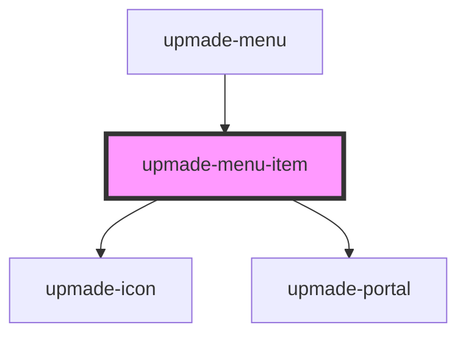

# upmade-menu-item

<!-- Auto Generated Below -->

## Properties

| Property | Attribute | Description | Type                   | Default     |
| -------- | --------- | ----------- | ---------------------- | ----------- |
| `item`   | --        |             | `IUpmadeMenuItem<any>` | `undefined` |
| `parent` | --        |             | `IUpmadeMenuItem<any>` | `null`      |

## Events

| Event                 | Description | Type                                               |
| --------------------- | ----------- | -------------------------------------------------- |
| `itemCancel`          |             | `CustomEvent<IUpmadeMenuItem<any>>`                |
| `itemCloseChildMenu`  |             | `CustomEvent<IUpmadeMenuItem<any>>`                |
| `itemSave`            |             | `CustomEvent<IUpmadeMenuItem<any>>`                |
| `itemSelect`          |             | `CustomEvent<IUpmadeMenuItemSelectEvent>`          |
| `itemToggleChildMenu` |             | `CustomEvent<IUpmadeMenuItemToggleChildMenuEvent>` |

## Dependencies

### Used by

 - [upmade-menu](../upmade-menu)

### Depends on

- upmade-icon
- [upmade-portal](../upmade-portal)

### Graph

----------------------------------------------

*Built with [StencilJS](https://stenciljs.com/)*
