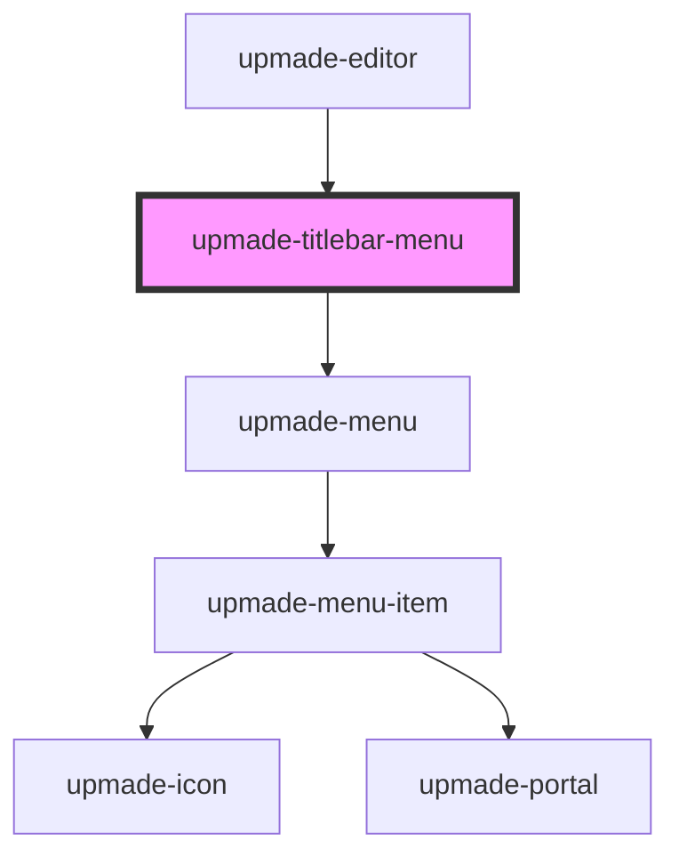

# upmade-titlebar-menu

<!-- Auto Generated Below -->

## Overview

The menu opened from a titlebar `menu` element: a compact `upmade-menu` styled like the
context menu through the `--upmade-titlebar-menu-*` theme variables.

## Properties

| Property | Attribute | Description                                                      | Type                       | Default |
| -------- | --------- | ---------------------------------------------------------------- | -------------------------- | ------- |
| `items`  | --        | Menu items of the open titlebar menu, as resolved by the engine. | `UpmadeTitlebarMenuItem[]` | `[]`    |

## Events

| Event            | Description                                    | Type                  |
| ---------------- | ---------------------------------------------- | --------------------- |
| `menuItemSelect` | Emitted with the id of the selected menu item. | `CustomEvent<string>` |

## Dependencies

### Used by

 - [upmade-editor](../upmade-editor)

### Depends on

- [upmade-menu](../upmade-menu)

### Graph

----------------------------------------------

*Built with [StencilJS](https://stenciljs.com/)*
