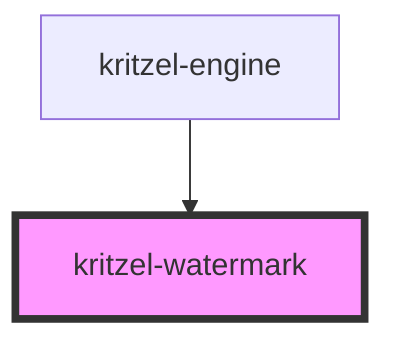

# kritzel-watermark

<!-- Auto Generated Below -->

## Overview

"Powered by Kritzel" watermark shown in the bottom-right corner of the engine
when the editor is not licensed.

Rendered inside the engine's Shadow DOM and gated by the license manager on
the engine's reactive render path, so removing the node simply causes it to
reappear on the next render. The badge links to the Kritzel website.

## Properties

| Property            | Attribute | Description                                                                                                                                                                            | Type          | Default     |
| ------------------- | --------- | -------------------------------------------------------------------------------------------------------------------------------------------------------------------------------------- | ------------- | ----------- |
| `core` _(required)_ | --        | The core instance used to resolve localized terms.                                                                                                                                     | `KritzelCore` | `undefined` |
| `label`             | `label`   | Resolved "Powered by Kritzel" label. Passed in by the engine so the badge re-renders when the active locale changes. Falls back to resolving the term from the core when not provided. | `string`      | `undefined` |

## Shadow Parts

| Part          | Description |
| ------------- | ----------- |
| `"watermark"` |             |

## Dependencies

### Used by

 - [kritzel-engine](../kritzel-engine)

### Graph

----------------------------------------------

*Built with [StencilJS](https://stenciljs.com/)*
