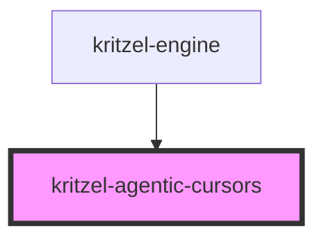

# kritzel-agentic-cursors

<!-- Auto Generated Below -->

## Overview

Renders the cursors of the local agents (`KritzelAgenticCursorManager`) and of collaborators' agents
(`KritzelRemoteAgentManager`), the outlines of the objects each agent has selected and, like a person's
selection of one object, its rotation handle. Everything is keyed by the cursor key, so the same agent ID
in two tabs never collides.

Structural changes (added/removed cursors, name, color, status, selections) re-render through
Stencil. Per-frame movement of on-screen cursors, outlines and handles is written directly to the
elements, in Stencil's write phase: the engine renders objects there too, so an outline is drawn in
the same frame as the object state it follows and never runs ahead of the object.

## Properties

| Property               | Attribute                | Description | Type          | Default     |
| ---------------------- | ------------------------ | ----------- | ------------- | ----------- |
| `core` _(required)_    | --                       |             | `KritzelCore` | `undefined` |
| `edgeIndicatorPadding` | `edge-indicator-padding` |             | `number`      | `8`         |
| `showEdgeIndicators`   | `show-edge-indicators`   |             | `boolean`     | `true`      |

## Dependencies

### Used by

 - [kritzel-engine](../kritzel-engine)

### Graph

----------------------------------------------

*Built with [StencilJS](https://stenciljs.com/)*
