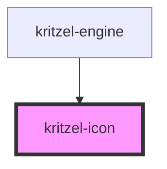

# kritzel-icon

<!-- Auto Generated Below -->

## Properties

| Property | Attribute | Description | Type                                                                                                                                                                                                                                                                                                                                                                                                                                                                                                                                                                                                                                                                                                                                                                                                                                                                                                                                                                                                                             | Default     |
| -------- | --------- | ----------- | -------------------------------------------------------------------------------------------------------------------------------------------------------------------------------------------------------------------------------------------------------------------------------------------------------------------------------------------------------------------------------------------------------------------------------------------------------------------------------------------------------------------------------------------------------------------------------------------------------------------------------------------------------------------------------------------------------------------------------------------------------------------------------------------------------------------------------------------------------------------------------------------------------------------------------------------------------------------------------------------------------------------------------- | ----------- |
| `label`  | `label`   |             | `string`                                                                                                                                                                                                                                                                                                                                                                                                                                                                                                                                                                                                                                                                                                                                                                                                                                                                                                                                                                                                                         | `undefined` |
| `name`   | `name`    |             | `"align" \| "alignCenterHorizontal" \| "alignCenterVertical" \| "alignEndHorizontal" \| "alignEndVertical" \| "alignStartHorizontal" \| "alignStartVertical" \| "arrow" \| "arrowDownFromDot" \| "arrowUp" \| "arrowUpFromDot" \| "braces" \| "bringToFront" \| "check" \| "chevronDown" \| "chevronLeft" \| "chevronRight" \| "chevronUp" \| "chevronsLeft" \| "command" \| "copy" \| "cursor" \| "cut" \| "delete" \| "download" \| "ellipsisVertical" \| "eraser" \| "facebook" \| "github" \| "google" \| "group" \| "hand" \| "handGrab" \| "heart" \| "highlighter" \| "image" \| "imageOff" \| "info" \| "layoutTemplate" \| "logOut" \| "minus" \| "mousePointer" \| "moveVertical" \| "ordering" \| "palette" \| "paste" \| "pen" \| "play" \| "plus" \| "pointer" \| "redo" \| "selectAll" \| "sendToBack" \| "settings" \| "shapeEllipse" \| "shapeRectangle" \| "shapeTriangle" \| "shapes" \| "share" \| "square" \| "type" \| "undo" \| "ungroup" \| "upload" \| "usersRound" \| "viewport" \| "x" \| string & {}` | `undefined` |
| `size`   | `size`    |             | `number`                                                                                                                                                                                                                                                                                                                                                                                                                                                                                                                                                                                                                                                                                                                                                                                                                                                                                                                                                                                                                         | `24`        |

## Dependencies

### Used by

 - [kritzel-engine](../kritzel-engine)

### Graph

----------------------------------------------

*Built with [StencilJS](https://stenciljs.com/)*
