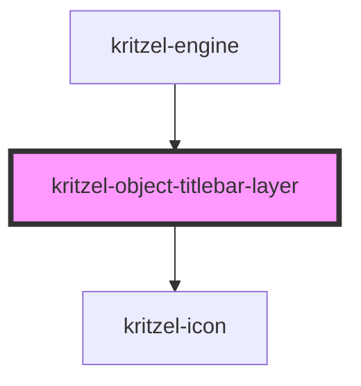

# kritzel-object-titlebar-layer

<!-- Auto Generated Below -->

## Overview

Renders object titlebars inside the engine's world-space origin. Each anchor is placed on
its owner's top edge and counter-scaled, so titlebar content keeps a constant screen size.

Rendered without a shadow root on purpose: the bars must stay in the engine's shadow tree so
`kritzel-engine::part(...)` styling and the engine's `elementsFromPoint` hit-testing reach them.
Must never use the `object` class: pointer handling treats `.object` elements as objects.

## Properties

| Property               | Attribute                | Description                                                                 | Type                                                                                                                    | Default     |
| ---------------------- | ------------------------ | --------------------------------------------------------------------------- | ----------------------------------------------------------------------------------------------------------------------- | ----------- |
| `elementClick`         | --                       | Called when a titlebar button or menu button is clicked.                    | `(ownerId: string, section: KritzelTitlebarSection, elementId: string, event: MouseEvent, anchor: HTMLElement) => void` | `undefined` |
| `surfacePointerEvents` | `surface-pointer-events` | Pointer events of the drag surfaces. Controls always receive pointer input. | `"auto" \| "none"`                                                                                                      | `'none'`    |
| `titleEdit`            | --                       | Called while a title is edited to rename its object.                        | `KritzelTitlebarTitleEditHandlers`                                                                                      | `undefined` |
| `titlebars`            | --                       | The titlebars to render, resolved by the engine for the current frame.      | `KritzelResolvedTitlebar[]`                                                                                             | `[]`        |

## Dependencies

### Used by

 - [kritzel-engine](../kritzel-engine)

### Depends on

- [kritzel-icon](../kritzel-icon)

### Graph

----------------------------------------------

*Built with [StencilJS](https://stenciljs.com/)*
