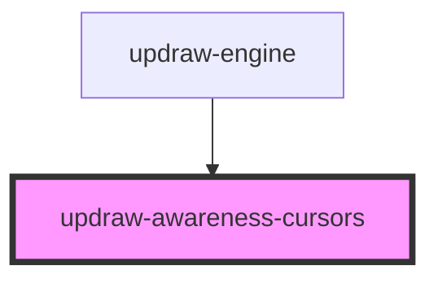

# updraw-awareness-cursors

<!-- Auto Generated Below -->

## Properties

| Property               | Attribute                | Description | Type         | Default     |
| ---------------------- | ------------------------ | ----------- | ------------ | ----------- |
| `core` _(required)_    | --                       |             | `UpdrawCore` | `undefined` |
| `edgeIndicatorPadding` | `edge-indicator-padding` |             | `number`     | `8`         |
| `showEdgeIndicators`   | `show-edge-indicators`   |             | `boolean`    | `true`      |

## Dependencies

### Used by

 - [updraw-engine](../updraw-engine)

### Graph

----------------------------------------------

*Built with [StencilJS](https://stenciljs.com/)*
