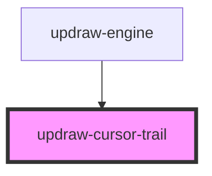

# updraw-cursor-trail

<!-- Auto Generated Below -->

## Properties

| Property            | Attribute | Description | Type          | Default     |
| ------------------- | --------- | ----------- | ------------- | ----------- |
| `core` _(required)_ | --        |             | `UpdrawCore` | `undefined` |

## Dependencies

### Used by

 - [updraw-engine](../updraw-engine)

### Graph

----------------------------------------------

*Built with [StencilJS](https://stenciljs.com/)*
