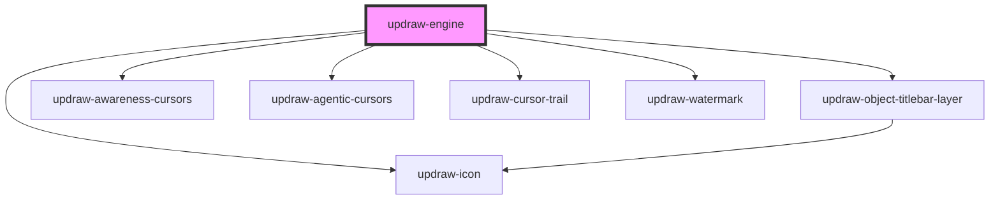

# updraw-engine

<!-- Auto Generated Below -->

## Properties

| Property                 | Attribute                  | Description                                                                                                                                                                                                                                                                                                                                                                                           | Type                                  | Default     |
| ------------------------ | -------------------------- | ----------------------------------------------------------------------------------------------------------------------------------------------------------------------------------------------------------------------------------------------------------------------------------------------------------------------------------------------------------------------------------------------------- | ------------------------------------- | ----------- |
| `activeWorkspaceId`      | `active-workspace-id`      | Optional workspace ID to load. If provided, the engine will look up and load this workspace by ID.                                                                                                                                                                                                                                                                                                    | `string`                              | `undefined` |
| `assetStorageConfig`     | --                         | Configuration for binary asset storage (e.g., images).  The Yjs document only persists asset ids; the actual bytes are stored by the providers listed here. Defaults to IndexedDB-only storage. To support cross-device image sync alongside a networked sync provider (Hocuspocus, WebSocket), configure at least one remote asset provider such as `HttpAssetProvider` or `PresignedAssetProvider`. | `UpdrawAssetStorageConfig`           | `undefined` |
| `chatSession`            | --                         | A chat session bound to this engine: its tools act on this canvas. With an agent, the agent is added here. A session replaced by another one is unbound once its running prompt ends.                                                                                                                                                                                                                 | `UpdrawChatSession`                  | `undefined` |
| `cursorTarget`           | --                         | The HTML element to apply cursor styles to. Defaults to `document.body` if not set.                                                                                                                                                                                                                                                                                                                   | `HTMLElement`                         | `undefined` |
| `debugInfo`              | --                         | Debug info display options controlling which debug overlays are visible                                                                                                                                                                                                                                                                                                                               | `UpdrawDebugInfo`                    | `undefined` |
| `editorId`               | `editor-id`                | Optional unique identifier for namespacing storage keys across multiple editor instances.                                                                                                                                                                                                                                                                                                             | `string`                              | `undefined` |
| `fallbackLocale`         | `fallback-locale`          | The locale used to resolve terms missing from the active locale.                                                                                                                                                                                                                                                                                                                                      | `"de" \| "en" \| "fr" \| string & {}` | `'en'`      |
| `globalContextMenuItems` | --                         | Context menu items shown when right-clicking the canvas background.                                                                                                                                                                                                                                                                                                                                   | `ContextMenuItem[]`                   | `undefined` |
| `isPanningEnabled`       | `is-panning-enabled`       | When false, non-modified wheel events do not pan the viewport.                                                                                                                                                                                                                                                                                                                                        | `boolean`                             | `true`      |
| `isWatermarkVisible`     | `is-watermark-visible`     | Whether the "Powered by Updraw" watermark is shown. Keeping it visible helps support the project.                                                                                                                                                                                                                                                                                                    | `boolean`                             | `true`      |
| `isZoomingEnabled`       | `is-zooming-enabled`       | When false, Ctrl+wheel events do not zoom the viewport.                                                                                                                                                                                                                                                                                                                                               | `boolean`                             | `true`      |
| `locale`                 | `locale`                   | The current locale (language) code to apply to the editor, e.g. 'en', 'de', 'fr'.                                                                                                                                                                                                                                                                                                                     | `"de" \| "en" \| "fr" \| string & {}` | `'en'`      |
| `locales`                | --                         | An array of available locale definitions (with optional partial term overrides). Replaces the built-in locale set (en/de/fr) when provided, even if empty.                                                                                                                                                                                                                                            | `UpdrawLocale[]`                     | `undefined` |
| `lockDrawingScale`       | `lock-drawing-scale`       | When true, objects are drawn at a fixed visual size regardless of zoom level                                                                                                                                                                                                                                                                                                                          | `boolean`                             | `true`      |
| `objectConfig`           | --                         | Configures how objects behave, in one place for all objects: which objects get a titlebar, and which can be rotated or resized. Each option is a boolean or a function of the object.                                                                                                                                                                                                                 | `UpdrawObjectConfig`                 | `undefined` |
| `objectContextMenuItems` | --                         | Context menu items shown when right-clicking a selected object.                                                                                                                                                                                                                                                                                                                                       | `ContextMenuItem[]`                   | `undefined` |
| `objectTitlebar`         | --                         | Content of the titlebar rendered above every object for which `objectConfig.hasTitlebar` is true. The same configuration applies to all objects. Leave unset to disable titlebars.                                                                                                                                                                                                                    | `UpdrawObjectTitlebarConfig`         | `undefined` |
| `scaleMax`               | `scale-max`                | Maximum zoom scale allowed. Clamped to the absolute maximum defined by the engine.                                                                                                                                                                                                                                                                                                                    | `number`                              | `1000`      |
| `scaleMin`               | `scale-min`                | Minimum zoom scale allowed. Clamped to the absolute minimum defined by the engine.                                                                                                                                                                                                                                                                                                                    | `number`                              | `0.0001`    |
| `syncConfig`             | --                         | Configuration for real-time synchronization providers (e.g., IndexedDB, WebSocket).                                                                                                                                                                                                                                                                                                                   | `UpdrawSyncConfig`                   | `undefined` |
| `theme`                  | `theme`                    | The current theme to apply to the editor                                                                                                                                                                                                                                                                                                                                                              | `"dark" \| "light" \| string & {}`    | `'light'`   |
| `themes`                 | --                         | An array of available themes for the editor.                                                                                                                                                                                                                                                                                                                                                          | `UpdrawTheme[]`                      | `undefined` |
| `tools`                  | --                         | Tool definitions to register with this engine instance.                                                                                                                                                                                                                                                                                                                                               | `UpdrawToolDefinition[]`             | `[]`        |
| `user`                   | --                         | The current user for awareness broadcasting (name, id, cursor position).                                                                                                                                                                                                                                                                                                                              | `IUpdrawUser`                        | `undefined` |
| `viewportBoundaryBottom` | `viewport-boundary-bottom` | Bottom boundary of the viewport in world coordinates. Objects beyond this Y position cannot be panned to.                                                                                                                                                                                                                                                                                             | `number`                              | `Infinity`  |
| `viewportBoundaryLeft`   | `viewport-boundary-left`   | Left boundary of the viewport in world coordinates. Objects beyond this X position cannot be panned to.                                                                                                                                                                                                                                                                                               | `number`                              | `-Infinity` |
| `viewportBoundaryRight`  | `viewport-boundary-right`  | Right boundary of the viewport in world coordinates. Objects beyond this X position cannot be panned to.                                                                                                                                                                                                                                                                                              | `number`                              | `Infinity`  |
| `viewportBoundaryTop`    | `viewport-boundary-top`    | Top boundary of the viewport in world coordinates. Objects beyond this Y position cannot be panned to.                                                                                                                                                                                                                                                                                                | `number`                              | `-Infinity` |
| `workspaces`             | --                         | Authoritative workspace catalog for this engine instance. When provided, provider-only workspaces are hidden but not deleted.                                                                                                                                                                                                                                                                         | `UpdrawWorkspace[]`                  | `undefined` |

## Events

| Event                           | Description                                                                                                                                                                                                                                                                  | Type                                                          |
| ------------------------------- | ---------------------------------------------------------------------------------------------------------------------------------------------------------------------------------------------------------------------------------------------------------------------------- | ------------------------------------------------------------- |
| `activeToolChange`              | Emitted when the active drawing tool changes.                                                                                                                                                                                                                                | `CustomEvent<UpdrawBaseTool>`                                |
| `activeWorkspaceChange`         | Emitted when the active workspace changes (e.g., after import).                                                                                                                                                                                                              | `CustomEvent<UpdrawWorkspace>`                               |
| `agentsChange`                  | Emitted when agents are added or removed, or when what the avatar stack shows of them changes (name, color, avatar, status, visibility, activity). Lists the local agents first, then the agents of collaborators (`isRemote: true`). Never emitted for plain cursor motion. | `CustomEvent<UpdrawAgentsChangeEvent>`                       |
| `awarenessChange`               | Emitted when the awareness state changes (remote user cursors, presence).                                                                                                                                                                                                    | `CustomEvent<Map<number, Record<string, any>>>`               |
| `contextMenuStateChange`        | Emitted when context-menu visibility, items, or position changes.                                                                                                                                                                                                            | `CustomEvent<UpdrawContextMenuState>`                        |
| `isEngineReady`                 | Emitted when the engine has fully initialized and is ready for interaction.                                                                                                                                                                                                  | `CustomEvent<UpdrawEngineState>`                             |
| `isLoadingChange`               | Emitted while the selected workspace's objects are being initialized and synchronized.                                                                                                                                                                                       | `CustomEvent<boolean>`                                        |
| `longpress`                     | Emitted on long-press (touch/pen). Useful for showing custom context menus on mobile.                                                                                                                                                                                        | `CustomEvent<PointerEvent>`                                   |
| `notificationsChange`           | Emitted when notifications change.                                                                                                                                                                                                                                           | `CustomEvent<UpdrawNotification>`                            |
| `objectElementClick`            | Emitted when the user clicks an element inside the content of an interactive (selected) object. The click works as usual.                                                                                                                                                    | `CustomEvent<UpdrawObjectElementClickEvent>`                 |
| `objectElementHover`            | Emitted when the pointer moves onto another element inside the content of an interactive (selected) object, such as an iframe object, and with `element: null` when it leaves the content or the object stops being interactive.                                             | `CustomEvent<UpdrawObjectElementHoverEvent>`                 |
| `objectElementPick`             | Emitted when the user picks an element inside an object that is picking elements, see `setObjectElementPicking`.                                                                                                                                                             | `CustomEvent<UpdrawObjectElementPickEvent>`                  |
| `objectsAdded`                  | Emitted when one or more objects are added to the canvas. `source` is set when an agent made the change.                                                                                                                                                                     | `CustomEvent<ObjectsAddedEvent>`                              |
| `objectsChange`                 | Emitted when objects on the canvas are added, removed, or modified.                                                                                                                                                                                                          | `CustomEvent<UpdrawBaseObject<HTMLElement \| SVGElement>[]>` |
| `objectsInViewportChange`       | Emitted when the set of objects visible in the current viewport changes (e.g., after pan or zoom).                                                                                                                                                                           | `CustomEvent<UpdrawBaseObject<Element>[]>`                   |
| `objectsRemoved`                | Emitted when one or more objects are removed from the canvas. `source` is set when an agent made the change.                                                                                                                                                                 | `CustomEvent<ObjectsRemovedEvent>`                            |
| `objectsSelectionChange`        | Emitted when the set of selected objects changes.                                                                                                                                                                                                                            | `CustomEvent<UpdrawBaseObject<HTMLElement \| SVGElement>[]>` |
| `objectsUpdated`                | Emitted when one or more objects are updated on the canvas. `source` is set when an agent made the change.                                                                                                                                                                   | `CustomEvent<ObjectsUpdatedEvent>`                            |
| `objectTitlebarAction`          | Emitted when a button or a menu item in an object titlebar is clicked.                                                                                                                                                                                                       | `CustomEvent<UpdrawObjectTitlebarActionEvent>`               |
| `objectTitlebarMenuStateChange` | Emitted when a titlebar menu opens or closes. The engine renders no menu itself; hosts render `items` anchored to `anchor` and report selections through `selectObjectTitlebarMenuItem`.                                                                                     | `CustomEvent<UpdrawObjectTitlebarMenuState>`                 |
| `undoStateChange`               | Emitted when the undo/redo state changes, providing current undo availability.                                                                                                                                                                                               | `CustomEvent<UpdrawUndoState>`                               |
| `viewportChange`                | Emitted when the viewport position, scale, or dimensions change (e.g., after pan, zoom, or resize).                                                                                                                                                                          | `CustomEvent<UpdrawViewportState>`                           |
| `workspacesChange`              | Emitted when workspaces are created, updated, or deleted.                                                                                                                                                                                                                    | `CustomEvent<UpdrawWorkspace[]>`                             |

## Methods

### `addAgent(agent: UpdrawAgent) => Promise<UpdrawAgent>`

Adds an agent and shows its cursor. Adding the same agent again does nothing. An agent belongs to
one editor at a time; an agent of an editor that was removed from the page moves here.

#### Parameters

| Name    | Type           | Description                       |
| ------- | -------------- | --------------------------------- |
| `agent` | `UpdrawAgent` | - A `new UpdrawAgent({ name })`. |

#### Returns

Type: `Promise<UpdrawAgent>`

The same agent.

### `addObject<T extends UpdrawBaseObject>(object: T) => Promise<T | null>`

Adds a new object to the canvas. The object will be assigned an ID, core reference, and z-index automatically.

#### Parameters

| Name     | Type | Description                   |
| -------- | ---- | ----------------------------- |
| `object` | `T`  | - The object instance to add. |

#### Returns

Type: `Promise<T>`

The added object.

### `addObjects<T extends UpdrawBaseObject>(objects: T[]) => Promise<T[]>`

Adds multiple objects to the canvas in a single batch operation.
All objects are inserted within one Yjs transaction (single undo step),
triggering only one rerender cycle. Intended for programmatic streaming
scenarios where per-object overhead would cause stutter.

#### Parameters

| Name      | Type  | Description                    |
| --------- | ----- | ------------------------------ |
| `objects` | `T[]` | - The object instances to add. |

#### Returns

Type: `Promise<T[]>`

The added objects.

### `alignObjects(alignment: UpdrawAlignment) => Promise<void>`

Aligns the currently selected objects according to the specified alignment.

#### Parameters

| Name        | Type               | Description                                                            |
| ----------- | ------------------ | ---------------------------------------------------------------------- |
| `alignment` | `UpdrawAlignment` | - The alignment direction (e.g., `CenterHorizontal`, `StartVertical`). |

#### Returns

Type: `Promise<void>`

### `backToContent() => Promise<boolean>`

Pans and zooms the viewport to fit the nearest content, with padding.
Useful when the user has panned away from all objects.

#### Returns

Type: `Promise<boolean>`

`true` if content was found and the viewport was adjusted, `false` otherwise.

### `beginSceneBootstrap() => Promise<void>`

Starts a scene bootstrap phase by hiding the scene immediately.

#### Returns

Type: `Promise<void>`

### `bringForward(object?: UpdrawBaseObject<any>) => Promise<void>`

Moves an object, or each selected layer, one layer forward in the z-order, past the next layer above it.
A group is one layer: all of its children move together. A grouped object moves within its group.

#### Parameters

| Name     | Type                     | Description                                                         |
| -------- | ------------------------ | ------------------------------------------------------------------- |
| `object` | `UpdrawBaseObject<any>` | - The object to move. If omitted, applies to the current selection. |

#### Returns

Type: `Promise<void>`

### `bringToFront(object?: UpdrawBaseObject<any>) => Promise<void>`

Moves an object, or the selected layers, to the very front of the z-order, keeping the relative order
of the moved layers. A group moves together with all of its children; a grouped object moves to the
front of its group.

#### Parameters

| Name     | Type                     | Description                                                         |
| -------- | ------------------------ | ------------------------------------------------------------------- |
| `object` | `UpdrawBaseObject<any>` | - The object to move. If omitted, applies to the current selection. |

#### Returns

Type: `Promise<void>`

### `canExportSelectedObjectAs(format: UpdrawObjectExportFormat) => Promise<boolean>`

Checks whether the currently selected object supports a specific export format.
Returns false when none or multiple objects are selected.

#### Parameters

| Name     | Type             | Description |
| -------- | ---------------- | ----------- |
| `format` | `"svg" \| "png"` |             |

#### Returns

Type: `Promise<boolean>`

### `cancelImportFromFile() => Promise<void>`

Cancels an active file picker opened by importFromFile.

#### Returns

Type: `Promise<void>`

### `centerAllObjects(animate?: boolean) => Promise<boolean>`

Pans and zooms the viewport to fit ALL objects on the canvas, including those not currently rendered.
Calculates the combined bounding box of all objects and centers the viewport to show them.

#### Parameters

| Name      | Type      | Description                                                   |
| --------- | --------- | ------------------------------------------------------------- |
| `animate` | `boolean` | - Whether to animate the viewport transition (default: true). |

#### Returns

Type: `Promise<boolean>`

`true` if objects were found and the viewport was adjusted, `false` otherwise.

### `centerObjectInViewport(object: UpdrawBaseObject) => Promise<UpdrawBaseObject<HTMLElement | SVGElement>>`

Pans and zooms the viewport to center on the given object.

#### Parameters

| Name     | Type                                           | Description                             |
| -------- | ---------------------------------------------- | --------------------------------------- |
| `object` | `UpdrawBaseObject<HTMLElement \| SVGElement>` | - The object to center in the viewport. |

#### Returns

Type: `Promise<UpdrawBaseObject<HTMLElement | SVGElement>>`

The centered object.

### `centerObjects(objects: UpdrawBaseObject[], animate?: boolean) => Promise<boolean>`

Pans and zooms the viewport to fit the provided objects.
Calculates the combined bounding box of the given objects and centers the viewport to show them.

#### Parameters

| Name      | Type                                             | Description                                                   |
| --------- | ------------------------------------------------ | ------------------------------------------------------------- |
| `objects` | `UpdrawBaseObject<HTMLElement \| SVGElement>[]` | - The objects to center and fit in the viewport.              |
| `animate` | `boolean`                                        | - Whether to animate the viewport transition (default: true). |

#### Returns

Type: `Promise<boolean>`

`true` if objects were provided and the viewport was adjusted, `false` otherwise.

### `clearObjectElementHighlights(objectId?: string) => Promise<void>`

Removes element highlights.

#### Parameters

| Name       | Type     | Description                                                                                    |
| ---------- | -------- | ---------------------------------------------------------------------------------------------- |
| `objectId` | `string` | - The object whose highlights are removed. Removes the highlights of all objects when omitted. |

#### Returns

Type: `Promise<void>`

### `clearSelection() => Promise<void>`

Deselects all currently selected objects.

#### Returns

Type: `Promise<void>`

### `closeObjectTitlebarMenu() => Promise<void>`

Closes the open object titlebar menu, if any.

#### Returns

Type: `Promise<void>`

### `configureLocales(locales?: UpdrawLocale[]) => Promise<void>`

Declaratively configures the full locale catalog, replacing the available
locale set. Pass `undefined` to restore the built-in locales (en/de/fr).

#### Parameters

| Name      | Type              | Description                                              |
| --------- | ----------------- | -------------------------------------------------------- |
| `locales` | `UpdrawLocale[]` | - The full locale catalog, or `undefined` for built-ins. |

#### Returns

Type: `Promise<void>`

### `copy() => Promise<void>`

Copies the currently selected objects to the internal clipboard.

#### Returns

Type: `Promise<void>`

### `createWorkspace(workspace: UpdrawWorkspace) => Promise<UpdrawWorkspace | null>`

Creates a new workspace and emits a `workspacesChange` event.
Emits `activeWorkspaceChange` if the created workspace is activated.

#### Parameters

| Name        | Type               | Description                         |
| ----------- | ------------------ | ----------------------------------- |
| `workspace` | `UpdrawWorkspace` | - The workspace instance to create. |

#### Returns

Type: `Promise<UpdrawWorkspace>`

The created workspace.

### `cut() => Promise<void>`

Cuts the currently selected objects to the internal clipboard (deletes them from the canvas).

#### Returns

Type: `Promise<void>`

### `delete() => Promise<void>`

Deletes the currently selected objects from the canvas.

#### Returns

Type: `Promise<void>`

### `deleteWorkspace(workspace: UpdrawWorkspace) => Promise<void>`

Deletes a workspace and emits a `workspacesChange` event.

#### Parameters

| Name        | Type               | Description                |
| ----------- | ------------------ | -------------------------- |
| `workspace` | `UpdrawWorkspace` | - The workspace to delete. |

#### Returns

Type: `Promise<void>`

### `disable() => Promise<void>`

Disables all user interaction with the engine (pointer, keyboard, etc.).

#### Returns

Type: `Promise<void>`

### `downloadAsJson(filename?: string) => Promise<void>`

Exports the current workspace as a JSON file and triggers a browser download.

#### Parameters

| Name       | Type     | Description                                                                                |
| ---------- | -------- | ------------------------------------------------------------------------------------------ |
| `filename` | `string` | - Optional custom filename (without extension). Defaults to workspace name with timestamp. |

#### Returns

Type: `Promise<void>`

### `enable() => Promise<void>`

Re-enables user interaction after a call to `disable()`.

#### Returns

Type: `Promise<void>`

### `endSceneBootstrap() => Promise<void>`

Ends a scene bootstrap phase by fading the scene back in.

#### Returns

Type: `Promise<void>`

### `exportAsJson() => Promise<string>`

Exports the current workspace and all its objects as a JSON string.
The exported data includes workspace metadata (id, name, viewport) and all canvas objects.

#### Returns

Type: `Promise<string>`

A JSON string representing the complete workspace state.

### `exportSelectedObject(format: UpdrawObjectExportFormat) => Promise<void>`

Exports the currently selected object in the requested format and triggers a file download.
Only supports single selection.

#### Parameters

| Name     | Type             | Description |
| -------- | ---------------- | ----------- |
| `format` | `"svg" \| "png"` |             |

#### Returns

Type: `Promise<void>`

### `exportViewportAsPng() => Promise<void>`

Exports the current viewport as a PNG file and triggers a browser download.

#### Returns

Type: `Promise<void>`

### `exportViewportAsSvg() => Promise<void>`

Exports the current viewport as an SVG file and triggers a browser download.

#### Returns

Type: `Promise<void>`

### `findObjects<T extends UpdrawBaseObject>(predicate: (obj: UpdrawBaseObject<Element>) => boolean) => Promise<T[]>`

Returns all objects that match the given predicate function.
Excludes internal selection-related objects (selection groups and selection boxes).

#### Parameters

| Name        | Type                                           | Description                                                           |
| ----------- | ---------------------------------------------- | --------------------------------------------------------------------- |
| `predicate` | `(obj: UpdrawBaseObject<Element>) => boolean` | - A filter function called for each object. Return `true` to include. |

#### Returns

Type: `Promise<T[]>`

An array of matching objects.

### `getActiveWorkspace() => Promise<UpdrawWorkspace>`

Returns the currently active workspace.

#### Returns

Type: `Promise<UpdrawWorkspace>`

### `getAgent(id: string) => Promise<UpdrawAgent | null>`

Returns an added agent by its ID.

#### Parameters

| Name | Type     | Description       |
| ---- | -------- | ----------------- |
| `id` | `string` | - The agent's ID. |

#### Returns

Type: `Promise<UpdrawAgent>`

### `getAgents() => Promise<UpdrawAgent[]>`

Returns the added agents.

#### Returns

Type: `Promise<UpdrawAgent[]>`

### `getAllObjects<T extends UpdrawBaseObject>() => Promise<T[]>`

Returns all objects on the canvas across all layers.

#### Returns

Type: `Promise<T[]>`

### `getAvailableLocaleOptions() => Promise<{ code: LocaleCode; label: string; }[]>`

Gets the list of available locales as `{ code, label }` options for a selector.

#### Returns

Type: `Promise<{ code: LocaleCode; label: string; }[]>`

### `getAvailableLocales() => Promise<LocaleCode[]>`

Gets the list of available locale codes (built-in and registered).

#### Returns

Type: `Promise<LocaleCode[]>`

### `getDisplayableShortcuts() => Promise<Omit<UpdrawShortcut, "action" | "condition">[]>`

Returns all registered keyboard shortcuts (without action/condition) for display in a help UI.

#### Returns

Type: `Promise<Omit<UpdrawShortcut, "action" | "condition">[]>`

### `getIsPublic() => Promise<boolean>`

Gets whether the active workspace is publicly accessible.

#### Returns

Type: `Promise<boolean>`

True if the workspace is public, false otherwise

### `getLocale() => Promise<LocaleCode>`

Gets the currently active locale code.

#### Returns

Type: `Promise<LocaleCode>`

### `getObjectById<T extends UpdrawBaseObject>(id: string) => Promise<T | null>`

Retrieves a canvas object by its unique ID.

#### Parameters

| Name | Type     | Description                       |
| ---- | -------- | --------------------------------- |
| `id` | `string` | - The object's unique identifier. |

#### Returns

Type: `Promise<T>`

The matching object, or `null` if not found.

### `getObjectsInViewport() => Promise<UpdrawBaseObject[]>`

Returns all objects currently visible within the viewport bounds.

#### Returns

Type: `Promise<UpdrawBaseObject<HTMLElement | SVGElement>[]>`

### `getObjectsTotalCount() => Promise<number>`

Returns the total number of objects on the canvas.

#### Returns

Type: `Promise<number>`

### `getRemoteAgents() => Promise<UpdrawRemoteAgentPresence[]>`

Returns the agents of collaborators, as shared through presence.

#### Returns

Type: `Promise<UpdrawRemoteAgentPresence[]>`

### `getResolvedTerms() => Promise<Partial<Record<UpdrawTermKey, string>>>`

Resolves every known term key for the active locale into a flat map.
Useful for UI layers that need to localize many strings at once.

#### Returns

Type: `Promise<Partial<Record<keyof UpdrawTerms, string>>>`

### `getScreenshot(format?: "png" | "svg") => Promise<string | null>`

Captures a screenshot of the current viewport as a data URL.

#### Parameters

| Name     | Type             | Description                                       |
| -------- | ---------------- | ------------------------------------------------- |
| `format` | `"svg" \| "png"` | - The image format: `'png'` (default) or `'svg'`. |

#### Returns

Type: `Promise<string>`

A data URL string of the captured image.

### `getSelectedObjectSupportedExportFormats() => Promise<UpdrawObjectExportFormat[]>`

Returns export formats supported by the currently selected object.
Only returns formats when exactly one object is selected.

#### Returns

Type: `Promise<UpdrawObjectExportFormat[]>`

### `getSelectedObjects() => Promise<UpdrawBaseObject<any>[]>`

Returns the currently selected objects. Returns an empty array if nothing is selected.

#### Returns

Type: `Promise<UpdrawBaseObject<any>[]>`

### `getTool(toolName: string) => Promise<UpdrawBaseTool | null>`

Returns a tool registered in this engine instance.

#### Parameters

| Name       | Type     | Description |
| ---------- | -------- | ----------- |
| `toolName` | `string` |             |

#### Returns

Type: `Promise<UpdrawBaseTool>`

### `getViewport() => Promise<UpdrawViewportState>`

Returns the current viewport state including position, scale, and dimensions.

#### Returns

Type: `Promise<UpdrawViewportState>`

The current viewport state.

### `getWorkspaces() => Promise<UpdrawWorkspace[]>`

Returns all available workspaces.

#### Returns

Type: `Promise<UpdrawWorkspace[]>`

### `group(objects: UpdrawBaseObject<any>[]) => Promise<UpdrawGroup | null>`

Creates a group (`UpdrawGroup`) from the given objects. Requires at least two objects. The grouped objects
become one layer at the position of the topmost object, as a single undoable step.

Objects are resolved by id, so stale references work. Objects that are not in the active workspace are
skipped with a console warning. Objects inside a common group are grouped within it; objects from different
groups are grouped at the level that contains all of them. An object passed together with one of its
ancestor groups is grouped as part of that ancestor. Selected objects that end up in the group are replaced
by the group in the selection.

To group the current selection, pass `await getSelectedObjects()`.

#### Parameters

| Name      | Type                       | Description             |
| --------- | -------------------------- | ----------------------- |
| `objects` | `UpdrawBaseObject<any>[]` | - The objects to group. |

#### Returns

Type: `Promise<UpdrawGroup>`

The created group, or `null` (with a console warning) when fewer than two objects could be grouped.

### `hideContextMenu() => Promise<void>`

Hides the context menu and resets any associated selection state.

#### Returns

Type: `Promise<void>`

### `highlightObjectElements(objectId: string, highlights: UpdrawObjectElementHighlight[]) => Promise<void>`

Highlights elements inside an object's content, replacing its previous highlights.
Highlights are local: they are neither saved nor shown to collaborators.

#### Parameters

| Name         | Type                              | Description                                                                                     |
| ------------ | --------------------------------- | ----------------------------------------------------------------------------------------------- |
| `objectId`   | `string`                          | - The object ID.                                                                                |
| `highlights` | `UpdrawObjectElementHighlight[]` | - `{ selector, color?, label? }` entries. Every element that matches a selector is highlighted. |

#### Returns

Type: `Promise<void>`

### `importFromFile() => Promise<void>`

Opens a file picker dialog and imports the selected JSON file into the workspace.
This method creates a hidden file input, triggers the browser's file chooser,
reads the selected JSON file, and imports it using importFromJson.

#### Returns

Type: `Promise<void>`

A promise that resolves when the import is complete or rejects on error/cancel.

### `importFromJson(json: string) => Promise<void>`

Imports a workspace from a JSON string into a new workspace.
Creates a new workspace with the imported data and automatically switches to it.

#### Parameters

| Name   | Type     | Description                                                    |
| ------ | -------- | -------------------------------------------------------------- |
| `json` | `string` | - A JSON string containing workspace data (from exportAsJson). |

#### Returns

Type: `Promise<void>`

### `loadObjectsFromJson(json: string) => Promise<number>`

Loads objects from a workspace JSON string into the current workspace.
Unlike importFromJson, this does not create a new workspace - it adds objects to the existing one.
Useful for initializing a workspace with pre-existing content after the editor is ready.

#### Parameters

| Name   | Type     | Description                                                    |
| ------ | -------- | -------------------------------------------------------------- |
| `json` | `string` | - A JSON string containing workspace data (from exportAsJson). |

#### Returns

Type: `Promise<number>`

The number of objects loaded.

### `loadSettings() => Promise<Partial<UpdrawSettingsConfig> | null>`

Loads the persisted settings object from localStorage.

#### Returns

Type: `Promise<Partial<UpdrawSettingsConfig>>`

The stored settings, or null if nothing is stored or the value is invalid.

### `loadSharedWorkspace(token: string) => Promise<void>`

Loads a shared workspace by token.
If the workspace exists locally, it switches to it.
If it doesn't exist, it adds it to the local workspaces list and then switches to it.

#### Parameters

| Name    | Type     | Description                                             |
| ------- | -------- | ------------------------------------------------------- |
| `token` | `string` | - The connection token identifying the shared workspace |

#### Returns

Type: `Promise<void>`

### `openContextMenu(options: { x: number; y: number; objectId?: string; }) => Promise<void>`

Programmatically opens the context menu at a specified world-coordinate position.
If `objectId` is provided and found, the object context menu is shown for that object.
If no `objectId` is provided but a selection group already exists, the object context menu is shown.
Otherwise, the global context menu is shown.

#### Parameters

| Name      | Type                                           | Description |
| --------- | ---------------------------------------------- | ----------- |
| `options` | `{ x: number; y: number; objectId?: string; }` |             |

#### Returns

Type: `Promise<void>`

### `panTo(x: number, y: number) => Promise<void>`

Pans the viewport to center on the given world coordinates without changing the scale.

#### Parameters

| Name | Type     | Description                                     |
| ---- | -------- | ----------------------------------------------- |
| `x`  | `number` | - X position in world coordinates to center on. |
| `y`  | `number` | - Y position in world coordinates to center on. |

#### Returns

Type: `Promise<void>`

### `panToObject(object: UpdrawBaseObject) => Promise<void>`

Pans the viewport to center on the given object without changing the zoom level.
Unlike `centerObjectInViewport`, this moves the camera — not the object.

#### Parameters

| Name     | Type                                           | Description                                           |
| -------- | ---------------------------------------------- | ----------------------------------------------------- |
| `object` | `UpdrawBaseObject<HTMLElement \| SVGElement>` | - The object whose center the viewport should pan to. |

#### Returns

Type: `Promise<void>`

### `paste(x: number, y: number) => Promise<void>`

Pastes previously copied objects at the specified world coordinates.

#### Parameters

| Name | Type     | Description                        |
| ---- | -------- | ---------------------------------- |
| `x`  | `number` | - X position in world coordinates. |
| `y`  | `number` | - Y position in world coordinates. |

#### Returns

Type: `Promise<void>`

### `queryObjectElements(objectId: string, selector: string, limit?: number) => Promise<UpdrawObjectElementInfo[]>`

Describes the elements inside an object's content that match a CSS selector, in document order.
The object must be mounted, which it is while it is in or near the viewport.

#### Parameters

| Name       | Type     | Description                                                 |
| ---------- | -------- | ----------------------------------------------------------- |
| `objectId` | `string` | - The object ID.                                            |
| `selector` | `string` | - A CSS selector, e.g. `'button'` or `'[data-updraw-id]'`. |
| `limit`    | `number` | - Maximum number of elements, 1 to 500. Defaults to 100.    |

#### Returns

Type: `Promise<UpdrawObjectElementInfo[]>`

The matching elements, each with a `selector` that can be used to highlight it or point an agent's cursor
at it with `agent.moveTo({ objectId, selector })`.

### `redo() => Promise<void>`

Redoes the last undone action.

#### Returns

Type: `Promise<void>`

### `registerLocales(locales: UpdrawLocale[]) => Promise<void>`

Registers additional locale definitions (with optional partial term overrides).

#### Parameters

| Name      | Type              | Description                           |
| --------- | ----------------- | ------------------------------------- |
| `locales` | `UpdrawLocale[]` | - The locale definitions to register. |

#### Returns

Type: `Promise<void>`

### `registerTool(toolName: string, toolClass: any, toolConfig?: UpdrawTextToolConfig | UpdrawBrushToolConfig | UpdrawLineToolConfig | UpdrawShapeToolConfig) => Promise<UpdrawBaseTool | null>`

Registers a new drawing tool with the engine.

#### Parameters

| Name         | Type                                                                                                 | Description                                                     |
| ------------ | ---------------------------------------------------------------------------------------------------- | --------------------------------------------------------------- |
| `toolName`   | `string`                                                                                             | - Unique identifier for the tool (e.g., 'brush', 'eraser').     |
| `toolClass`  | `any`                                                                                                | - Constructor class extending `UpdrawBaseTool`.                |
| `toolConfig` | `UpdrawTextToolConfig \| UpdrawBrushToolConfig \| UpdrawLineToolConfig \| UpdrawShapeToolConfig` | - Optional initial configuration to apply to the tool instance. |

#### Returns

Type: `Promise<UpdrawBaseTool>`

The registered tool instance, or `null` if registration failed.

### `reinitSync() => Promise<void>`

Reinitializes sync by performing a full teardown and re-initialization.
Destroys the current Yjs documents and providers, then rebuilds everything
from the current syncConfig. Data reloads from IndexedDB nearly instantly.
Call this after updating the syncConfig prop (e.g. after authentication state changes).

#### Returns

Type: `Promise<void>`

### `removeAgent(agent: UpdrawAgent | string) => Promise<boolean>`

Removes an agent: its running action is rolled back, its queued actions resolve with
`'agent-removed'`, and its cursor and history are dropped. The agent can be added again.

#### Parameters

| Name    | Type                     | Description            |
| ------- | ------------------------ | ---------------------- |
| `agent` | `string \| UpdrawAgent` | - The agent or its ID. |

#### Returns

Type: `Promise<boolean>`

`false` if the agent was not added.

### `removeObject<T extends UpdrawBaseObject>(object: T) => Promise<T | null>`

Removes an object from the canvas.

#### Parameters

| Name     | Type | Description             |
| -------- | ---- | ----------------------- |
| `object` | `T`  | - The object to remove. |

#### Returns

Type: `Promise<T>`

The removed object.

### `removeObjects<T extends UpdrawBaseObject>(objects: T[]) => Promise<T[]>`

Removes multiple objects from the canvas in a single batch operation.
All removals happen within one Yjs transaction (single undo step),
triggering only one rerender cycle. Intended for programmatic streaming
scenarios where per-object overhead would cause stutter.

#### Parameters

| Name      | Type  | Description              |
| --------- | ----- | ------------------------ |
| `objects` | `T[]` | - The objects to remove. |

#### Returns

Type: `Promise<T[]>`

The removed objects.

### `saveSettings(settings: UpdrawSettingsConfig) => Promise<void>`

Persists the given settings object to localStorage using the namespaced storage key.

#### Parameters

| Name       | Type                    | Description                              |
| ---------- | ----------------------- | ---------------------------------------- |
| `settings` | `UpdrawSettingsConfig` | - The settings configuration to persist. |

#### Returns

Type: `Promise<void>`

### `screenToWorld(x: number, y: number) => Promise<{ x: number; y: number; }>`

Converts screen-relative pixel coordinates to world coordinates.

#### Parameters

| Name | Type     | Description                                                     |
| ---- | -------- | --------------------------------------------------------------- |
| `x`  | `number` | - X position in screen pixels (relative to the engine element). |
| `y`  | `number` | - Y position in screen pixels (relative to the engine element). |

#### Returns

Type: `Promise<{ x: number; y: number; }>`

World coordinates { x, y }.

### `selectAllObjectsInViewport() => Promise<void>`

Selects all objects currently visible in the viewport. Switches to the selection tool automatically.

#### Returns

Type: `Promise<void>`

### `selectObjectTitlebarMenuItem(menuItemId: string) => Promise<void>`

Selects an item of the open object titlebar menu: closes the menu, runs the item's `action`
and emits `objectTitlebarAction` with the item's id as `menuItemId`.

#### Parameters

| Name         | Type     | Description                                                                       |
| ------------ | -------- | --------------------------------------------------------------------------------- |
| `menuItemId` | `string` | - The id of a menu item in the open menu's `objectTitlebarMenuStateChange` state. |

#### Returns

Type: `Promise<void>`

### `selectObjects(objects: UpdrawBaseObject[]) => Promise<void>`

Programmatically selects the given objects. Switches to the selection tool automatically.

#### Parameters

| Name      | Type                                             | Description              |
| --------- | ------------------------------------------------ | ------------------------ |
| `objects` | `UpdrawBaseObject<HTMLElement \| SVGElement>[]` | - The objects to select. |

#### Returns

Type: `Promise<void>`

### `sendBackward(object?: UpdrawBaseObject<any>) => Promise<void>`

Moves an object, or each selected layer, one layer backward in the z-order, past the next layer below it.
A group is one layer: all of its children move together. A grouped object moves within its group.

#### Parameters

| Name     | Type                     | Description                                                         |
| -------- | ------------------------ | ------------------------------------------------------------------- |
| `object` | `UpdrawBaseObject<any>` | - The object to move. If omitted, applies to the current selection. |

#### Returns

Type: `Promise<void>`

### `sendToBack(object?: UpdrawBaseObject<any>) => Promise<void>`

Moves an object, or the selected layers, to the very back of the z-order, keeping the relative order
of the moved layers. A group moves together with all of its children; a grouped object moves to the
back of its group.

#### Parameters

| Name     | Type                     | Description                                                         |
| -------- | ------------------------ | ------------------------------------------------------------------- |
| `object` | `UpdrawBaseObject<any>` | - The object to move. If omitted, applies to the current selection. |

#### Returns

Type: `Promise<void>`

### `setActiveTool(toolName: string) => Promise<void>`

Switches the active drawing tool by its registered name.

#### Parameters

| Name       | Type     | Description                                                        |
| ---------- | -------- | ------------------------------------------------------------------ |
| `toolName` | `string` | - The name the tool was registered with (e.g., 'brush', 'eraser'). |

#### Returns

Type: `Promise<void>`

### `setActiveWorkspace(id: string) => Promise<void>`

Switches the active workspace in the engine by ID.

#### Parameters

| Name | Type     | Description                                  |
| ---- | -------- | -------------------------------------------- |
| `id` | `string` | - The unique ID of the workspace to activate |

#### Returns

Type: `Promise<void>`

### `setLocale(code: LocaleCode) => Promise<void>`

Sets the active locale (language) and re-renders the UI.

#### Parameters

| Name   | Type                                    | Description                               |
| ------ | --------------------------------------- | ----------------------------------------- |
| `code` | `(string & {}) \| "en" \| "de" \| "fr"` | - The locale code to activate, e.g. 'de'. |

#### Returns

Type: `Promise<void>`

### `setObjectElementPicking(objectId: string, enabled: boolean, options?: UpdrawObjectElementPickingOptions) => Promise<void>`

Turns element picking on or off for an object whose content has elements, such as an iframe object.
While picking, the element under the pointer is highlighted, and a click emits `objectElementPick`
instead of reaching the content. Picking works while the object is interactive, which it is while selected.

#### Parameters

| Name       | Type                                 | Description                                                                         |
| ---------- | ------------------------------------ | ----------------------------------------------------------------------------------- |
| `objectId` | `string`                             | - The object ID.                                                                    |
| `enabled`  | `boolean`                            | - Whether the object picks elements.                                                |
| `options`  | `UpdrawObjectElementPickingOptions` | - `selector` limits picking to matching elements, `color` sets the highlight color. |

#### Returns

Type: `Promise<void>`

### `setViewport(x: number, y: number, scale: number) => Promise<void>`

Sets the viewport to center on the given world coordinates at the specified scale.

#### Parameters

| Name    | Type     | Description                                     |
| ------- | -------- | ----------------------------------------------- |
| `x`     | `number` | - X position in world coordinates to center on. |
| `y`     | `number` | - Y position in world coordinates to center on. |
| `scale` | `number` | - Target scale level.                           |

#### Returns

Type: `Promise<void>`

### `t(key: UpdrawTermKey, vars?: UpdrawTermVars) => Promise<string>`

Resolves a term key to its translated string for the active locale.

#### Parameters

| Name   | Type                                 | Description                                          |
| ------ | ------------------------------------ | ---------------------------------------------------- |
| `key`  | `keyof UpdrawTerms`                 | - The term key to resolve.                           |
| `vars` | `{ [x: string]: string \| number; }` | - Optional values for `{placeholder}` interpolation. |

#### Returns

Type: `Promise<string>`

### `triggerSelectionChange() => Promise<void>`

Manually triggers the `objectsSelectionChange` event.

#### Returns

Type: `Promise<void>`

### `undo() => Promise<void>`

Undoes the last action.

#### Returns

Type: `Promise<void>`

### `ungroup(groups: UpdrawGroup[]) => Promise<UpdrawBaseObject<any>[]>`

Ungroups the given groups. Their children become individual objects again and keep their stacking order;
the children of a nested group stay in its parent group. All groups are dissolved in a single undoable step.

Groups are resolved by id, so stale references work. Entries that are not an `UpdrawGroup` or not in the
active workspace are skipped with a console warning. Dissolved groups in the selection are replaced by their
children.

To ungroup the current selection, pass the `UpdrawGroup` objects from `await getSelectedObjects()`.

#### Parameters

| Name     | Type             | Description              |
| -------- | ---------------- | ------------------------ |
| `groups` | `UpdrawGroup[]` | - The groups to ungroup. |

#### Returns

Type: `Promise<UpdrawBaseObject<any>[]>`

The extracted children.

### `updateObject<T extends UpdrawBaseObject>(object: T, updatedProperties: Partial<T>) => Promise<T | null>`

Updates properties of an existing canvas object.

#### Parameters

| Name                | Type                         | Description                             |
| ------------------- | ---------------------------- | --------------------------------------- |
| `object`            | `T`                          | - The object to update.                 |
| `updatedProperties` | `{ [P in keyof T]?: T[P]; }` | - A partial set of properties to apply. |

#### Returns

Type: `Promise<T>`

The updated object.

### `updateWorkspace(workspace: UpdrawWorkspace) => Promise<void>`

Applies a workspace as declared and emits a `workspacesChange` event.
Metadata and viewport are always applied. When `workspace.objects` is set it is treated as the
complete desired object set (`undefined` leaves objects untouched, `[]` removes them all);
updating objects of a non-active workspace requires a configured sync provider.

#### Parameters

| Name        | Type               | Description                                   |
| ----------- | ------------------ | --------------------------------------------- |
| `workspace` | `UpdrawWorkspace` | - The workspace describing the desired state. |

#### Returns

Type: `Promise<void>`

### `worldToScreen(x: number, y: number) => Promise<{ x: number; y: number; }>`

Converts world coordinates to screen-relative pixel coordinates.

#### Parameters

| Name | Type     | Description                        |
| ---- | -------- | ---------------------------------- |
| `x`  | `number` | - X position in world coordinates. |
| `y`  | `number` | - Y position in world coordinates. |

#### Returns

Type: `Promise<{ x: number; y: number; }>`

Screen coordinates { x, y } relative to the engine element.

### `zoomIn(factor: number, duration: number) => Promise<void>`

Zooms in by a fixed step, centered on the current viewport center, with a smooth animation.

#### Parameters

| Name       | Type     | Description                           |
| ---------- | -------- | ------------------------------------- |
| `factor`   | `number` | - Multiplicative zoom-in step.        |
| `duration` | `number` | - Animation duration in milliseconds. |

#### Returns

Type: `Promise<void>`

### `zoomOut(factor: number, duration: number) => Promise<void>`

Zooms out by a fixed step, centered on the current viewport center, with a smooth animation.

#### Parameters

| Name       | Type     | Description                           |
| ---------- | -------- | ------------------------------------- |
| `factor`   | `number` | - Multiplicative zoom-out step.       |
| `duration` | `number` | - Animation duration in milliseconds. |

#### Returns

Type: `Promise<void>`

### `zoomTo(scale: number, worldX?: number, worldY?: number) => Promise<void>`

Zooms the viewport to the given scale level.
Optionally centers on a world point; if omitted, zooms around the viewport center.

#### Parameters

| Name     | Type     | Description                                              |
| -------- | -------- | -------------------------------------------------------- |
| `scale`  | `number` | - Target scale level.                                    |
| `worldX` | `number` | - Optional X position in world coordinates to center on. |
| `worldY` | `number` | - Optional Y position in world coordinates to center on. |

#### Returns

Type: `Promise<void>`

## Dependencies

### Depends on

- [updraw-icon](../updraw-icon)
- [updraw-object-titlebar-layer](../updraw-object-titlebar-layer)
- [updraw-awareness-cursors](../updraw-awareness-cursors)
- [updraw-agentic-cursors](../updraw-agentic-cursors)
- [updraw-cursor-trail](../updraw-cursor-trail)
- [updraw-watermark](../updraw-watermark)

### Graph

----------------------------------------------

*Built with [StencilJS](https://stenciljs.com/)*
