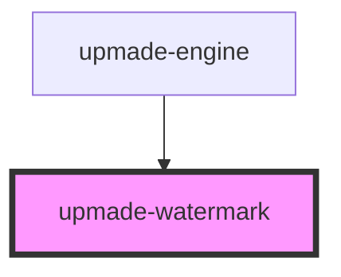

# upmade-watermark

<!-- Auto Generated Below -->

## Overview

Watermark shown in the bottom-right corner of the engine: the Upmade mark and "upmade.io".

Rendered inside the engine's Shadow DOM unless the engine's
`isWatermarkVisible` prop is set to false. The badge links to the Upmade
website, and its tooltip reads "Powered by Upmade" in the active locale.

## Properties

| Property            | Attribute | Description                                                                                                                                                                                                         | Type         | Default     |
| ------------------- | --------- | ------------------------------------------------------------------------------------------------------------------------------------------------------------------------------------------------------------------- | ------------ | ----------- |
| `core` _(required)_ | --        | The core instance used to resolve localized terms.                                                                                                                                                                  | `UpmadeCore` | `undefined` |
| `label`             | `label`   | Resolved "Powered by Upmade" label, shown as the badge's tooltip. Passed in by the engine so the badge re-renders when the active locale changes. Falls back to resolving the term from the core when not provided. | `string`     | `undefined` |

## Shadow Parts

| Part               | Description                              |
| ------------------ | ---------------------------------------- |
| `"watermark"`      | The badge (a link to the Upmade website) |
| `"watermark-logo"` | The Upmade mark inside the badge         |

## Dependencies

### Used by

 - [upmade-engine](../upmade-engine)

### Graph

----------------------------------------------

*Built with [StencilJS](https://stenciljs.com/)*
