# kritzel-editor

<!-- Auto Generated Below -->

## Properties

| Property                    | Attribute                      | Description                                                                                                                       | Type                      | Default                                                                                                                                                                                                                                                                                                                                                                                                                                                                                                                                                                                                                                                                                                                                                                                                                                                                                                                                                                                                                                                                                                                                                                                                                                                                                                                                                                                                                                                                                                                                                                                                                                                                                                                                                                                                                                                                                                                                                                                                                                                                                                                                                                                                                                                                                                                                                                                                                                                                                                                                                                                                                                                                                                                                                                                                                                                                                                                                                                                                                                                                                                      |
| --------------------------- | ------------------------------ | --------------------------------------------------------------------------------------------------------------------------------- | ------------------------- | ------------------------------------------------------------------------------------------------------------------------------------------------------------------------------------------------------------------------------------------------------------------------------------------------------------------------------------------------------------------------------------------------------------------------------------------------------------------------------------------------------------------------------------------------------------------------------------------------------------------------------------------------------------------------------------------------------------------------------------------------------------------------------------------------------------------------------------------------------------------------------------------------------------------------------------------------------------------------------------------------------------------------------------------------------------------------------------------------------------------------------------------------------------------------------------------------------------------------------------------------------------------------------------------------------------------------------------------------------------------------------------------------------------------------------------------------------------------------------------------------------------------------------------------------------------------------------------------------------------------------------------------------------------------------------------------------------------------------------------------------------------------------------------------------------------------------------------------------------------------------------------------------------------------------------------------------------------------------------------------------------------------------------------------------------------------------------------------------------------------------------------------------------------------------------------------------------------------------------------------------------------------------------------------------------------------------------------------------------------------------------------------------------------------------------------------------------------------------------------------------------------------------------------------------------------------------------------------------------------------------------------------------------------------------------------------------------------------------------------------------------------------------------------------------------------------------------------------------------------------------------------------------------------------------------------------------------------------------------------------------------------------------------------------------------------------------------------------------------------ |
| `activeUsers`               | --                             |                                                                                                                                   | `IKritzelUser[]`          | `undefined`                                                                                                                                                                                                                                                                                                                                                                                                                                                                                                                                                                                                                                                                                                                                                                                                                                                                                                                                                                                                                                                                                                                                                                                                                                                                                                                                                                                                                                                                                                                                                                                                                                                                                                                                                                                                                                                                                                                                                                                                                                                                                                                                                                                                                                                                                                                                                                                                                                                                                                                                                                                                                                                                                                                                                                                                                                                                                                                                                                                                                                                                                                  |
| `activeWorkspaceId`         | `active-workspace-id`          | Optional workspace ID to set as active. If provided, the editor will automatically activate the workspace with this ID.           | `string`                  | `undefined`                                                                                                                                                                                                                                                                                                                                                                                                                                                                                                                                                                                                                                                                                                                                                                                                                                                                                                                                                                                                                                                                                                                                                                                                                                                                                                                                                                                                                                                                                                                                                                                                                                                                                                                                                                                                                                                                                                                                                                                                                                                                                                                                                                                                                                                                                                                                                                                                                                                                                                                                                                                                                                                                                                                                                                                                                                                                                                                                                                                                                                                                                                  |
| `controls`                  | --                             |                                                                                                                                   | `KritzelToolbarControl[]` | `[     {       name: 'selection',       type: 'tool',       isDefault: true,       tool: KritzelSelectionTool,       icon: 'cursor',     },     {       name: 'brush',       type: 'tool',       tool: KritzelBrushTool,       icon: 'pen',       config: DEFAULT_BRUSH_CONFIG,     },     {       name: 'eraser',       type: 'tool',       tool: KritzelEraserTool,       icon: 'eraser',     },     {       name: 'line',       type: 'tool',       tool: KritzelLineTool,       icon: 'arrow',       config: DEFAULT_LINE_TOOL_CONFIG,     },     {       name: 'shape',       type: 'tool',       tool: KritzelShapeTool,       icon: 'shape-rectangle',       config: DEFAULT_SHAPE_CONFIG,       subOptions: [         { id: 'rectangle', icon: 'shape-rectangle', label: 'Rectangle', value: ShapeType.Rectangle, toolProperty: 'shapeType' },         { id: 'ellipse', icon: 'shape-ellipse', label: 'Ellipse', value: ShapeType.Ellipse, toolProperty: 'shapeType' },         { id: 'triangle', icon: 'shape-triangle', label: 'Triangle', value: ShapeType.Triangle, toolProperty: 'shapeType' },       ],     },     {       name: 'text',       type: 'tool',       tool: KritzelTextTool,       icon: 'type',       config: DEFAULT_TEXT_CONFIG,     },     {       name: 'image',       type: 'tool',       tool: KritzelImageTool,       icon: 'image',     },     {       name: 'config',       type: 'config',     },   ]`                                                                                                                                                                                                                                                                                                                                                                                                                                                                                                                                                                                                                                                                                                                                                                                                                                                                                                                                                                                                                                                                                                                                                                                                                                                                                                                                                                                                                                                                                                                                                                                                                                                                 |
| `cursorTarget`              | --                             | The element to use as the target for the cursor. Defaults to the editor container if not set.                                     | `HTMLElement`             | `undefined`                                                                                                                                                                                                                                                                                                                                                                                                                                                                                                                                                                                                                                                                                                                                                                                                                                                                                                                                                                                                                                                                                                                                                                                                                                                                                                                                                                                                                                                                                                                                                                                                                                                                                                                                                                                                                                                                                                                                                                                                                                                                                                                                                                                                                                                                                                                                                                                                                                                                                                                                                                                                                                                                                                                                                                                                                                                                                                                                                                                                                                                                                                  |
| `customSvgIcons`            | --                             |                                                                                                                                   | `string`                  | `{}`                                                                                                                                                                                                                                                                                                                                                                                                                                                                                                                                                                                                                                                                                                                                                                                                                                                                                                                                                                                                                                                                                                                                                                                                                                                                                                                                                                                                                                                                                                                                                                                                                                                                                                                                                                                                                                                                                                                                                                                                                                                                                                                                                                                                                                                                                                                                                                                                                                                                                                                                                                                                                                                                                                                                                                                                                                                                                                                                                                                                                                                                                                         |
| `debugInfo`                 | --                             |                                                                                                                                   | `KritzelDebugInfo`        | `{     showViewportInfo: false,     showObjectInfo: false,     showSyncProviderInfo: true,     showMigrationInfo: true,   }`                                                                                                                                                                                                                                                                                                                                                                                                                                                                                                                                                                                                                                                                                                                                                                                                                                                                                                                                                                                                                                                                                                                                                                                                                                                                                                                                                                                                                                                                                                                                                                                                                                                                                                                                                                                                                                                                                                                                                                                                                                                                                                                                                                                                                                                                                                                                                                                                                                                                                                                                                                                                                                                                                                                                                                                                                                                                                                                                                                                 |
| `editorId`                  | `editor-id`                    | Optional unique identifier for namespacing storage keys across multiple editor instances.                                         | `string`                  | `undefined`                                                                                                                                                                                                                                                                                                                                                                                                                                                                                                                                                                                                                                                                                                                                                                                                                                                                                                                                                                                                                                                                                                                                                                                                                                                                                                                                                                                                                                                                                                                                                                                                                                                                                                                                                                                                                                                                                                                                                                                                                                                                                                                                                                                                                                                                                                                                                                                                                                                                                                                                                                                                                                                                                                                                                                                                                                                                                                                                                                                                                                                                                                  |
| `globalContextMenuItems`    | --                             |                                                                                                                                   | `ContextMenuItem[]`       | `[     {       label: 'Paste',       icon: 'paste',       disabled: async () => (await this.engineRef.getCopiedObjects()).length === 0,       action: menu => this.engineRef.paste(menu.x, menu.y),     },     {       label: 'Select All',       icon: 'select-all',       disabled: async () => (await this.engineRef.getObjectsInViewport()).length === 0,       action: () => this.selectAllObjectsInViewport(),     },   ]`                                                                                                                                                                                                                                                                                                                                                                                                                                                                                                                                                                                                                                                                                                                                                                                                                                                                                                                                                                                                                                                                                                                                                                                                                                                                                                                                                                                                                                                                                                                                                                                                                                                                                                                                                                                                                                                                                                                                                                                                                                                                                                                                                                                                                                                                                                                                                                                                                                                                                                                                                                                                                                                                             |
| `isControlsVisible`         | `is-controls-visible`          |                                                                                                                                   | `boolean`                 | `true`                                                                                                                                                                                                                                                                                                                                                                                                                                                                                                                                                                                                                                                                                                                                                                                                                                                                                                                                                                                                                                                                                                                                                                                                                                                                                                                                                                                                                                                                                                                                                                                                                                                                                                                                                                                                                                                                                                                                                                                                                                                                                                                                                                                                                                                                                                                                                                                                                                                                                                                                                                                                                                                                                                                                                                                                                                                                                                                                                                                                                                                                                                       |
| `isLoading`                 | `is-loading`                   | Whether the editor is in a loading state. When true, a loading overlay is displayed.                                              | `boolean`                 | `false`                                                                                                                                                                                                                                                                                                                                                                                                                                                                                                                                                                                                                                                                                                                                                                                                                                                                                                                                                                                                                                                                                                                                                                                                                                                                                                                                                                                                                                                                                                                                                                                                                                                                                                                                                                                                                                                                                                                                                                                                                                                                                                                                                                                                                                                                                                                                                                                                                                                                                                                                                                                                                                                                                                                                                                                                                                                                                                                                                                                                                                                                                                      |
| `isUtilityPanelVisible`     | `is-utility-panel-visible`     |                                                                                                                                   | `boolean`                 | `true`                                                                                                                                                                                                                                                                                                                                                                                                                                                                                                                                                                                                                                                                                                                                                                                                                                                                                                                                                                                                                                                                                                                                                                                                                                                                                                                                                                                                                                                                                                                                                                                                                                                                                                                                                                                                                                                                                                                                                                                                                                                                                                                                                                                                                                                                                                                                                                                                                                                                                                                                                                                                                                                                                                                                                                                                                                                                                                                                                                                                                                                                                                       |
| `isWorkspaceManagerVisible` | `is-workspace-manager-visible` |                                                                                                                                   | `boolean`                 | `true`                                                                                                                                                                                                                                                                                                                                                                                                                                                                                                                                                                                                                                                                                                                                                                                                                                                                                                                                                                                                                                                                                                                                                                                                                                                                                                                                                                                                                                                                                                                                                                                                                                                                                                                                                                                                                                                                                                                                                                                                                                                                                                                                                                                                                                                                                                                                                                                                                                                                                                                                                                                                                                                                                                                                                                                                                                                                                                                                                                                                                                                                                                       |
| `lockDrawingScale`          | `lock-drawing-scale`           |                                                                                                                                   | `boolean`                 | `true`                                                                                                                                                                                                                                                                                                                                                                                                                                                                                                                                                                                                                                                                                                                                                                                                                                                                                                                                                                                                                                                                                                                                                                                                                                                                                                                                                                                                                                                                                                                                                                                                                                                                                                                                                                                                                                                                                                                                                                                                                                                                                                                                                                                                                                                                                                                                                                                                                                                                                                                                                                                                                                                                                                                                                                                                                                                                                                                                                                                                                                                                                                       |
| `loginConfig`               | --                             | Optional login configuration. When provided, a "Sign in" button is shown that opens a login dialog with the configured providers. | `KritzelLoginConfig`      | `{     providers: [       {         label: 'Sign in with Google',         icon: 'google',         name: 'Google',       },     ],   }`                                                                                                                                                                                                                                                                                                                                                                                                                                                                                                                                                                                                                                                                                                                                                                                                                                                                                                                                                                                                                                                                                                                                                                                                                                                                                                                                                                                                                                                                                                                                                                                                                                                                                                                                                                                                                                                                                                                                                                                                                                                                                                                                                                                                                                                                                                                                                                                                                                                                                                                                                                                                                                                                                                                                                                                                                                                                                                                                                                       |
| `objectContextMenuItems`    | --                             |                                                                                                                                   | `ContextMenuItem[]`       | `[     { label: 'Copy', icon: 'copy', group: 'clipboard', action: () => this.engineRef.copy() },     {       label: 'Paste',       icon: 'paste',       group: 'clipboard',       disabled: async () => (await this.engineRef.getCopiedObjects()).length === 0,       action: (menu, _) => this.engineRef.paste(menu.x, menu.y),     },     {       label: 'Order',       icon: 'ordering',       group: 'other',       children: [         { label: 'Bring to Front', icon: 'bring-to-front', action: () => this.engineRef.bringToFront() },         { label: 'Send to Back', icon: 'send-to-back', action: () => this.engineRef.sendToBack() },         { label: 'Move Up', icon: 'arrow-up-from-dot', action: () => this.engineRef.bringForward() },         { label: 'Move Down', icon: 'arrow-down-from-dot', action: () => this.engineRef.sendBackward() },       ],     },     {       label: 'Align',       icon: 'align',       group: 'other',       disabled: async () => (await this.engineRef.getSelectedObjects()).length < 2,       children: [         { label: 'Align Left', icon: 'align-start-vertical', action: () => this.engineRef.alignObjects(KritzelAlignment.StartHorizontal) },         { label: 'Align Center Horizontally', icon: 'align-center-horizontal', action: () => this.engineRef.alignObjects(KritzelAlignment.CenterHorizontal) },         { label: 'Align Right', icon: 'align-end-vertical', action: () => this.engineRef.alignObjects(KritzelAlignment.EndHorizontal) },         { label: 'Align Top', icon: 'align-start-horizontal', action: () => this.engineRef.alignObjects(KritzelAlignment.StartVertical) },         { label: 'Align Center Vertically', icon: 'align-center-vertical', action: () => this.engineRef.alignObjects(KritzelAlignment.CenterVertical) },         { label: 'Align Bottom', icon: 'align-end-horizontal', action: () => this.engineRef.alignObjects(KritzelAlignment.EndVertical) },       ],     },     {       label: 'Group',       icon: 'group',       group: 'other',       children: [         {           label: 'Group',           icon: 'group',           disabled: async () => (await this.engineRef.getSelectedObjects()).length < 2,           action: () => this.engineRef.group(),         },         {           label: 'Ungroup',           icon: 'ungroup',           disabled: async () => {             const selectedObjects = await this.engineRef.getSelectedObjects();             return !selectedObjects.some(obj => obj.__class__ === 'KritzelGroup');           },           action: () => this.engineRef.ungroup(),         },       ],     },     {       label: 'Export',       icon: 'download',       group: 'export',       children: [         { label: 'Export as SVG', icon: 'download', action: () => this.engineRef.exportSelectedObjectsAsSvg() },         { label: 'Export as PNG', icon: 'download', action: () => this.engineRef.exportSelectedObjectsAsPng() },       ],     },     { label: 'Delete', icon: 'delete', group: 'edit', action: () => this.engineRef.delete() },   ]` |
| `overlayContainer`          | --                             | The element to use as the container for dialogs and portals. Defaults to `document.body` if not set.                              | `HTMLElement`             | `undefined`                                                                                                                                                                                                                                                                                                                                                                                                                                                                                                                                                                                                                                                                                                                                                                                                                                                                                                                                                                                                                                                                                                                                                                                                                                                                                                                                                                                                                                                                                                                                                                                                                                                                                                                                                                                                                                                                                                                                                                                                                                                                                                                                                                                                                                                                                                                                                                                                                                                                                                                                                                                                                                                                                                                                                                                                                                                                                                                                                                                                                                                                                                  |
| `scaleMax`                  | `scale-max`                    |                                                                                                                                   | `number`                  | `ABSOLUTE_SCALE_MAX`                                                                                                                                                                                                                                                                                                                                                                                                                                                                                                                                                                                                                                                                                                                                                                                                                                                                                                                                                                                                                                                                                                                                                                                                                                                                                                                                                                                                                                                                                                                                                                                                                                                                                                                                                                                                                                                                                                                                                                                                                                                                                                                                                                                                                                                                                                                                                                                                                                                                                                                                                                                                                                                                                                                                                                                                                                                                                                                                                                                                                                                                                         |
| `scaleMin`                  | `scale-min`                    |                                                                                                                                   | `number`                  | `ABSOLUTE_SCALE_MIN`                                                                                                                                                                                                                                                                                                                                                                                                                                                                                                                                                                                                                                                                                                                                                                                                                                                                                                                                                                                                                                                                                                                                                                                                                                                                                                                                                                                                                                                                                                                                                                                                                                                                                                                                                                                                                                                                                                                                                                                                                                                                                                                                                                                                                                                                                                                                                                                                                                                                                                                                                                                                                                                                                                                                                                                                                                                                                                                                                                                                                                                                                         |
| `syncConfig`                | --                             |                                                                                                                                   | `KritzelSyncConfig`       | `DEFAULT_SYNC_CONFIG`                                                                                                                                                                                                                                                                                                                                                                                                                                                                                                                                                                                                                                                                                                                                                                                                                                                                                                                                                                                                                                                                                                                                                                                                                                                                                                                                                                                                                                                                                                                                                                                                                                                                                                                                                                                                                                                                                                                                                                                                                                                                                                                                                                                                                                                                                                                                                                                                                                                                                                                                                                                                                                                                                                                                                                                                                                                                                                                                                                                                                                                                                        |
| `user`                      | --                             |                                                                                                                                   | `IKritzelUser`            | `undefined`                                                                                                                                                                                                                                                                                                                                                                                                                                                                                                                                                                                                                                                                                                                                                                                                                                                                                                                                                                                                                                                                                                                                                                                                                                                                                                                                                                                                                                                                                                                                                                                                                                                                                                                                                                                                                                                                                                                                                                                                                                                                                                                                                                                                                                                                                                                                                                                                                                                                                                                                                                                                                                                                                                                                                                                                                                                                                                                                                                                                                                                                                                  |
| `viewportBoundaryBottom`    | `viewport-boundary-bottom`     |                                                                                                                                   | `number`                  | `Infinity`                                                                                                                                                                                                                                                                                                                                                                                                                                                                                                                                                                                                                                                                                                                                                                                                                                                                                                                                                                                                                                                                                                                                                                                                                                                                                                                                                                                                                                                                                                                                                                                                                                                                                                                                                                                                                                                                                                                                                                                                                                                                                                                                                                                                                                                                                                                                                                                                                                                                                                                                                                                                                                                                                                                                                                                                                                                                                                                                                                                                                                                                                                   |
| `viewportBoundaryLeft`      | `viewport-boundary-left`       |                                                                                                                                   | `number`                  | `-Infinity`                                                                                                                                                                                                                                                                                                                                                                                                                                                                                                                                                                                                                                                                                                                                                                                                                                                                                                                                                                                                                                                                                                                                                                                                                                                                                                                                                                                                                                                                                                                                                                                                                                                                                                                                                                                                                                                                                                                                                                                                                                                                                                                                                                                                                                                                                                                                                                                                                                                                                                                                                                                                                                                                                                                                                                                                                                                                                                                                                                                                                                                                                                  |
| `viewportBoundaryRight`     | `viewport-boundary-right`      |                                                                                                                                   | `number`                  | `Infinity`                                                                                                                                                                                                                                                                                                                                                                                                                                                                                                                                                                                                                                                                                                                                                                                                                                                                                                                                                                                                                                                                                                                                                                                                                                                                                                                                                                                                                                                                                                                                                                                                                                                                                                                                                                                                                                                                                                                                                                                                                                                                                                                                                                                                                                                                                                                                                                                                                                                                                                                                                                                                                                                                                                                                                                                                                                                                                                                                                                                                                                                                                                   |
| `viewportBoundaryTop`       | `viewport-boundary-top`        |                                                                                                                                   | `number`                  | `-Infinity`                                                                                                                                                                                                                                                                                                                                                                                                                                                                                                                                                                                                                                                                                                                                                                                                                                                                                                                                                                                                                                                                                                                                                                                                                                                                                                                                                                                                                                                                                                                                                                                                                                                                                                                                                                                                                                                                                                                                                                                                                                                                                                                                                                                                                                                                                                                                                                                                                                                                                                                                                                                                                                                                                                                                                                                                                                                                                                                                                                                                                                                                                                  |
| `wheelEnabled`              | `wheel-enabled`                |                                                                                                                                   | `boolean`                 | `true`                                                                                                                                                                                                                                                                                                                                                                                                                                                                                                                                                                                                                                                                                                                                                                                                                                                                                                                                                                                                                                                                                                                                                                                                                                                                                                                                                                                                                                                                                                                                                                                                                                                                                                                                                                                                                                                                                                                                                                                                                                                                                                                                                                                                                                                                                                                                                                                                                                                                                                                                                                                                                                                                                                                                                                                                                                                                                                                                                                                                                                                                                                       |

## Events

| Event                   | Description | Type                                                          |
| ----------------------- | ----------- | ------------------------------------------------------------- |
| `activeWorkspaceChange` |             | `CustomEvent<ActiveWorkspaceChangeEvent>`                     |
| `awarenessChange`       |             | `CustomEvent<Map<number, Record<string, any>>>`               |
| `isPublicChange`        |             | `CustomEvent<IKritzelIsPublicChangedEvent>`                   |
| `isReady`               |             | `CustomEvent<EditorIsReadyEvent>`                             |
| `login`                 |             | `CustomEvent<LoginEvent>`                                     |
| `logout`                |             | `CustomEvent<void>`                                           |
| `objectsAdded`          |             | `CustomEvent<ObjectsAddedEvent>`                              |
| `objectsChange`         |             | `CustomEvent<KritzelBaseObject<HTMLElement \| SVGElement>[]>` |
| `objectsRemoved`        |             | `CustomEvent<ObjectsRemovedEvent>`                            |
| `objectsUpdated`        |             | `CustomEvent<ObjectsUpdatedEvent>`                            |
| `themeChange`           |             | `CustomEvent<"dark" \| "light">`                              |
| `undoStateChange`       |             | `CustomEvent<KritzelUndoState>`                               |
| `viewportChange`        |             | `CustomEvent<KritzelViewportState>`                           |

## Methods

### `addObject<T extends KritzelBaseObject>(object: T) => Promise<T | null>`

#### Parameters

| Name     | Type | Description |
| -------- | ---- | ----------- |
| `object` | `T`  |             |

#### Returns

Type: `Promise<T>`

### `alignObjects(alignment: KritzelAlignment) => Promise<void>`

#### Parameters

| Name        | Type               | Description |
| ----------- | ------------------ | ----------- |
| `alignment` | `KritzelAlignment` |             |

#### Returns

Type: `Promise<void>`

### `backToContent() => Promise<boolean>`

#### Returns

Type: `Promise<boolean>`

### `bringForward(object?: KritzelBaseObject<any>) => Promise<void>`

#### Parameters

| Name     | Type                     | Description |
| -------- | ------------------------ | ----------- |
| `object` | `KritzelBaseObject<any>` |             |

#### Returns

Type: `Promise<void>`

### `bringToFront(object?: KritzelBaseObject<any>) => Promise<void>`

#### Parameters

| Name     | Type                     | Description |
| -------- | ------------------------ | ----------- |
| `object` | `KritzelBaseObject<any>` |             |

#### Returns

Type: `Promise<void>`

### `centerAllObjects(animate?: boolean) => Promise<boolean>`

#### Parameters

| Name      | Type      | Description |
| --------- | --------- | ----------- |
| `animate` | `boolean` |             |

#### Returns

Type: `Promise<boolean>`

### `centerObjectInViewport(object: KritzelBaseObject) => Promise<KritzelBaseObject<HTMLElement | SVGElement>>`

#### Parameters

| Name     | Type                                           | Description |
| -------- | ---------------------------------------------- | ----------- |
| `object` | `KritzelBaseObject<HTMLElement \| SVGElement>` |             |

#### Returns

Type: `Promise<KritzelBaseObject<HTMLElement | SVGElement>>`

### `changeActiveTool(tool: KritzelBaseTool) => Promise<void>`

#### Parameters

| Name   | Type              | Description |
| ------ | ----------------- | ----------- |
| `tool` | `KritzelBaseTool` |             |

#### Returns

Type: `Promise<void>`

### `clearSelection() => Promise<void>`

#### Returns

Type: `Promise<void>`

### `copy() => Promise<void>`

#### Returns

Type: `Promise<void>`

### `createWorkspace(workspace: KritzelWorkspace) => Promise<KritzelWorkspace | null>`

#### Parameters

| Name        | Type               | Description |
| ----------- | ------------------ | ----------- |
| `workspace` | `KritzelWorkspace` |             |

#### Returns

Type: `Promise<KritzelWorkspace>`

### `delete() => Promise<void>`

#### Returns

Type: `Promise<void>`

### `deleteWorkspace(workspace: KritzelWorkspace) => Promise<void>`

#### Parameters

| Name        | Type               | Description |
| ----------- | ------------------ | ----------- |
| `workspace` | `KritzelWorkspace` |             |

#### Returns

Type: `Promise<void>`

### `disable() => Promise<void>`

#### Returns

Type: `Promise<void>`

### `downloadAsJson(filename?: string) => Promise<void>`

#### Parameters

| Name       | Type     | Description |
| ---------- | -------- | ----------- |
| `filename` | `string` |             |

#### Returns

Type: `Promise<void>`

### `enable() => Promise<void>`

#### Returns

Type: `Promise<void>`

### `exportViewportAsPng() => Promise<void>`

#### Returns

Type: `Promise<void>`

### `exportViewportAsSvg() => Promise<void>`

#### Returns

Type: `Promise<void>`

### `findObjects<T extends KritzelBaseObject>(predicate: (obj: KritzelBaseObject<Element>) => boolean) => Promise<T[]>`

#### Parameters

| Name        | Type                                           | Description |
| ----------- | ---------------------------------------------- | ----------- |
| `predicate` | `(obj: KritzelBaseObject<Element>) => boolean` |             |

#### Returns

Type: `Promise<T[]>`

### `getActiveWorkspace() => Promise<KritzelWorkspace>`

#### Returns

Type: `Promise<KritzelWorkspace>`

### `getAllObjects<T extends KritzelBaseObject>() => Promise<T[]>`

#### Returns

Type: `Promise<T[]>`

### `getCopiedObjects() => Promise<KritzelBaseObject[]>`

#### Returns

Type: `Promise<KritzelBaseObject<HTMLElement | SVGElement>[]>`

### `getDisplayableShortcuts() => Promise<Omit<KritzelShortcut, "action" | "condition">[]>`

#### Returns

Type: `Promise<Omit<KritzelShortcut, "action" | "condition">[]>`

### `getObjectById<T extends KritzelBaseObject>(id: string) => Promise<T | null>`

#### Parameters

| Name | Type     | Description |
| ---- | -------- | ----------- |
| `id` | `string` |             |

#### Returns

Type: `Promise<T>`

### `getObjectsInViewport() => Promise<KritzelBaseObject[]>`

#### Returns

Type: `Promise<KritzelBaseObject<HTMLElement | SVGElement>[]>`

### `getObjectsTotalCount() => Promise<number>`

#### Returns

Type: `Promise<number>`

### `getScreenshot(format?: "png" | "svg") => Promise<string | null>`

#### Parameters

| Name     | Type             | Description |
| -------- | ---------------- | ----------- |
| `format` | `"svg" \| "png"` |             |

#### Returns

Type: `Promise<string>`

### `getSelectedObjects() => Promise<KritzelBaseObject[]>`

#### Returns

Type: `Promise<KritzelBaseObject<HTMLElement | SVGElement>[]>`

### `getViewport() => Promise<KritzelViewportState>`

#### Returns

Type: `Promise<KritzelViewportState>`

### `getWorkspaces() => Promise<KritzelWorkspace[]>`

#### Returns

Type: `Promise<KritzelWorkspace[]>`

### `group() => Promise<void>`

#### Returns

Type: `Promise<void>`

### `hideContextMenu() => Promise<void>`

#### Returns

Type: `Promise<void>`

### `importFromFile() => Promise<void>`

#### Returns

Type: `Promise<void>`

### `loadObjectsFromJson(json: string) => Promise<number>`

#### Parameters

| Name   | Type     | Description |
| ------ | -------- | ----------- |
| `json` | `string` |             |

#### Returns

Type: `Promise<number>`

### `loadSharedWorkspace(token: string) => Promise<void>`

#### Parameters

| Name    | Type     | Description |
| ------- | -------- | ----------- |
| `token` | `string` |             |

#### Returns

Type: `Promise<void>`

### `openLoginDialog() => Promise<void>`

#### Returns

Type: `Promise<void>`

### `panTo(x: number, y: number) => Promise<void>`

#### Parameters

| Name | Type     | Description |
| ---- | -------- | ----------- |
| `x`  | `number` |             |
| `y`  | `number` |             |

#### Returns

Type: `Promise<void>`

### `paste(x: number, y: number) => Promise<void>`

#### Parameters

| Name | Type     | Description |
| ---- | -------- | ----------- |
| `x`  | `number` |             |
| `y`  | `number` |             |

#### Returns

Type: `Promise<void>`

### `redo() => Promise<void>`

#### Returns

Type: `Promise<void>`

### `registerTool(toolName: string, toolClass: any, toolConfig?: KritzelTextToolConfig | KritzelBrushToolConfig | KritzelLineToolConfig | KritzelShapeToolConfig) => Promise<KritzelBaseTool | null>`

#### Parameters

| Name         | Type                                                                                                 | Description |
| ------------ | ---------------------------------------------------------------------------------------------------- | ----------- |
| `toolName`   | `string`                                                                                             |             |
| `toolClass`  | `any`                                                                                                |             |
| `toolConfig` | `KritzelTextToolConfig \| KritzelBrushToolConfig \| KritzelLineToolConfig \| KritzelShapeToolConfig` |             |

#### Returns

Type: `Promise<KritzelBaseTool>`

### `reinitSync() => Promise<void>`

#### Returns

Type: `Promise<void>`

### `removeObject<T extends KritzelBaseObject>(object: T) => Promise<T | null>`

#### Parameters

| Name     | Type | Description |
| -------- | ---- | ----------- |
| `object` | `T`  |             |

#### Returns

Type: `Promise<T>`

### `screenToWorld(x: number, y: number) => Promise<{ x: number; y: number; }>`

#### Parameters

| Name | Type     | Description |
| ---- | -------- | ----------- |
| `x`  | `number` |             |
| `y`  | `number` |             |

#### Returns

Type: `Promise<{ x: number; y: number; }>`

### `selectAllObjectsInViewport() => Promise<void>`

#### Returns

Type: `Promise<void>`

### `selectObjects(objects: KritzelBaseObject[]) => Promise<void>`

#### Parameters

| Name      | Type                                             | Description |
| --------- | ------------------------------------------------ | ----------- |
| `objects` | `KritzelBaseObject<HTMLElement \| SVGElement>[]` |             |

#### Returns

Type: `Promise<void>`

### `sendBackward(object?: KritzelBaseObject<any>) => Promise<void>`

#### Parameters

| Name     | Type                     | Description |
| -------- | ------------------------ | ----------- |
| `object` | `KritzelBaseObject<any>` |             |

#### Returns

Type: `Promise<void>`

### `sendToBack(object?: KritzelBaseObject<any>) => Promise<void>`

#### Parameters

| Name     | Type                     | Description |
| -------- | ------------------------ | ----------- |
| `object` | `KritzelBaseObject<any>` |             |

#### Returns

Type: `Promise<void>`

### `setLoginLoading(provider: string | null) => Promise<void>`

#### Parameters

| Name       | Type     | Description |
| ---------- | -------- | ----------- |
| `provider` | `string` |             |

#### Returns

Type: `Promise<void>`

### `setViewport(x: number, y: number, scale: number) => Promise<void>`

#### Parameters

| Name    | Type     | Description |
| ------- | -------- | ----------- |
| `x`     | `number` |             |
| `y`     | `number` |             |
| `scale` | `number` |             |

#### Returns

Type: `Promise<void>`

### `triggerSelectionChange() => Promise<void>`

#### Returns

Type: `Promise<void>`

### `undo() => Promise<void>`

#### Returns

Type: `Promise<void>`

### `ungroup() => Promise<void>`

#### Returns

Type: `Promise<void>`

### `updateObject<T extends KritzelBaseObject>(object: T, updatedProperties: Partial<T>) => Promise<T | null>`

#### Parameters

| Name                | Type                         | Description |
| ------------------- | ---------------------------- | ----------- |
| `object`            | `T`                          |             |
| `updatedProperties` | `{ [P in keyof T]?: T[P]; }` |             |

#### Returns

Type: `Promise<T>`

### `updateWorkspace(workspace: KritzelWorkspace) => Promise<void>`

#### Parameters

| Name        | Type               | Description |
| ----------- | ------------------ | ----------- |
| `workspace` | `KritzelWorkspace` |             |

#### Returns

Type: `Promise<void>`

### `worldToScreen(x: number, y: number) => Promise<{ x: number; y: number; }>`

#### Parameters

| Name | Type     | Description |
| ---- | -------- | ----------- |
| `x`  | `number` |             |
| `y`  | `number` |             |

#### Returns

Type: `Promise<{ x: number; y: number; }>`

### `zoomTo(scale: number, worldX?: number, worldY?: number) => Promise<void>`

#### Parameters

| Name     | Type     | Description |
| -------- | -------- | ----------- |
| `scale`  | `number` |             |
| `worldX` | `number` |             |
| `worldY` | `number` |             |

#### Returns

Type: `Promise<void>`

## Dependencies

### Depends on

- [kritzel-workspace-manager](../../ui/kritzel-workspace-manager)
- [kritzel-back-to-content](../../ui/kritzel-back-to-content)
- [kritzel-engine](../kritzel-engine)
- [kritzel-controls](../../ui/kritzel-controls)
- [kritzel-settings](../../ui/kritzel-settings)
- [kritzel-export](../../ui/kritzel-export)
- [kritzel-active-users](../../ui/kritzel-active-users)
- [kritzel-current-user](../../ui/kritzel-current-user)
- [kritzel-button](../../shared/kritzel-button)
- [kritzel-more-menu](../../ui/kritzel-more-menu)
- [kritzel-share-dialog](../../ui/kritzel-share-dialog)
- [kritzel-login-dialog](../../ui/kritzel-login-dialog)

### Graph

```mermaid
graph TD;
  kritzel-editor --> kritzel-workspace-manager
  kritzel-editor --> kritzel-back-to-content
  kritzel-editor --> kritzel-engine
  kritzel-editor --> kritzel-controls
  kritzel-editor --> kritzel-settings
  kritzel-editor --> kritzel-export
  kritzel-editor --> kritzel-active-users
  kritzel-editor --> kritzel-current-user
  kritzel-editor --> kritzel-button
  kritzel-editor --> kritzel-more-menu
  kritzel-editor --> kritzel-share-dialog
  kritzel-editor --> kritzel-login-dialog
  kritzel-workspace-manager --> kritzel-split-button
  kritzel-split-button --> kritzel-icon
  kritzel-split-button --> kritzel-portal
  kritzel-split-button --> kritzel-menu
  kritzel-menu --> kritzel-menu-item
  kritzel-menu-item --> kritzel-icon
  kritzel-menu-item --> kritzel-portal
  kritzel-menu-item --> kritzel-menu
  kritzel-back-to-content --> kritzel-icon
  kritzel-engine --> kritzel-context-menu
  kritzel-engine --> kritzel-awareness-cursors
  kritzel-engine --> kritzel-cursor-trail
  kritzel-context-menu --> kritzel-icon
  kritzel-controls --> kritzel-utility-panel
  kritzel-controls --> kritzel-icon
  kritzel-controls --> kritzel-tooltip
  kritzel-controls --> kritzel-tool-config
  kritzel-controls --> kritzel-font
  kritzel-controls --> kritzel-color
  kritzel-utility-panel --> kritzel-icon
  kritzel-tool-config --> kritzel-stroke-size
  kritzel-tool-config --> kritzel-font-size
  kritzel-tool-config --> kritzel-line-endings
  kritzel-tool-config --> kritzel-shape-fill
  kritzel-tool-config --> kritzel-font-family
  kritzel-tool-config --> kritzel-color-palette
  kritzel-tool-config --> kritzel-opacity-slider
  kritzel-tool-config --> kritzel-icon
  kritzel-stroke-size --> kritzel-color
  kritzel-font-size --> kritzel-font
  kritzel-font-family --> kritzel-dropdown
  kritzel-color-palette --> kritzel-color
  kritzel-settings --> kritzel-slide-toggle
  kritzel-settings --> kritzel-numeric-input
  kritzel-settings --> kritzel-dialog
  kritzel-settings --> kritzel-master-detail
  kritzel-master-detail --> kritzel-icon
  kritzel-export --> kritzel-input
  kritzel-export --> kritzel-dropdown
  kritzel-export --> kritzel-dialog
  kritzel-export --> kritzel-pill-tabs
  kritzel-pill-tabs --> kritzel-icon
  kritzel-active-users --> kritzel-avatar
  kritzel-current-user --> kritzel-avatar
  kritzel-current-user --> kritzel-current-user-dialog
  kritzel-current-user-dialog --> kritzel-dialog
  kritzel-current-user-dialog --> kritzel-avatar
  kritzel-more-menu --> kritzel-icon
  kritzel-more-menu --> kritzel-portal
  kritzel-more-menu --> kritzel-menu
  kritzel-share-dialog --> kritzel-dialog
  kritzel-share-dialog --> kritzel-slide-toggle
  kritzel-share-dialog --> kritzel-icon
  kritzel-login-dialog --> kritzel-dialog
  kritzel-login-dialog --> kritzel-icon
  style kritzel-editor fill:#f9f,stroke:#333,stroke-width:4px
```

----------------------------------------------

*Built with [StencilJS](https://stenciljs.com/)*
