# kritzel-editor

<!-- Auto Generated Below -->

## Properties

| Property                 | Attribute                  | Description | Type                      | Default                                                                                                                                                                                                                                                                                                                                                                                                                                                                                                                                                                                                                                                                                                                                                                                                                                                                                                                                                                                                                                                                                                                                                                                                                                                                                                                                                                                                                                      |
| ------------------------ | -------------------------- | ----------- | ------------------------- | -------------------------------------------------------------------------------------------------------------------------------------------------------------------------------------------------------------------------------------------------------------------------------------------------------------------------------------------------------------------------------------------------------------------------------------------------------------------------------------------------------------------------------------------------------------------------------------------------------------------------------------------------------------------------------------------------------------------------------------------------------------------------------------------------------------------------------------------------------------------------------------------------------------------------------------------------------------------------------------------------------------------------------------------------------------------------------------------------------------------------------------------------------------------------------------------------------------------------------------------------------------------------------------------------------------------------------------------------------------------------------------------------------------------------------------------- |
| `controls`               | --                         |             | `KritzelToolbarControl[]` | `[     {       name: 'selection',       type: 'tool',       isDefault: true,       tool: KritzelSelectionTool,       icon: 'cursor',     },     {       name: 'brush',       type: 'tool',       tool: KritzelBrushTool,       icon: 'pen',       config: DEFAULT_BRUSH_CONFIG,     },     {       name: 'line',       type: 'tool',       tool: KritzelLineTool,       icon: 'arrow',       config: DEFAULT_LINE_TOOL_CONFIG,     },     {       name: 'eraser',       type: 'tool',       tool: KritzelEraserTool,       icon: 'eraser',     },     {       name: 'text',       type: 'tool',       tool: KritzelTextTool,       icon: 'type',       config: DEFAULT_TEXT_CONFIG,     },     {       name: 'shape',       type: 'tool',       tool: KritzelShapeTool,       icon: 'shape-rectangle',       config: DEFAULT_SHAPE_CONFIG,       subOptions: [         { id: 'rectangle', icon: 'shape-rectangle', label: 'Rectangle', value: ShapeType.Rectangle, toolProperty: 'shapeType' },         { id: 'ellipse', icon: 'shape-ellipse', label: 'Ellipse', value: ShapeType.Ellipse, toolProperty: 'shapeType' },         { id: 'triangle', icon: 'shape-triangle', label: 'Triangle', value: ShapeType.Triangle, toolProperty: 'shapeType' },       ],     },     {       name: 'image',       type: 'tool',       tool: KritzelImageTool,       icon: 'image',     },     {       name: 'config',       type: 'config',     },   ]` |
| `customSvgIcons`         | --                         |             | `string`                  | `{}`                                                                                                                                                                                                                                                                                                                                                                                                                                                                                                                                                                                                                                                                                                                                                                                                                                                                                                                                                                                                                                                                                                                                                                                                                                                                                                                                                                                                                                         |
| `globalContextMenuItems` | --                         |             | `ContextMenuItem[]`       | `[     {       label: 'Paste',       icon: 'paste',       disabled: async () => (await this.engineRef.getCopiedObjects()).length === 0,       action: menu => this.engineRef.paste(menu.x, menu.y),     },     { label: 'Select All', icon: 'select-all', action: () => this.selectAllObjectsInViewport() },   ]`                                                                                                                                                                                                                                                                                                                                                                                                                                                                                                                                                                                                                                                                                                                                                                                                                                                                                                                                                                                                                                                                                                                            |
| `isControlsVisible`      | `is-controls-visible`      |             | `boolean`                 | `true`                                                                                                                                                                                                                                                                                                                                                                                                                                                                                                                                                                                                                                                                                                                                                                                                                                                                                                                                                                                                                                                                                                                                                                                                                                                                                                                                                                                                                                       |
| `isUtilityPanelVisible`  | `is-utility-panel-visible` |             | `boolean`                 | `true`                                                                                                                                                                                                                                                                                                                                                                                                                                                                                                                                                                                                                                                                                                                                                                                                                                                                                                                                                                                                                                                                                                                                                                                                                                                                                                                                                                                                                                       |
| `lockDrawingScale`       | `lock-drawing-scale`       |             | `boolean`                 | `true`                                                                                                                                                                                                                                                                                                                                                                                                                                                                                                                                                                                                                                                                                                                                                                                                                                                                                                                                                                                                                                                                                                                                                                                                                                                                                                                                                                                                                                       |
| `objectContextMenuItems` | --                         |             | `ContextMenuItem[]`       | `[     { label: 'Copy', icon: 'copy', action: () => this.engineRef.copy() },     {       label: 'Paste',       icon: 'paste',       disabled: async () => (await this.engineRef.getCopiedObjects()).length === 0,       action: (menu, _) => this.engineRef.paste(menu.x, menu.y),     },     { label: 'Delete', icon: 'delete', action: () => this.engineRef.delete() },     { label: 'Bring to Front', icon: 'bring-to-front', action: () => this.engineRef.bringToFront() },     { label: 'Send to Back', icon: 'send-to-back', action: () => this.engineRef.sendToBack() },     {       label: 'Group',       icon: 'group',       disabled: async () => (await this.engineRef.getSelectedObjects()).length < 2,       action: () => this.engineRef.group(),     },     {       label: 'Ungroup',       icon: 'ungroup',       disabled: async () => {         const selectedObjects = await this.engineRef.getSelectedObjects();         return !selectedObjects.some(obj => obj.__class__ === 'KritzelGroup');       },       action: () => this.engineRef.ungroup(),     },   ]`                                                                                                                                                                                                                                                                                                                                                      |
| `scaleMax`               | `scale-max`                |             | `number`                  | `ABSOLUTE_SCALE_MAX`                                                                                                                                                                                                                                                                                                                                                                                                                                                                                                                                                                                                                                                                                                                                                                                                                                                                                                                                                                                                                                                                                                                                                                                                                                                                                                                                                                                                                         |
| `scaleMin`               | `scale-min`                |             | `number`                  | `ABSOLUTE_SCALE_MIN`                                                                                                                                                                                                                                                                                                                                                                                                                                                                                                                                                                                                                                                                                                                                                                                                                                                                                                                                                                                                                                                                                                                                                                                                                                                                                                                                                                                                                         |
| `syncConfig`             | --                         |             | `KritzelSyncConfig`       | `undefined`                                                                                                                                                                                                                                                                                                                                                                                                                                                                                                                                                                                                                                                                                                                                                                                                                                                                                                                                                                                                                                                                                                                                                                                                                                                                                                                                                                                                                                  |

## Events

| Event             | Description | Type                                                          |
| ----------------- | ----------- | ------------------------------------------------------------- |
| `isReady`         |             | `CustomEvent<HTMLElement>`                                    |
| `objectsChange`   |             | `CustomEvent<KritzelBaseObject<HTMLElement \| SVGElement>[]>` |
| `themeChange`     |             | `CustomEvent<"dark" \| "light">`                              |
| `undoStateChange` |             | `CustomEvent<KritzelUndoState>`                               |

## Methods

### `addObject<T extends KritzelBaseObject>(object: T) => Promise<T | null>`

#### Parameters

| Name     | Type | Description |
| -------- | ---- | ----------- |
| `object` | `T`  |             |

#### Returns

Type: `Promise<T>`

### `backToContent() => Promise<boolean>`

#### Returns

Type: `Promise<boolean>`

### `centerObjectInViewport(object: KritzelBaseObject) => Promise<KritzelBaseObject<HTMLElement | SVGElement>>`

#### Parameters

| Name     | Type                                           | Description |
| -------- | ---------------------------------------------- | ----------- |
| `object` | `KritzelBaseObject<HTMLElement \| SVGElement>` |             |

#### Returns

Type: `Promise<KritzelBaseObject<HTMLElement | SVGElement>>`

### `clearSelection() => Promise<void>`

#### Returns

Type: `Promise<void>`

### `createWorkspace(name: string, viewport?: { translateX: number; translateY: number; scale: number; }) => Promise<KritzelWorkspace | null>`

#### Parameters

| Name       | Type                                                         | Description |
| ---------- | ------------------------------------------------------------ | ----------- |
| `name`     | `string`                                                     |             |
| `viewport` | `{ translateX: number; translateY: number; scale: number; }` |             |

#### Returns

Type: `Promise<KritzelWorkspace>`

### `deleteWorkspace(workspace: KritzelWorkspace) => Promise<void>`

#### Parameters

| Name        | Type               | Description |
| ----------- | ------------------ | ----------- |
| `workspace` | `KritzelWorkspace` |             |

#### Returns

Type: `Promise<void>`

### `getActiveWorkspace() => Promise<KritzelWorkspace>`

#### Returns

Type: `Promise<KritzelWorkspace>`

### `getObjectById<T extends KritzelBaseObject>(id: string) => Promise<T | null>`

#### Parameters

| Name | Type     | Description |
| ---- | -------- | ----------- |
| `id` | `string` |             |

#### Returns

Type: `Promise<T>`

### `getSelectedObjects() => Promise<KritzelBaseObject[]>`

#### Returns

Type: `Promise<KritzelBaseObject<HTMLElement | SVGElement>[]>`

### `getWorkspaces() => Promise<KritzelWorkspace[]>`

#### Returns

Type: `Promise<KritzelWorkspace[]>`

### `removeObject<T extends KritzelBaseObject>(object: T) => Promise<T | null>`

#### Parameters

| Name     | Type | Description |
| -------- | ---- | ----------- |
| `object` | `T`  |             |

#### Returns

Type: `Promise<T>`

### `selectAllObjectsInViewport() => Promise<void>`

#### Returns

Type: `Promise<void>`

### `selectObjects(objects: KritzelBaseObject[]) => Promise<void>`

#### Parameters

| Name      | Type                                             | Description |
| --------- | ------------------------------------------------ | ----------- |
| `objects` | `KritzelBaseObject<HTMLElement \| SVGElement>[]` |             |

#### Returns

Type: `Promise<void>`

### `updateObject<T extends KritzelBaseObject>(object: T, updatedProperties: Partial<T>) => Promise<T | null>`

#### Parameters

| Name                | Type                         | Description |
| ------------------- | ---------------------------- | ----------- |
| `object`            | `T`                          |             |
| `updatedProperties` | `{ [P in keyof T]?: T[P]; }` |             |

#### Returns

Type: `Promise<T>`

### `updateWorkspace(workspace: KritzelWorkspace) => Promise<void>`

#### Parameters

| Name        | Type               | Description |
| ----------- | ------------------ | ----------- |
| `workspace` | `KritzelWorkspace` |             |

#### Returns

Type: `Promise<void>`

## Dependencies

### Depends on

- [kritzel-workspace-manager](../../ui/kritzel-workspace-manager)
- [kritzel-back-to-content](../../ui/kritzel-back-to-content)
- [kritzel-engine](../kritzel-engine)
- [kritzel-controls](../../ui/kritzel-controls)
- [kritzel-settings](../../ui/kritzel-settings)
- [kritzel-export](../../ui/kritzel-export)
- [kritzel-more-menu](../../ui/kritzel-more-menu)

### Graph

```mermaid
graph TD;
  kritzel-editor --> kritzel-workspace-manager
  kritzel-editor --> kritzel-back-to-content
  kritzel-editor --> kritzel-engine
  kritzel-editor --> kritzel-controls
  kritzel-editor --> kritzel-settings
  kritzel-editor --> kritzel-export
  kritzel-editor --> kritzel-more-menu
  kritzel-workspace-manager --> kritzel-split-button
  kritzel-split-button --> kritzel-icon
  kritzel-split-button --> kritzel-portal
  kritzel-split-button --> kritzel-menu
  kritzel-menu --> kritzel-menu-item
  kritzel-menu-item --> kritzel-icon
  kritzel-menu-item --> kritzel-portal
  kritzel-menu-item --> kritzel-menu
  kritzel-back-to-content --> kritzel-icon
  kritzel-engine --> kritzel-context-menu
  kritzel-engine --> kritzel-cursor-trail
  kritzel-context-menu --> kritzel-icon
  kritzel-controls --> kritzel-utility-panel
  kritzel-controls --> kritzel-icon
  kritzel-controls --> kritzel-tooltip
  kritzel-controls --> kritzel-tool-config
  kritzel-controls --> kritzel-font
  kritzel-controls --> kritzel-color
  kritzel-utility-panel --> kritzel-icon
  kritzel-tool-config --> kritzel-stroke-size
  kritzel-tool-config --> kritzel-font-size
  kritzel-tool-config --> kritzel-line-endings
  kritzel-tool-config --> kritzel-shape-fill
  kritzel-tool-config --> kritzel-font-family
  kritzel-tool-config --> kritzel-color-palette
  kritzel-tool-config --> kritzel-opacity-slider
  kritzel-tool-config --> kritzel-icon
  kritzel-stroke-size --> kritzel-color
  kritzel-font-size --> kritzel-font
  kritzel-font-family --> kritzel-dropdown
  kritzel-color-palette --> kritzel-color
  kritzel-settings --> kritzel-numeric-input
  kritzel-settings --> kritzel-slide-toggle
  kritzel-settings --> kritzel-dialog
  kritzel-settings --> kritzel-master-detail
  kritzel-master-detail --> kritzel-icon
  kritzel-export --> kritzel-dialog
  kritzel-export --> kritzel-icon
  kritzel-more-menu --> kritzel-icon
  kritzel-more-menu --> kritzel-portal
  kritzel-more-menu --> kritzel-menu
  style kritzel-editor fill:#f9f,stroke:#333,stroke-width:4px
```

----------------------------------------------

*Built with [StencilJS](https://stenciljs.com/)*
