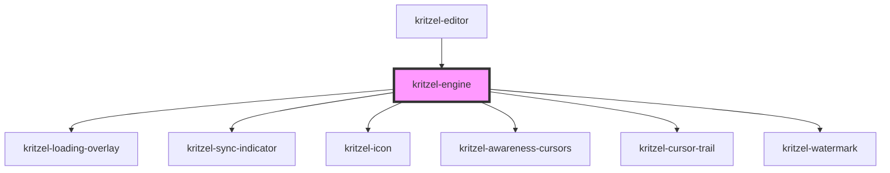

# kritzel-engine

<!-- Auto Generated Below -->

## Properties

| Property                       | Attribute                          | Description                                                                                                                                                                                                                                                                                                                                                                                           | Type                                  | Default     |
| ------------------------------ | ---------------------------------- | ----------------------------------------------------------------------------------------------------------------------------------------------------------------------------------------------------------------------------------------------------------------------------------------------------------------------------------------------------------------------------------------------------- | ------------------------------------- | ----------- |
| `activeWorkspaceId`            | `active-workspace-id`              | Optional workspace ID to load. If provided, the engine will look up and load this workspace by ID.                                                                                                                                                                                                                                                                                                    | `string`                              | `undefined` |
| `assetStorageConfig`           | --                                 | Configuration for binary asset storage (e.g., images).  The Yjs document only persists asset ids; the actual bytes are stored by the providers listed here. Defaults to IndexedDB-only storage. To support cross-device image sync alongside a networked sync provider (Hocuspocus, WebSocket), configure at least one remote asset provider such as `HttpAssetProvider` or `PresignedAssetProvider`. | `KritzelAssetStorageConfig`           | `undefined` |
| `cursorTarget`                 | --                                 | The HTML element to apply cursor styles to. Defaults to `document.body` if not set.                                                                                                                                                                                                                                                                                                                   | `HTMLElement`                         | `undefined` |
| `debugInfo`                    | --                                 | Debug info display options controlling which debug overlays are visible                                                                                                                                                                                                                                                                                                                               | `KritzelDebugInfo`                    | `undefined` |
| `editorId`                     | `editor-id`                        | Optional unique identifier for namespacing storage keys across multiple editor instances.                                                                                                                                                                                                                                                                                                             | `string`                              | `undefined` |
| `fallbackLocale`               | `fallback-locale`                  | The locale used to resolve terms missing from the active locale.                                                                                                                                                                                                                                                                                                                                      | `"de" \| "en" \| "fr" \| string & {}` | `'en'`      |
| `globalContextMenuItems`       | --                                 | Context menu items shown when right-clicking the canvas background.                                                                                                                                                                                                                                                                                                                                   | `ContextMenuItem[]`                   | `undefined` |
| `isLoading`                    | `is-loading`                       | External loading state. Combined with internal workspace-loading state to drive the overlay.                                                                                                                                                                                                                                                                                                          | `boolean`                             | `false`     |
| `isObjectDistanceFadingActive` | `is-object-distance-fading-active` | When true, objects fade based on distance to the viewport center.                                                                                                                                                                                                                                                                                                                                     | `boolean`                             | `false`     |
| `isPanningEnabled`             | `is-panning-enabled`               | When false, non-modified wheel events do not pan the viewport.                                                                                                                                                                                                                                                                                                                                        | `boolean`                             | `true`      |
| `isZoomingEnabled`             | `is-zooming-enabled`               | When false, Ctrl+wheel events do not zoom the viewport.                                                                                                                                                                                                                                                                                                                                               | `boolean`                             | `true`      |
| `licenseKey`                   | `license-key`                      | License key that, when valid, removes the "Powered by Kritzel" watermark.                                                                                                                                                                                                                                                                                                                             | `string`                              | `undefined` |
| `locale`                       | `locale`                           | The current locale (language) code to apply to the editor, e.g. 'en', 'de', 'fr'.                                                                                                                                                                                                                                                                                                                     | `"de" \| "en" \| "fr" \| string & {}` | `'en'`      |
| `locales`                      | --                                 | An array of available locale definitions (with optional partial term overrides).                                                                                                                                                                                                                                                                                                                      | `KritzelLocale[]`                     | `undefined` |
| `lockDrawingScale`             | `lock-drawing-scale`               | When true, objects are drawn at a fixed visual size regardless of zoom level                                                                                                                                                                                                                                                                                                                          | `boolean`                             | `true`      |
| `objectContextMenuItems`       | --                                 | Context menu items shown when right-clicking a selected object.                                                                                                                                                                                                                                                                                                                                       | `ContextMenuItem[]`                   | `undefined` |
| `scaleMax`                     | `scale-max`                        | Maximum zoom scale allowed. Clamped to the absolute maximum defined by the engine.                                                                                                                                                                                                                                                                                                                    | `number`                              | `1000`      |
| `scaleMin`                     | `scale-min`                        | Minimum zoom scale allowed. Clamped to the absolute minimum defined by the engine.                                                                                                                                                                                                                                                                                                                    | `number`                              | `0.0001`    |
| `syncConfig`                   | --                                 | Configuration for real-time synchronization providers (e.g., IndexedDB, WebSocket).                                                                                                                                                                                                                                                                                                                   | `KritzelSyncConfig`                   | `undefined` |
| `theme`                        | `theme`                            | The current theme to apply to the editor                                                                                                                                                                                                                                                                                                                                                              | `"dark" \| "light" \| string & {}`    | `'light'`   |
| `themes`                       | --                                 | An array of available themes for the editor.                                                                                                                                                                                                                                                                                                                                                          | `KritzelTheme[]`                      | `undefined` |
| `user`                         | --                                 | The current user for awareness broadcasting (name, id, cursor position).                                                                                                                                                                                                                                                                                                                              | `IKritzelUser`                        | `undefined` |
| `viewportBoundaryBottom`       | `viewport-boundary-bottom`         | Bottom boundary of the viewport in world coordinates. Objects beyond this Y position cannot be panned to.                                                                                                                                                                                                                                                                                             | `number`                              | `Infinity`  |
| `viewportBoundaryLeft`         | `viewport-boundary-left`           | Left boundary of the viewport in world coordinates. Objects beyond this X position cannot be panned to.                                                                                                                                                                                                                                                                                               | `number`                              | `-Infinity` |
| `viewportBoundaryRight`        | `viewport-boundary-right`          | Right boundary of the viewport in world coordinates. Objects beyond this X position cannot be panned to.                                                                                                                                                                                                                                                                                              | `number`                              | `Infinity`  |
| `viewportBoundaryTop`          | `viewport-boundary-top`            | Top boundary of the viewport in world coordinates. Objects beyond this Y position cannot be panned to.                                                                                                                                                                                                                                                                                                | `number`                              | `-Infinity` |
| `workspace`                    | --                                 | The workspace to load and display. Changing this prop switches the active workspace.                                                                                                                                                                                                                                                                                                                  | `KritzelWorkspace`                    | `undefined` |

## Events

| Event                     | Description                                                                                                | Type                                                          |
| ------------------------- | ---------------------------------------------------------------------------------------------------------- | ------------------------------------------------------------- |
| `activeToolChange`        | Emitted when the active drawing tool changes.                                                              | `CustomEvent<KritzelBaseTool>`                                |
| `activeWorkspaceChange`   | Emitted when the active workspace changes (e.g., after import).                                            | `CustomEvent<KritzelWorkspace>`                               |
| `awarenessChange`         | Emitted when the awareness state changes (remote user cursors, presence).                                  | `CustomEvent<Map<number, Record<string, any>>>`               |
| `contextMenuStateChange`  | Emitted when context-menu visibility, items, or position changes.                                          | `CustomEvent<KritzelContextMenuState>`                        |
| `isEngineReady`           | Emitted when the engine has fully initialized and is ready for interaction.                                | `CustomEvent<KritzelEngineState>`                             |
| `loadingChange`           | Emitted when the combined loading state (external `isLoading` prop or internal workspace loading) changes. | `CustomEvent<boolean>`                                        |
| `longpress`               | Emitted on long-press (touch/pen). Useful for showing custom context menus on mobile.                      | `CustomEvent<PointerEvent>`                                   |
| `notificationsChange`     | Emitted when notifications change.                                                                         | `CustomEvent<KritzelNotification>`                            |
| `objectsAdded`            | Emitted when one or more objects are added to the canvas.                                                  | `CustomEvent<ObjectsAddedEvent>`                              |
| `objectsChange`           | Emitted when objects on the canvas are added, removed, or modified.                                        | `CustomEvent<KritzelBaseObject<HTMLElement \| SVGElement>[]>` |
| `objectsInViewportChange` | Emitted when the set of objects visible in the current viewport changes (e.g., after pan or zoom).         | `CustomEvent<KritzelBaseObject<Element>[]>`                   |
| `objectsRemoved`          | Emitted when one or more objects are removed from the canvas.                                              | `CustomEvent<ObjectsRemovedEvent>`                            |
| `objectsSelectionChange`  | Emitted when the set of selected objects changes.                                                          | `CustomEvent<void>`                                           |
| `objectsUpdated`          | Emitted when one or more objects are updated on the canvas.                                                | `CustomEvent<ObjectsUpdatedEvent>`                            |
| `syncingChange`           | Emitted when remote workspace synchronization is in progress.                                              | `CustomEvent<boolean>`                                        |
| `undoStateChange`         | Emitted when the undo/redo state changes, providing current undo availability.                             | `CustomEvent<KritzelUndoState>`                               |
| `viewportChange`          | Emitted when the viewport position, scale, or dimensions change (e.g., after pan, zoom, or resize).        | `CustomEvent<KritzelViewportState>`                           |
| `workspacesChange`        | Emitted when workspaces are created, updated, or deleted.                                                  | `CustomEvent<KritzelWorkspace[]>`                             |

## Methods

### `addObject<T extends KritzelBaseObject>(object: T) => Promise<T | null>`

Adds a new object to the canvas. The object will be assigned an ID, core reference, and z-index automatically.

#### Parameters

| Name     | Type | Description                   |
| -------- | ---- | ----------------------------- |
| `object` | `T`  | - The object instance to add. |

#### Returns

Type: `Promise<T>`

The added object.

### `addObjects<T extends KritzelBaseObject>(objects: T[]) => Promise<T[]>`

Adds multiple objects to the canvas in a single batch operation.
All objects are inserted within one Yjs transaction (single undo step),
triggering only one rerender cycle. Intended for programmatic streaming
scenarios where per-object overhead would cause stutter.

#### Parameters

| Name      | Type  | Description                    |
| --------- | ----- | ------------------------------ |
| `objects` | `T[]` | - The object instances to add. |

#### Returns

Type: `Promise<T[]>`

The added objects.

### `alignObjects(alignment: KritzelAlignment) => Promise<void>`

Aligns the currently selected objects according to the specified alignment.

#### Parameters

| Name        | Type               | Description                                                            |
| ----------- | ------------------ | ---------------------------------------------------------------------- |
| `alignment` | `KritzelAlignment` | - The alignment direction (e.g., `CenterHorizontal`, `StartVertical`). |

#### Returns

Type: `Promise<void>`

### `backToContent() => Promise<boolean>`

Pans and zooms the viewport to fit the nearest content, with padding.
Useful when the user has panned away from all objects.

#### Returns

Type: `Promise<boolean>`

`true` if content was found and the viewport was adjusted, `false` otherwise.

### `beginSceneBootstrap() => Promise<void>`

Starts a scene bootstrap phase by hiding the scene immediately.

#### Returns

Type: `Promise<void>`

### `bringForward(object?: KritzelBaseObject<any>) => Promise<void>`

Moves an object one layer forward in the z-order.

#### Parameters

| Name     | Type                     | Description                                                         |
| -------- | ------------------------ | ------------------------------------------------------------------- |
| `object` | `KritzelBaseObject<any>` | - The object to move. If omitted, applies to the current selection. |

#### Returns

Type: `Promise<void>`

### `bringToFront(object?: KritzelBaseObject<any>) => Promise<void>`

Moves an object to the very front of the z-order.

#### Parameters

| Name     | Type                     | Description                                                         |
| -------- | ------------------------ | ------------------------------------------------------------------- |
| `object` | `KritzelBaseObject<any>` | - The object to move. If omitted, applies to the current selection. |

#### Returns

Type: `Promise<void>`

### `canExportSelectedObjectAs(format: KritzelObjectExportFormat) => Promise<boolean>`

Checks whether the currently selected object supports a specific export format.
Returns false when none or multiple objects are selected.

#### Parameters

| Name     | Type             | Description |
| -------- | ---------------- | ----------- |
| `format` | `"svg" \| "png"` |             |

#### Returns

Type: `Promise<boolean>`

### `centerAllObjects(animate?: boolean) => Promise<boolean>`

Pans and zooms the viewport to fit ALL objects on the canvas, including those not currently rendered.
Calculates the combined bounding box of all objects and centers the viewport to show them.

#### Parameters

| Name      | Type      | Description                                                   |
| --------- | --------- | ------------------------------------------------------------- |
| `animate` | `boolean` | - Whether to animate the viewport transition (default: true). |

#### Returns

Type: `Promise<boolean>`

`true` if objects were found and the viewport was adjusted, `false` otherwise.

### `centerObjectInViewport(object: KritzelBaseObject) => Promise<KritzelBaseObject<HTMLElement | SVGElement>>`

Pans and zooms the viewport to center on the given object.

#### Parameters

| Name     | Type                                           | Description                             |
| -------- | ---------------------------------------------- | --------------------------------------- |
| `object` | `KritzelBaseObject<HTMLElement \| SVGElement>` | - The object to center in the viewport. |

#### Returns

Type: `Promise<KritzelBaseObject<HTMLElement | SVGElement>>`

The centered object.

### `centerObjects(objects: KritzelBaseObject[], animate?: boolean) => Promise<boolean>`

Pans and zooms the viewport to fit the provided objects.
Calculates the combined bounding box of the given objects and centers the viewport to show them.

#### Parameters

| Name      | Type                                             | Description                                                   |
| --------- | ------------------------------------------------ | ------------------------------------------------------------- |
| `objects` | `KritzelBaseObject<HTMLElement \| SVGElement>[]` | - The objects to center and fit in the viewport.              |
| `animate` | `boolean`                                        | - Whether to animate the viewport transition (default: true). |

#### Returns

Type: `Promise<boolean>`

`true` if objects were provided and the viewport was adjusted, `false` otherwise.

### `changeActiveTool(tool: KritzelBaseTool) => Promise<void>`

Switches the active drawing tool. Deactivates the current tool and clears any selection.

#### Parameters

| Name   | Type              | Description                      |
| ------ | ----------------- | -------------------------------- |
| `tool` | `KritzelBaseTool` | - The tool instance to activate. |

#### Returns

Type: `Promise<void>`

### `changeActiveToolByName(toolName: string) => Promise<void>`

Switches the active drawing tool by its registered name.

#### Parameters

| Name       | Type     | Description                                                        |
| ---------- | -------- | ------------------------------------------------------------------ |
| `toolName` | `string` | - The name the tool was registered with (e.g., 'brush', 'eraser'). |

#### Returns

Type: `Promise<void>`

### `clearSelection() => Promise<void>`

Deselects all currently selected objects.

#### Returns

Type: `Promise<void>`

### `copy() => Promise<void>`

Copies the currently selected objects to the internal clipboard.

#### Returns

Type: `Promise<void>`

### `createWorkspace(workspace: KritzelWorkspace) => Promise<KritzelWorkspace | null>`

Creates a new workspace and emits a `workspacesChange` event.

#### Parameters

| Name        | Type               | Description                |
| ----------- | ------------------ | -------------------------- |
| `workspace` | `KritzelWorkspace` | - The workspace to create. |

#### Returns

Type: `Promise<KritzelWorkspace>`

The created workspace.

### `cut() => Promise<void>`

Cuts the currently selected objects to the internal clipboard (deletes them from the canvas).

#### Returns

Type: `Promise<void>`

### `delete() => Promise<void>`

Deletes the currently selected objects from the canvas.

#### Returns

Type: `Promise<void>`

### `deleteWorkspace(workspace: KritzelWorkspace) => Promise<void>`

Deletes a workspace and emits a `workspacesChange` event.

#### Parameters

| Name        | Type               | Description                |
| ----------- | ------------------ | -------------------------- |
| `workspace` | `KritzelWorkspace` | - The workspace to delete. |

#### Returns

Type: `Promise<void>`

### `disable() => Promise<void>`

Disables all user interaction with the engine (pointer, keyboard, etc.).

#### Returns

Type: `Promise<void>`

### `downloadAsJson(filename?: string) => Promise<void>`

Exports the current workspace as a JSON file and triggers a browser download.

#### Parameters

| Name       | Type     | Description                                                                                |
| ---------- | -------- | ------------------------------------------------------------------------------------------ |
| `filename` | `string` | - Optional custom filename (without extension). Defaults to workspace name with timestamp. |

#### Returns

Type: `Promise<void>`

### `enable() => Promise<void>`

Re-enables user interaction after a call to `disable()`.

#### Returns

Type: `Promise<void>`

### `endSceneBootstrap() => Promise<void>`

Ends a scene bootstrap phase by fading the scene back in.

#### Returns

Type: `Promise<void>`

### `exportAsJson() => Promise<string>`

Exports the current workspace and all its objects as a JSON string.
The exported data includes workspace metadata (id, name, viewport) and all canvas objects.

#### Returns

Type: `Promise<string>`

A JSON string representing the complete workspace state.

### `exportSelectedObject(format: KritzelObjectExportFormat) => Promise<void>`

Exports the currently selected object in the requested format and triggers a file download.
Only supports single selection.

#### Parameters

| Name     | Type             | Description |
| -------- | ---------------- | ----------- |
| `format` | `"svg" \| "png"` |             |

#### Returns

Type: `Promise<void>`

### `exportViewportAsPng(options?: { includeBackground?: boolean; }) => Promise<void>`

Exports the current viewport as a PNG file and triggers a browser download.

#### Parameters

| Name      | Type                               | Description                 |
| --------- | ---------------------------------- | --------------------------- |
| `options` | `{ includeBackground?: boolean; }` | - Optional export settings. |

#### Returns

Type: `Promise<void>`

### `exportViewportAsSvg(options?: { includeBackground?: boolean; }) => Promise<void>`

Exports the current viewport as an SVG file and triggers a browser download.

#### Parameters

| Name      | Type                               | Description                 |
| --------- | ---------------------------------- | --------------------------- |
| `options` | `{ includeBackground?: boolean; }` | - Optional export settings. |

#### Returns

Type: `Promise<void>`

### `findObjects<T extends KritzelBaseObject>(predicate: (obj: KritzelBaseObject<Element>) => boolean) => Promise<T[]>`

Returns all objects that match the given predicate function.
Excludes internal selection-related objects (selection groups and selection boxes).

#### Parameters

| Name        | Type                                           | Description                                                           |
| ----------- | ---------------------------------------------- | --------------------------------------------------------------------- |
| `predicate` | `(obj: KritzelBaseObject<Element>) => boolean` | - A filter function called for each object. Return `true` to include. |

#### Returns

Type: `Promise<T[]>`

An array of matching objects.

### `getActiveWorkspace() => Promise<KritzelWorkspace>`

Returns the currently active workspace.

#### Returns

Type: `Promise<KritzelWorkspace>`

### `getAllObjects<T extends KritzelBaseObject>() => Promise<T[]>`

Returns all objects on the canvas across all layers.

#### Returns

Type: `Promise<T[]>`

### `getAvailableLocaleOptions() => Promise<{ code: LocaleCode; label: string; }[]>`

Gets the list of available locales as `{ code, label }` options for a selector.

#### Returns

Type: `Promise<{ code: LocaleCode; label: string; }[]>`

### `getAvailableLocales() => Promise<LocaleCode[]>`

Gets the list of available locale codes (built-in and registered).

#### Returns

Type: `Promise<LocaleCode[]>`

### `getDisplayableShortcuts() => Promise<Omit<KritzelShortcut, "action" | "condition">[]>`

Returns all registered keyboard shortcuts (without action/condition) for display in a help UI.

#### Returns

Type: `Promise<Omit<KritzelShortcut, "action" | "condition">[]>`

### `getIsPublic() => Promise<boolean>`

Gets whether the active workspace is publicly accessible.

#### Returns

Type: `Promise<boolean>`

True if the workspace is public, false otherwise

### `getLocale() => Promise<LocaleCode>`

Gets the currently active locale code.

#### Returns

Type: `Promise<LocaleCode>`

### `getObjectById<T extends KritzelBaseObject>(id: string) => Promise<T | null>`

Retrieves a canvas object by its unique ID.

#### Parameters

| Name | Type     | Description                       |
| ---- | -------- | --------------------------------- |
| `id` | `string` | - The object's unique identifier. |

#### Returns

Type: `Promise<T>`

The matching object, or `null` if not found.

### `getObjectsInViewport() => Promise<KritzelBaseObject[]>`

Returns all objects currently visible within the viewport bounds.

#### Returns

Type: `Promise<KritzelBaseObject<HTMLElement | SVGElement>[]>`

### `getObjectsTotalCount() => Promise<number>`

Returns the total number of objects on the canvas.

#### Returns

Type: `Promise<number>`

### `getResolvedTerms() => Promise<Partial<Record<KritzelTermKey, string>>>`

Resolves every known term key for the active locale into a flat map.
Useful for UI layers that need to localize many strings at once.

#### Returns

Type: `Promise<Partial<Record<keyof KritzelTerms, string>>>`

### `getScreenshot(format?: "png" | "svg", options?: { includeBackground?: boolean; }) => Promise<string | null>`

Captures a screenshot of the current viewport as a data URL.

#### Parameters

| Name      | Type                               | Description                                       |
| --------- | ---------------------------------- | ------------------------------------------------- |
| `format`  | `"svg" \| "png"`                   | - The image format: `'png'` (default) or `'svg'`. |
| `options` | `{ includeBackground?: boolean; }` | - Optional screenshot settings.                   |

#### Returns

Type: `Promise<string>`

A data URL string of the captured image.

### `getSelectedObjectSupportedExportFormats() => Promise<KritzelObjectExportFormat[]>`

Returns export formats supported by the currently selected object.
Only returns formats when exactly one object is selected.

#### Returns

Type: `Promise<KritzelObjectExportFormat[]>`

### `getSelectedObjects() => Promise<KritzelBaseObject<any>[]>`

Returns the currently selected objects. Returns an empty array if nothing is selected.

#### Returns

Type: `Promise<KritzelBaseObject<any>[]>`

### `getViewport() => Promise<KritzelViewportState>`

Returns the current viewport state including position, scale, and dimensions.

#### Returns

Type: `Promise<KritzelViewportState>`

The current viewport state.

### `getWorkspaces() => Promise<KritzelWorkspace[]>`

Returns all available workspaces.

#### Returns

Type: `Promise<KritzelWorkspace[]>`

### `group() => Promise<void>`

Groups the currently selected objects into a single selection group.

#### Returns

Type: `Promise<void>`

### `hideContextMenu() => Promise<void>`

Hides the context menu and resets any associated selection state.

#### Returns

Type: `Promise<void>`

### `importFromFile() => Promise<void>`

Opens a file picker dialog and imports the selected JSON file into the workspace.
This method creates a hidden file input, triggers the browser's file chooser,
reads the selected JSON file, and imports it using importFromJson.

#### Returns

Type: `Promise<void>`

A promise that resolves when the import is complete or rejects on error/cancel.

### `importFromJson(json: string) => Promise<void>`

Imports a workspace from a JSON string into a new workspace.
Creates a new workspace with the imported data and automatically switches to it.

#### Parameters

| Name   | Type     | Description                                                    |
| ------ | -------- | -------------------------------------------------------------- |
| `json` | `string` | - A JSON string containing workspace data (from exportAsJson). |

#### Returns

Type: `Promise<void>`

### `loadObjectsFromJson(json: string) => Promise<number>`

Loads objects from a workspace JSON string into the current workspace.
Unlike importFromJson, this does not create a new workspace - it adds objects to the existing one.
Useful for initializing a workspace with pre-existing content after the editor is ready.

#### Parameters

| Name   | Type     | Description                                                    |
| ------ | -------- | -------------------------------------------------------------- |
| `json` | `string` | - A JSON string containing workspace data (from exportAsJson). |

#### Returns

Type: `Promise<number>`

The number of objects loaded.

### `loadSettings() => Promise<Partial<KritzelSettingsConfig> | null>`

Loads the persisted settings object from localStorage.

#### Returns

Type: `Promise<Partial<KritzelSettingsConfig>>`

The stored settings, or null if nothing is stored or the value is invalid.

### `loadSharedWorkspace(token: string) => Promise<void>`

Loads a shared workspace by token.
If the workspace exists locally, it switches to it.
If it doesn't exist, it adds it to the local workspaces list and then switches to it.

#### Parameters

| Name    | Type     | Description                                             |
| ------- | -------- | ------------------------------------------------------- |
| `token` | `string` | - The connection token identifying the shared workspace |

#### Returns

Type: `Promise<void>`

### `openContextMenu(options: { x: number; y: number; objectId?: string; }) => Promise<void>`

Programmatically opens the context menu at a specified world-coordinate position.
If `objectId` is provided and found, the object context menu is shown for that object.
If no `objectId` is provided but a selection group already exists, the object context menu is shown.
Otherwise, the global context menu is shown.

#### Parameters

| Name      | Type                                           | Description |
| --------- | ---------------------------------------------- | ----------- |
| `options` | `{ x: number; y: number; objectId?: string; }` |             |

#### Returns

Type: `Promise<void>`

### `panTo(x: number, y: number) => Promise<void>`

Pans the viewport to center on the given world coordinates without changing the scale.

#### Parameters

| Name | Type     | Description                                     |
| ---- | -------- | ----------------------------------------------- |
| `x`  | `number` | - X position in world coordinates to center on. |
| `y`  | `number` | - Y position in world coordinates to center on. |

#### Returns

Type: `Promise<void>`

### `panToObject(object: KritzelBaseObject) => Promise<void>`

Pans the viewport to center on the given object without changing the zoom level.
Unlike `centerObjectInViewport`, this moves the camera — not the object.

#### Parameters

| Name     | Type                                           | Description                                           |
| -------- | ---------------------------------------------- | ----------------------------------------------------- |
| `object` | `KritzelBaseObject<HTMLElement \| SVGElement>` | - The object whose center the viewport should pan to. |

#### Returns

Type: `Promise<void>`

### `paste(x: number, y: number) => Promise<void>`

Pastes previously copied objects at the specified world coordinates.

#### Parameters

| Name | Type     | Description                        |
| ---- | -------- | ---------------------------------- |
| `x`  | `number` | - X position in world coordinates. |
| `y`  | `number` | - Y position in world coordinates. |

#### Returns

Type: `Promise<void>`

### `redo() => Promise<void>`

Redoes the last undone action.

#### Returns

Type: `Promise<void>`

### `registerLocales(locales: KritzelLocale[]) => Promise<void>`

Registers additional locale definitions (with optional partial term overrides).

#### Parameters

| Name      | Type              | Description                           |
| --------- | ----------------- | ------------------------------------- |
| `locales` | `KritzelLocale[]` | - The locale definitions to register. |

#### Returns

Type: `Promise<void>`

### `registerTool(toolName: string, toolClass: any, toolConfig?: KritzelTextToolConfig | KritzelBrushToolConfig | KritzelLineToolConfig | KritzelShapeToolConfig) => Promise<KritzelBaseTool | null>`

Registers a new drawing tool with the engine.

#### Parameters

| Name         | Type                                                                                                 | Description                                                     |
| ------------ | ---------------------------------------------------------------------------------------------------- | --------------------------------------------------------------- |
| `toolName`   | `string`                                                                                             | - Unique identifier for the tool (e.g., 'brush', 'eraser').     |
| `toolClass`  | `any`                                                                                                | - Constructor class extending `KritzelBaseTool`.                |
| `toolConfig` | `KritzelTextToolConfig \| KritzelBrushToolConfig \| KritzelLineToolConfig \| KritzelShapeToolConfig` | - Optional initial configuration to apply to the tool instance. |

#### Returns

Type: `Promise<KritzelBaseTool>`

The registered tool instance, or `null` if registration failed.

### `reinitSync() => Promise<void>`

Reinitializes sync by performing a full teardown and re-initialization.
Destroys the current Yjs documents and providers, then rebuilds everything
from the current syncConfig. Data reloads from IndexedDB nearly instantly.
Call this after updating the syncConfig prop (e.g. after authentication state changes).

#### Returns

Type: `Promise<void>`

### `removeObject<T extends KritzelBaseObject>(object: T) => Promise<T | null>`

Removes an object from the canvas.

#### Parameters

| Name     | Type | Description             |
| -------- | ---- | ----------------------- |
| `object` | `T`  | - The object to remove. |

#### Returns

Type: `Promise<T>`

The removed object.

### `removeObjects<T extends KritzelBaseObject>(objects: T[]) => Promise<T[]>`

Removes multiple objects from the canvas in a single batch operation.
All removals happen within one Yjs transaction (single undo step),
triggering only one rerender cycle. Intended for programmatic streaming
scenarios where per-object overhead would cause stutter.

#### Parameters

| Name      | Type  | Description              |
| --------- | ----- | ------------------------ |
| `objects` | `T[]` | - The objects to remove. |

#### Returns

Type: `Promise<T[]>`

The removed objects.

### `saveSettings(settings: KritzelSettingsConfig) => Promise<void>`

Persists the given settings object to localStorage using the namespaced storage key.

#### Parameters

| Name       | Type                    | Description                              |
| ---------- | ----------------------- | ---------------------------------------- |
| `settings` | `KritzelSettingsConfig` | - The settings configuration to persist. |

#### Returns

Type: `Promise<void>`

### `screenToWorld(x: number, y: number) => Promise<{ x: number; y: number; }>`

Converts screen-relative pixel coordinates to world coordinates.

#### Parameters

| Name | Type     | Description                                                     |
| ---- | -------- | --------------------------------------------------------------- |
| `x`  | `number` | - X position in screen pixels (relative to the engine element). |
| `y`  | `number` | - Y position in screen pixels (relative to the engine element). |

#### Returns

Type: `Promise<{ x: number; y: number; }>`

World coordinates { x, y }.

### `selectAllObjectsInViewport() => Promise<void>`

Selects all objects currently visible in the viewport. Switches to the selection tool automatically.

#### Returns

Type: `Promise<void>`

### `selectObjects(objects: KritzelBaseObject[]) => Promise<void>`

Programmatically selects the given objects. Switches to the selection tool automatically.

#### Parameters

| Name      | Type                                             | Description              |
| --------- | ------------------------------------------------ | ------------------------ |
| `objects` | `KritzelBaseObject<HTMLElement \| SVGElement>[]` | - The objects to select. |

#### Returns

Type: `Promise<void>`

### `sendBackward(object?: KritzelBaseObject<any>) => Promise<void>`

Moves an object one layer backward in the z-order.

#### Parameters

| Name     | Type                     | Description                                                         |
| -------- | ------------------------ | ------------------------------------------------------------------- |
| `object` | `KritzelBaseObject<any>` | - The object to move. If omitted, applies to the current selection. |

#### Returns

Type: `Promise<void>`

### `sendToBack(object?: KritzelBaseObject<any>) => Promise<void>`

Moves an object to the very back of the z-order.

#### Parameters

| Name     | Type                     | Description                                                         |
| -------- | ------------------------ | ------------------------------------------------------------------- |
| `object` | `KritzelBaseObject<any>` | - The object to move. If omitted, applies to the current selection. |

#### Returns

Type: `Promise<void>`

### `setLocale(code: LocaleCode) => Promise<void>`

Sets the active locale (language) and re-renders the UI.

#### Parameters

| Name   | Type                                    | Description                               |
| ------ | --------------------------------------- | ----------------------------------------- |
| `code` | `(string & {}) \| "en" \| "de" \| "fr"` | - The locale code to activate, e.g. 'de'. |

#### Returns

Type: `Promise<void>`

### `setViewport(x: number, y: number, scale: number) => Promise<void>`

Sets the viewport to center on the given world coordinates at the specified scale.

#### Parameters

| Name    | Type     | Description                                     |
| ------- | -------- | ----------------------------------------------- |
| `x`     | `number` | - X position in world coordinates to center on. |
| `y`     | `number` | - Y position in world coordinates to center on. |
| `scale` | `number` | - Target scale level.                           |

#### Returns

Type: `Promise<void>`

### `t(key: KritzelTermKey, vars?: KritzelTermVars) => Promise<string>`

Resolves a term key to its translated string for the active locale.

#### Parameters

| Name   | Type                                 | Description                                          |
| ------ | ------------------------------------ | ---------------------------------------------------- |
| `key`  | `keyof KritzelTerms`                 | - The term key to resolve.                           |
| `vars` | `{ [x: string]: string \| number; }` | - Optional values for `{placeholder}` interpolation. |

#### Returns

Type: `Promise<string>`

### `triggerSelectionChange() => Promise<void>`

Manually triggers the `objectsSelectionChange` event.

#### Returns

Type: `Promise<void>`

### `undo() => Promise<void>`

Undoes the last action.

#### Returns

Type: `Promise<void>`

### `ungroup() => Promise<void>`

Ungroups the currently selected group back into individual objects.

#### Returns

Type: `Promise<void>`

### `updateObject<T extends KritzelBaseObject>(object: T, updatedProperties: Partial<T>) => Promise<T | null>`

Updates properties of an existing canvas object.

#### Parameters

| Name                | Type                         | Description                             |
| ------------------- | ---------------------------- | --------------------------------------- |
| `object`            | `T`                          | - The object to update.                 |
| `updatedProperties` | `{ [P in keyof T]?: T[P]; }` | - A partial set of properties to apply. |

#### Returns

Type: `Promise<T>`

The updated object.

### `updateWorkspace(workspace: KritzelWorkspace) => Promise<void>`

Updates an existing workspace's metadata and emits a `workspacesChange` event.

#### Parameters

| Name        | Type               | Description                              |
| ----------- | ------------------ | ---------------------------------------- |
| `workspace` | `KritzelWorkspace` | - The workspace with updated properties. |

#### Returns

Type: `Promise<void>`

### `worldToScreen(x: number, y: number) => Promise<{ x: number; y: number; }>`

Converts world coordinates to screen-relative pixel coordinates.

#### Parameters

| Name | Type     | Description                        |
| ---- | -------- | ---------------------------------- |
| `x`  | `number` | - X position in world coordinates. |
| `y`  | `number` | - Y position in world coordinates. |

#### Returns

Type: `Promise<{ x: number; y: number; }>`

Screen coordinates { x, y } relative to the engine element.

### `zoomIn(factor: number, duration: number) => Promise<void>`

Zooms in by a fixed step, centered on the current viewport center, with a smooth animation.

#### Parameters

| Name       | Type     | Description                           |
| ---------- | -------- | ------------------------------------- |
| `factor`   | `number` | - Multiplicative zoom-in step.        |
| `duration` | `number` | - Animation duration in milliseconds. |

#### Returns

Type: `Promise<void>`

### `zoomOut(factor: number, duration: number) => Promise<void>`

Zooms out by a fixed step, centered on the current viewport center, with a smooth animation.

#### Parameters

| Name       | Type     | Description                           |
| ---------- | -------- | ------------------------------------- |
| `factor`   | `number` | - Multiplicative zoom-out step.       |
| `duration` | `number` | - Animation duration in milliseconds. |

#### Returns

Type: `Promise<void>`

### `zoomTo(scale: number, worldX?: number, worldY?: number) => Promise<void>`

Zooms the viewport to the given scale level.
Optionally centers on a world point; if omitted, zooms around the viewport center.

#### Parameters

| Name     | Type     | Description                                              |
| -------- | -------- | -------------------------------------------------------- |
| `scale`  | `number` | - Target scale level.                                    |
| `worldX` | `number` | - Optional X position in world coordinates to center on. |
| `worldY` | `number` | - Optional Y position in world coordinates to center on. |

#### Returns

Type: `Promise<void>`

## Dependencies

### Used by

 - [kritzel-editor](../kritzel-editor)

### Depends on

- [kritzel-loading-overlay](../../ui/kritzel-loading-overlay)
- [kritzel-sync-indicator](../../shared/kritzel-sync-indicator)
- [kritzel-icon](../../shared/kritzel-icon)
- [kritzel-awareness-cursors](../kritzel-awareness-cursors)
- [kritzel-cursor-trail](../kritzel-cursor-trail)
- [kritzel-watermark](../kritzel-watermark)

### Graph

----------------------------------------------

*Built with [StencilJS](https://stenciljs.com/)*
