# kritzel-icon

<!-- Auto Generated Below -->

## Properties

| Property | Attribute | Description | Type     | Default     |
| -------- | --------- | ----------- | -------- | ----------- |
| `label`  | `label`   |             | `string` | `undefined` |
| `name`   | `name`    |             | `string` | `undefined` |
| `size`   | `size`    |             | `number` | `24`        |

## Dependencies

### Used by

 - [kritzel-back-to-content](../../ui/kritzel-back-to-content)
 - [kritzel-brush-style](../kritzel-brush-style)
 - [kritzel-context-menu](../../ui/kritzel-context-menu)
 - [kritzel-engine](../../core/kritzel-engine)
 - [kritzel-login-dialog](../../ui/kritzel-login-dialog)
 - [kritzel-master-detail](../kritzel-master-detail)
 - [kritzel-menu-item](../kritzel-menu-item)
 - [kritzel-more-menu](../../ui/kritzel-more-menu)
 - [kritzel-notification-card](../../ui/kritzel-notification-card)
 - [kritzel-pill-tabs](../kritzel-pill-tabs)
 - [kritzel-share-dialog](../../ui/kritzel-share-dialog)
 - [kritzel-split-button](../kritzel-split-button)
 - [kritzel-tool-config](../../ui/kritzel-tool-config)
 - [kritzel-toolbar](../../ui/kritzel-toolbar)
 - [kritzel-utility-panel](../../ui/kritzel-utility-panel)
 - [kritzel-zoom-panel](../../ui/kritzel-zoom-panel)

### Graph

```mermaid
graph TD;
  kritzel-back-to-content --> kritzel-icon
  kritzel-brush-style --> kritzel-icon
  kritzel-context-menu --> kritzel-icon
  kritzel-engine --> kritzel-icon
  kritzel-login-dialog --> kritzel-icon
  kritzel-master-detail --> kritzel-icon
  kritzel-menu-item --> kritzel-icon
  kritzel-more-menu --> kritzel-icon
  kritzel-notification-card --> kritzel-icon
  kritzel-pill-tabs --> kritzel-icon
  kritzel-share-dialog --> kritzel-icon
  kritzel-split-button --> kritzel-icon
  kritzel-tool-config --> kritzel-icon
  kritzel-toolbar --> kritzel-icon
  kritzel-utility-panel --> kritzel-icon
  kritzel-zoom-panel --> kritzel-icon
  style kritzel-icon fill:#f9f,stroke:#333,stroke-width:4px
```

----------------------------------------------

*Built with [StencilJS](https://stenciljs.com/)*
