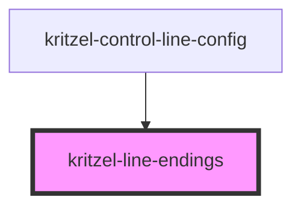

# kritzel-line-endings

A component for selecting line ending styles (arrows) for both the start and end of a line.

<!-- Auto Generated Below -->

## Properties

| Property      | Attribute      | Description                                | Type                                                         | Default                                             |
| ------------- | -------------- | ------------------------------------------ | ------------------------------------------------------------ | --------------------------------------------------- |
| `styles`      | --             | Available ending styles                    | `("none" \| "triangle" \| "open" \| "diamond" \| "circle")[]` | `['none', 'triangle', 'open', 'diamond', 'circle']` |
| `strokeColor` | `stroke-color` | Stroke color used for rendering the preview | `string`                                                    | `'#000000'`                                         |
| `value`       | --             | Current line arrow configuration           | `LineArrowConfig \| undefined`                               | `undefined`                                         |

## Events

| Event         | Description                                      | Type                           |
| ------------- | ------------------------------------------------ | ------------------------------ |
| `valueChange` | Emitted when the line endings configuration changes | `CustomEvent<LineArrowConfig>` |

## Dependencies

### Used by

- [kritzel-control-line-config](../../ui/kritzel-control-line-config)

### Graph

----------------------------------------------

*Built with [StencilJS](https://stenciljs.com/)*
