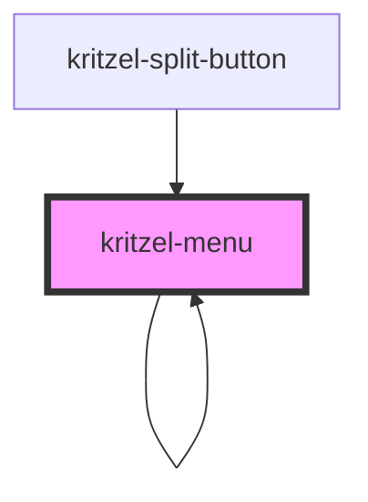

# kritzel-menu

<!-- Auto Generated Below -->

## Properties

| Property          | Attribute           | Description | Type                     | Default |
| ----------------- | ------------------- | ----------- | ------------------------ | ------- |
| `activeItemIndex` | `active-item-index` |             | `number`                 | `null`  |
| `editingIndex`    | `editing-index`     |             | `number`                 | `null`  |
| `items`           | `items`             |             | `KritzelMenuItem<any>[]` | `[]`    |
| `parent`          | `parent`            |             | `KritzelMenuItem<any>`   | `null`  |
| `parentIndex`     | `parent-index`      |             | `number`                 | `null`  |

## Events

| Event   | Description | Type                |
| ------- | ----------- | ------------------- |
| `close` |             | `CustomEvent<void>` |

## Dependencies

### Used by

 - [kritzel-menu](.)
 - [kritzel-split-button](../kritzel-split-button)

### Depends on

- [kritzel-icon](../kritzel-icon)
- [kritzel-portal](../kritzel-portal)
- [kritzel-menu](.)

### Graph

----------------------------------------------

*Built with [StencilJS](https://stenciljs.com/)*
