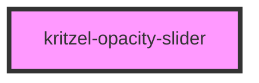

# kritzel-opacity-slider

A range slider component for adjusting opacity values. Displays a preview swatch with the current opacity applied, along with a percentage indicator.

<!-- Auto Generated Below -->

## Properties

| Property       | Attribute       | Description                                | Type     | Default     |
| -------------- | --------------- | ------------------------------------------ | -------- | ----------- |
| `max`          | `max`           | Maximum opacity value                      | `number` | `1`         |
| `min`          | `min`           | Minimum opacity value                      | `number` | `0`         |
| `previewColor` | `preview-color` | Color to display in the preview (optional) | `string` | `'#000000'` |
| `step`         | `step`          | Step increment                             | `number` | `0.01`      |
| `value`        | `value`         | Current opacity value (0 to 1)             | `number` | `1`         |

## Events

| Event         | Description                           | Type                  |
| ------------- | ------------------------------------- | --------------------- |
| `valueChange` | Emitted when the opacity value changes | `CustomEvent<number>` |

## CSS Custom Properties

| Property                                  | Default     | Description                              |
| ----------------------------------------- | ----------- | ---------------------------------------- |
| `--kritzel-opacity-slider-active-color`   | `#007AFF`   | Color of the filled portion of the track |
| `--kritzel-opacity-slider-track-color`    | `#e0e0e0`   | Color of the unfilled portion of the track |
| `--kritzel-opacity-slider-thumb-color`    | `#ffffff`   | Background color of the slider thumb     |
| `--kritzel-opacity-slider-thumb-border-color` | `#007AFF` | Border color of the slider thumb       |
| `--kritzel-opacity-slider-value-color`    | `#666666`   | Color of the percentage text             |

## Dependencies

### Used by

- Tool configuration components

### Graph

----------------------------------------------

*Built with [StencilJS](https://stenciljs.com/)*
