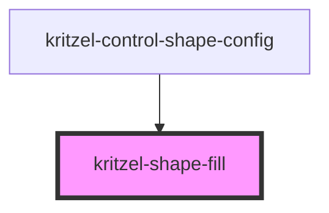

# kritzel-shape-fill

A component for selecting shape fill style (transparent or filled background).

<!-- Auto Generated Below -->

## Properties

| Property | Attribute | Description       | Type                          | Default         |
| -------- | --------- | ----------------- | ----------------------------- | --------------- |
| `value`  | `value`   | Current fill type | `"transparent" \| "filled"`   | `'transparent'` |

## Events

| Event         | Description                          | Type                                      |
| ------------- | ------------------------------------ | ----------------------------------------- |
| `valueChange` | Emitted when the fill type changes   | `CustomEvent<"transparent" \| "filled">` |

## Dependencies

### Used by

- [kritzel-control-shape-config](../../ui/kritzel-control-shape-config)

### Graph

----------------------------------------------

*Built with [StencilJS](https://stenciljs.com/)*
