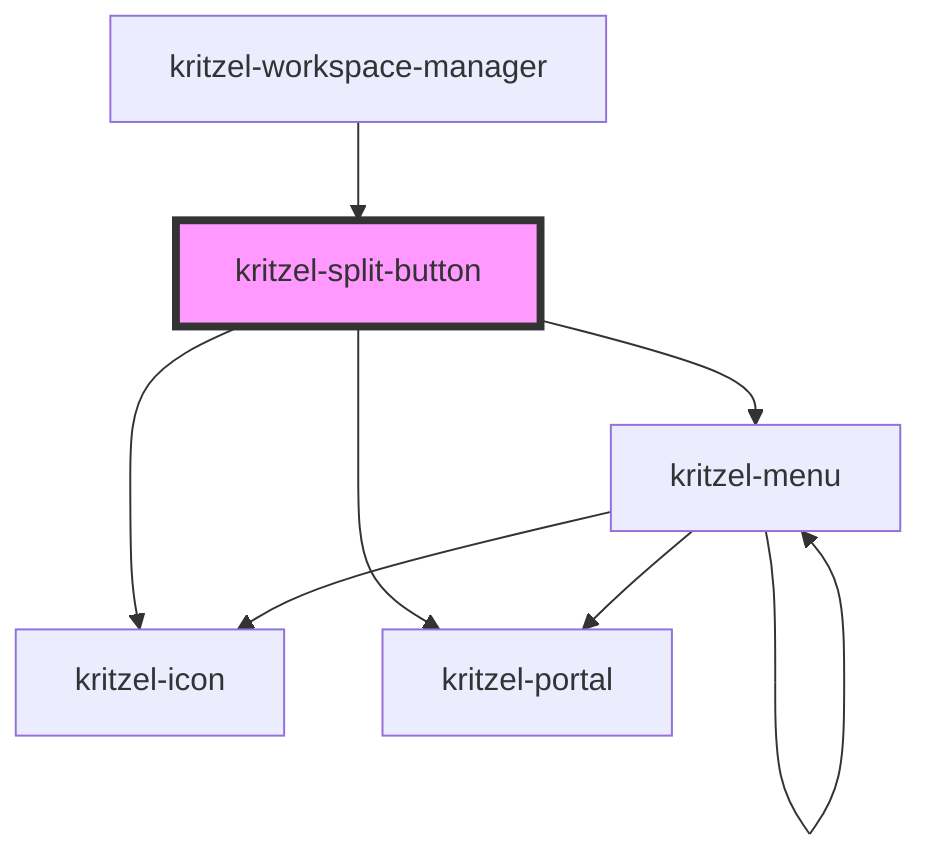

# kritzel-split-button

<!-- Auto Generated Below -->

## Properties

| Property          | Attribute           | Description | Type                     | Default          |
| ----------------- | ------------------- | ----------- | ------------------------ | ---------------- |
| `activeItemIndex` | `active-item-index` |             | `number`                 | `null`           |
| `buttonIcon`      | `button-icon`       |             | `string`                 | `undefined`      |
| `buttonText`      | `button-text`       |             | `string`                 | `undefined`      |
| `disabled`        | `disabled`          |             | `boolean`                | `false`          |
| `dropdownIcon`    | `dropdown-icon`     |             | `string`                 | `'chevron-down'` |
| `editingIndex`    | `editing-index`     |             | `number`                 | `null`           |
| `options`         | `options`           |             | `KritzelMenuItem<any>[]` | `[]`             |

## Events

| Event          | Description | Type                                |
| -------------- | ----------- | ----------------------------------- |
| `buttonClick`  |             | `CustomEvent<void>`                 |
| `menuClosed`   |             | `CustomEvent<void>`                 |
| `menuOpened`   |             | `CustomEvent<void>`                 |
| `optionSelect` |             | `CustomEvent<KritzelMenuItem<any>>` |

## Methods

### `closeMenu() => Promise<void>`

#### Returns

Type: `Promise<void>`

### `openMenu() => Promise<void>`

#### Returns

Type: `Promise<void>`

## Dependencies

### Used by

 - [kritzel-workspace-manager](../../ui/kritzel-workspace-manager)

### Depends on

- [kritzel-icon](../kritzel-icon)
- [kritzel-portal](../kritzel-portal)
- [kritzel-menu](../kritzel-menu)

### Graph

----------------------------------------------

*Built with [StencilJS](https://stenciljs.com/)*
