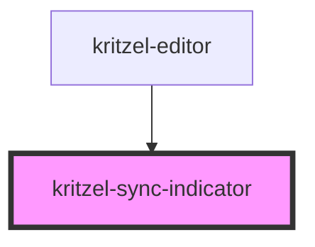

# kritzel-sync-indicator

<!-- Auto Generated Below -->

## Properties

| Property  | Attribute | Description                             | Type      | Default        |
| --------- | --------- | --------------------------------------- | --------- | -------------- |
| `text`    | `text`    | The text displayed next to the spinner. | `string`  | `'Syncing...'` |
| `visible` | `visible` | Whether the indicator is visible.       | `boolean` | `false`        |

## Dependencies

### Used by

 - [kritzel-editor](../../core/kritzel-editor)

### Graph

----------------------------------------------

*Built with [StencilJS](https://stenciljs.com/)*
