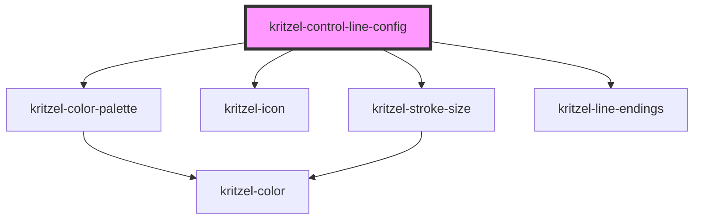

# kritzel-control-line-config

Configuration panel for the line tool. Allows users to adjust stroke color, stroke size, and line endings (arrows).

<!-- Auto Generated Below -->

## Properties

| Property     | Attribute     | Description                          | Type              | Default     |
| ------------ | ------------- | ------------------------------------ | ----------------- | ----------- |
| `isExpanded` | `is-expanded` | Whether the color palette is expanded | `boolean`         | `false`     |
| `tool`       | --            | The line tool instance to configure  | `KritzelLineTool` | `undefined` |

## Events

| Event        | Description                                   | Type                          |
| ------------ | --------------------------------------------- | ----------------------------- |
| `toolChange` | Emitted when any tool property is changed     | `CustomEvent<KritzelLineTool>` |

## Dependencies

### Depends on

- [kritzel-color-palette](../../shared/kritzel-color-palette)
- [kritzel-icon](../../shared/kritzel-icon)
- [kritzel-stroke-size](../../shared/kritzel-stroke-size)
- [kritzel-line-endings](../../shared/kritzel-line-endings)

### Graph

----------------------------------------------

*Built with [StencilJS](https://stenciljs.com/)*
