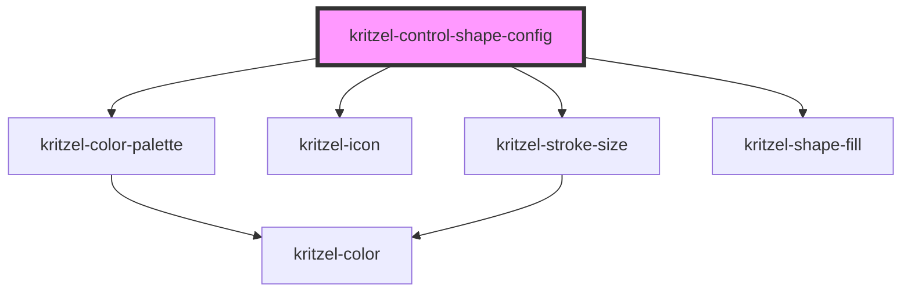

# kritzel-control-shape-config

Configuration panel for the shape tool. Allows users to adjust stroke color, stroke size, and fill style.

<!-- Auto Generated Below -->

## Properties

| Property     | Attribute     | Description                            | Type               | Default     |
| ------------ | ------------- | -------------------------------------- | ------------------ | ----------- |
| `isExpanded` | `is-expanded` | Whether the color palette is expanded  | `boolean`          | `false`     |
| `tool`       | --            | The shape tool instance to configure   | `KritzelShapeTool` | `undefined` |

## Events

| Event        | Description                                   | Type                           |
| ------------ | --------------------------------------------- | ------------------------------ |
| `toolChange` | Emitted when any tool property is changed     | `CustomEvent<KritzelShapeTool>` |

## Dependencies

### Depends on

- [kritzel-color-palette](../../shared/kritzel-color-palette)
- [kritzel-icon](../../shared/kritzel-icon)
- [kritzel-stroke-size](../../shared/kritzel-stroke-size)
- [kritzel-shape-fill](../../shared/kritzel-shape-fill)

### Graph

----------------------------------------------

*Built with [StencilJS](https://stenciljs.com/)*
