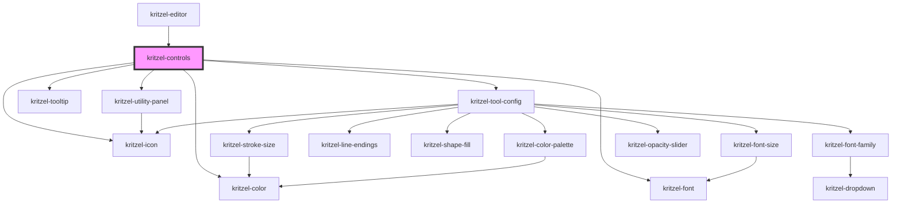

# kritzel-controls

<!-- Auto Generated Below -->

## Properties

| Property                | Attribute                  | Description | Type                      | Default |
| ----------------------- | -------------------------- | ----------- | ------------------------- | ------- |
| `activeControl`         | --                         |             | `KritzelToolbarControl`   | `null`  |
| `controls`              | --                         |             | `KritzelToolbarControl[]` | `[]`    |
| `isUtilityPanelVisible` | `is-utility-panel-visible` |             | `boolean`                 | `true`  |
| `undoState`             | --                         |             | `KritzelUndoState`        | `null`  |

## Events

| Event             | Description | Type                |
| ----------------- | ----------- | ------------------- |
| `isControlsReady` |             | `CustomEvent<void>` |

## Methods

### `closeTooltip() => Promise<void>`

#### Returns

Type: `Promise<void>`

## Dependencies

### Used by

 - [kritzel-editor](../../core/kritzel-editor)

### Depends on

- [kritzel-utility-panel](../kritzel-utility-panel)
- [kritzel-icon](../../shared/kritzel-icon)
- [kritzel-tooltip](../../shared/kritzel-tooltip)
- [kritzel-tool-config](../kritzel-tool-config)
- [kritzel-font](../../shared/kritzel-font)
- [kritzel-color](../../shared/kritzel-color)

### Graph

----------------------------------------------

*Built with [StencilJS](https://stenciljs.com/)*
