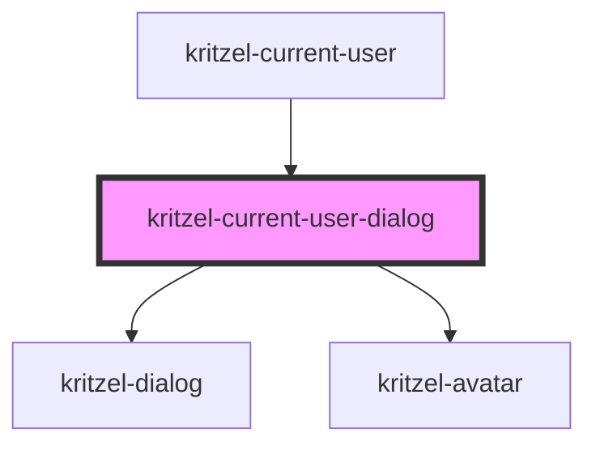

# kritzel-current-user-dialog

<!-- Auto Generated Below -->

## Properties

| Property | Attribute | Description | Type           | Default     |
| -------- | --------- | ----------- | -------------- | ----------- |
| `user`   | --        |             | `IKritzelUser` | `undefined` |

## Methods

### `close() => Promise<void>`

#### Returns

Type: `Promise<void>`

### `open() => Promise<void>`

#### Returns

Type: `Promise<void>`

## Dependencies

### Used by

 - [kritzel-current-user](../kritzel-current-user)

### Depends on

- [kritzel-dialog](../../shared/kritzel-dialog)
- [kritzel-avatar](../../shared/kritzel-avatar)

### Graph

----------------------------------------------

*Built with [StencilJS](https://stenciljs.com/)*
