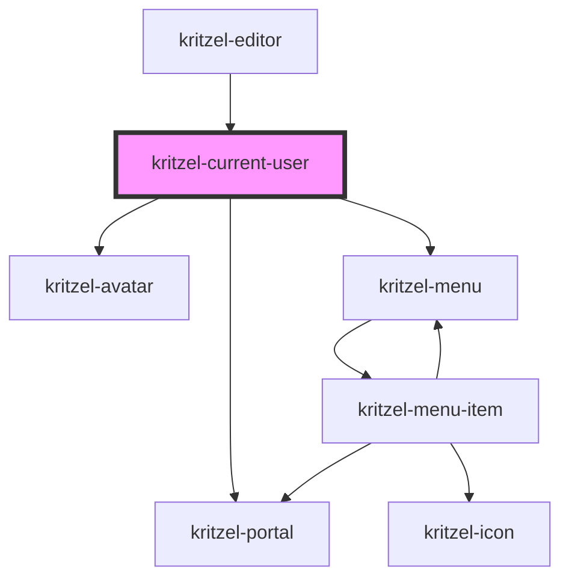

# kritzel-current-user

<!-- Auto Generated Below -->

## Properties

| Property     | Attribute     | Description                         | Type           | Default     |
| ------------ | ------------- | ----------------------------------- | -------------- | ----------- |
| `avatarSize` | `avatar-size` | Avatar size in pixels               | `number`       | `40`        |
| `offsetY`    | `offset-y`    | Offset Y for the portal positioning | `number`       | `4`         |
| `user`       | --            | The current user to display         | `IKritzelUser` | `undefined` |

## Events

| Event        | Description                          | Type                                                                           |
| ------------ | ------------------------------------ | ------------------------------------------------------------------------------ |
| `itemSelect` | Emitted when a menu item is selected | `CustomEvent<{ item: IKritzelMenuItem<any>; parent: IKritzelMenuItem<any>; }>` |

## Dependencies

### Used by

 - [kritzel-editor](../../core/kritzel-editor)

### Depends on

- [kritzel-avatar](../../shared/kritzel-avatar)
- [kritzel-portal](../../shared/kritzel-portal)
- [kritzel-menu](../../shared/kritzel-menu)

### Graph

----------------------------------------------

*Built with [StencilJS](https://stenciljs.com/)*
