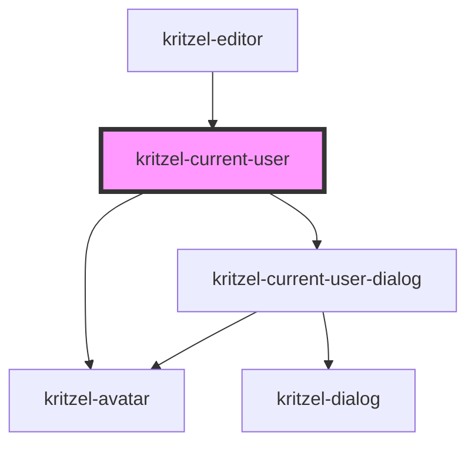

# kritzel-current-user

<!-- Auto Generated Below -->

## Properties

| Property     | Attribute     | Description                 | Type           | Default     |
| ------------ | ------------- | --------------------------- | -------------- | ----------- |
| `avatarSize` | `avatar-size` | Avatar size in pixels       | `number`       | `40`        |
| `user`       | --            | The current user to display | `IKritzelUser` | `undefined` |

## Dependencies

### Used by

 - [kritzel-editor](../../core/kritzel-editor)

### Depends on

- [kritzel-avatar](../../shared/kritzel-avatar)
- [kritzel-current-user-dialog](../kritzel-current-user-dialog)

### Graph

----------------------------------------------

*Built with [StencilJS](https://stenciljs.com/)*
