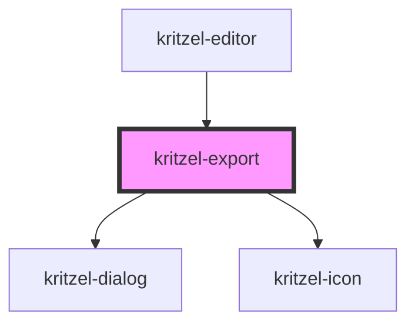

# kritzel-export

<!-- Auto Generated Below -->

## Events

| Event       | Description | Type                |
| ----------- | ----------- | ------------------- |
| `exportPng` |             | `CustomEvent<void>` |
| `exportSvg` |             | `CustomEvent<void>` |

## Methods

### `open(previewUrl?: string) => Promise<void>`

#### Parameters

| Name         | Type     | Description |
| ------------ | -------- | ----------- |
| `previewUrl` | `string` |             |

#### Returns

Type: `Promise<void>`

## Dependencies

### Used by

 - [kritzel-editor](../../core/kritzel-editor)

### Depends on

- [kritzel-dialog](../../shared/kritzel-dialog)
- [kritzel-icon](../../shared/kritzel-icon)

### Graph

----------------------------------------------

*Built with [StencilJS](https://stenciljs.com/)*
