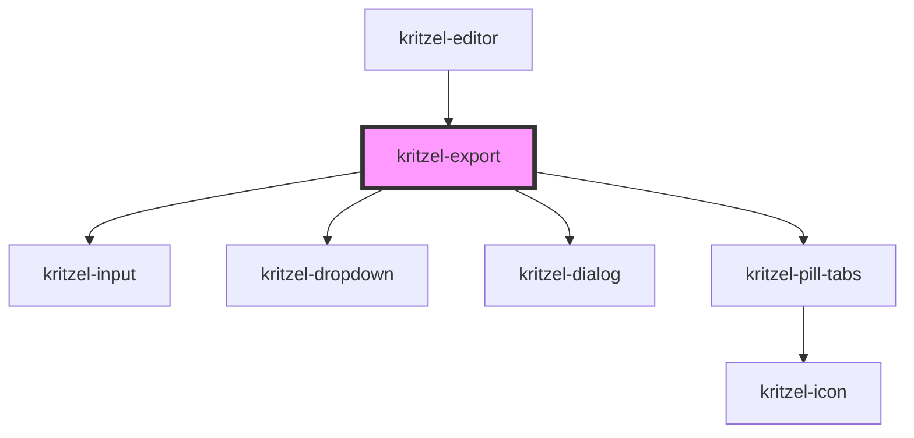

# kritzel-export

<!-- Auto Generated Below -->

## Properties

| Property        | Attribute        | Description                                                 | Type     | Default       |
| --------------- | ---------------- | ----------------------------------------------------------- | -------- | ------------- |
| `workspaceName` | `workspace-name` | The name of the current workspace, used as default filename | `string` | `'workspace'` |

## Events

| Event        | Description | Type                  |
| ------------ | ----------- | --------------------- |
| `exportJson` |             | `CustomEvent<string>` |
| `exportPng`  |             | `CustomEvent<void>`   |
| `exportSvg`  |             | `CustomEvent<void>`   |

## Methods

### `open(previewUrl?: string) => Promise<void>`

#### Parameters

| Name         | Type     | Description |
| ------------ | -------- | ----------- |
| `previewUrl` | `string` |             |

#### Returns

Type: `Promise<void>`

## Dependencies

### Used by

 - [kritzel-editor](../../core/kritzel-editor)

### Depends on

- [kritzel-input](../../shared/kritzel-input)
- [kritzel-dropdown](../../shared/kritzel-dropdown)
- [kritzel-dialog](../../shared/kritzel-dialog)
- [kritzel-pill-tabs](../../shared/kritzel-pill-tabs)

### Graph

----------------------------------------------

*Built with [StencilJS](https://stenciljs.com/)*
