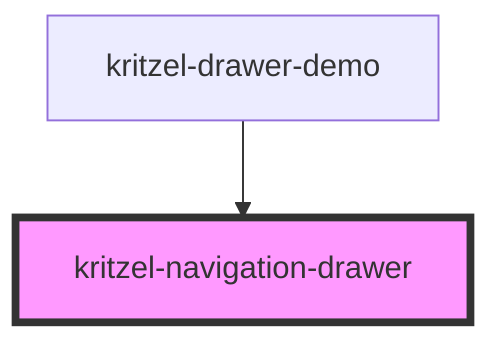

# kritzel-navigation-drawer

<!-- Auto Generated Below -->

## Properties

| Property      | Attribute      | Description | Type               | Default      |
| ------------- | -------------- | ----------- | ------------------ | ------------ |
| `drawerTitle` | `drawer-title` |             | `string`           | `'Settings'` |
| `isOpen`      | `is-open`      |             | `boolean`          | `false`      |
| `items`       | `items`        |             | `NavigationItem[]` | `[]`         |

## Events

| Event          | Description | Type                          |
| -------------- | ----------- | ----------------------------- |
| `drawerClosed` |             | `CustomEvent<void>`           |
| `itemSelected` |             | `CustomEvent<NavigationItem>` |

## Dependencies

### Used by

 - [kritzel-drawer-demo](../kritzel-drawer-demo)

### Graph

----------------------------------------------

*Built with [StencilJS](https://stenciljs.com/)*
