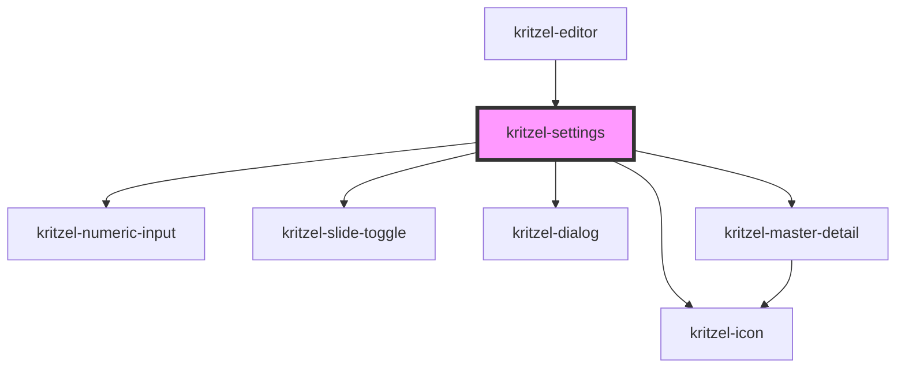

# kritzel-settings

A settings button component that opens a settings dialog when clicked.

## Usage

```html
<kritzel-settings></kritzel-settings>
```

## CSS Custom Properties

### Button Styling

| Property                                          | Default                      | Description                            |
| ------------------------------------------------- | ---------------------------- | -------------------------------------- |
| `--kritzel-settings-button-width`                 | `50px`                       | Button width                           |
| `--kritzel-settings-button-height`                | `50px`                       | Button height                          |
| `--kritzel-settings-button-border`                | `1px solid #ebebeb`          | Button border                          |
| `--kritzel-settings-button-border-radius`         | `12px`                       | Button border radius                   |
| `--kritzel-settings-button-background-color`      | `#ffffff`                    | Button background color                |
| `--kritzel-settings-button-box-shadow`            | `0 0 3px rgba(0, 0, 0, 0.08)`| Button box shadow                      |
| `--kritzel-settings-button-hover-background-color`| `#f5f5f5`                    | Button hover background color          |
| `--kritzel-settings-button-active-background-color`| `#ebebeb`                   | Button active background color         |

<!-- Auto Generated Below -->


## Events

| Event            | Description                  | Type                            |
| ---------------- | ---------------------------- | ------------------------------- |
| `settingsChange` | Emitted when settings change | `CustomEvent<IKritzelSettings>` |


## Dependencies

### Used by

 - [kritzel-editor](../../core/kritzel-editor)

### Depends on

- [kritzel-numeric-input](../../shared/kritzel-numeric-input)
- [kritzel-slide-toggle](../../shared/kritzel-slide-toggle)
- [kritzel-icon](../../shared/kritzel-icon)
- [kritzel-dialog](../../shared/kritzel-dialog)
- [kritzel-master-detail](../../shared/kritzel-master-detail)

### Graph


----------------------------------------------

*Built with [StencilJS](https://stenciljs.com/)*
