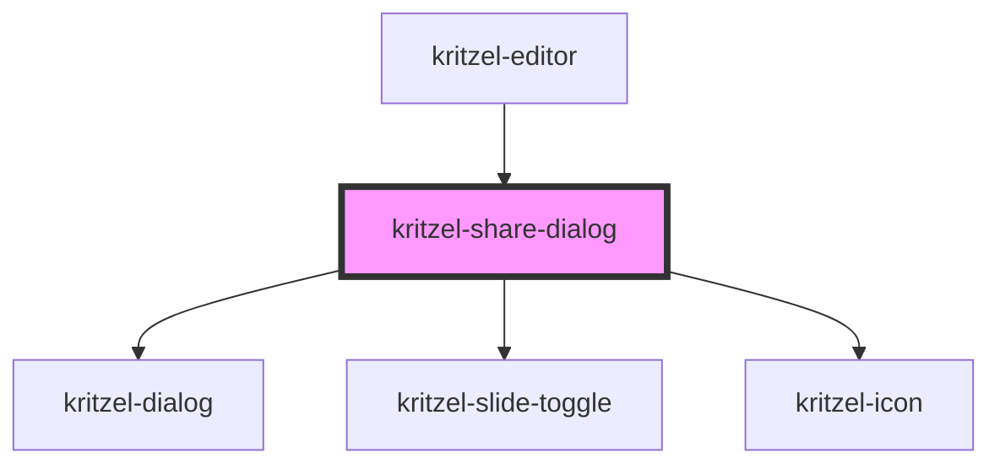

# kritzel-share-dialog

<!-- Auto Generated Below -->

## Overview

Share dialog component for managing workspace link sharing.
This is a presentational component that emits events for all actions.
The parent component (kritzel-editor) handles the business logic.

## Properties

| Property      | Attribute      | Description                                                        | Type      | Default     |
| ------------- | -------------- | ------------------------------------------------------------------ | --------- | ----------- |
| `isPublic`    | `is-public`    | Whether the workspace is currently public.                         | `boolean` | `false`     |
| `workspaceId` | `workspace-id` | The ID of the workspace being shared. Used to build the share URL. | `string`  | `undefined` |

## Events

| Event            | Description                                             | Type                   |
| ---------------- | ------------------------------------------------------- | ---------------------- |
| `dialogClosed`   | Emitted when the dialog is closed.                      | `CustomEvent<void>`    |
| `toggleIsPublic` | Emitted when the user toggles the public sharing state. | `CustomEvent<boolean>` |

## Methods

### `close() => Promise<void>`

Closes the share dialog.

#### Returns

Type: `Promise<void>`

### `open() => Promise<void>`

Opens the share dialog.

#### Returns

Type: `Promise<void>`

## Dependencies

### Used by

 - [kritzel-editor](../../core/kritzel-editor)

### Depends on

- [kritzel-dialog](../../shared/kritzel-dialog)
- [kritzel-slide-toggle](../../shared/kritzel-slide-toggle)
- [kritzel-icon](../../shared/kritzel-icon)

### Graph

----------------------------------------------

*Built with [StencilJS](https://stenciljs.com/)*
