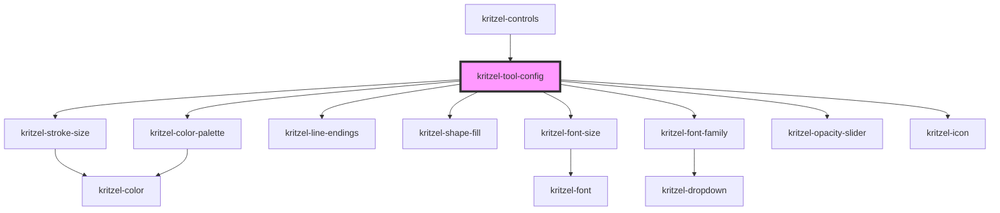

# kritzel-tool-config

<!-- Auto Generated Below -->

## Properties

| Property     | Attribute     | Description | Type                                                                                                 | Default     |
| ------------ | ------------- | ----------- | ---------------------------------------------------------------------------------------------------- | ----------- |
| `isExpanded` | `is-expanded` |             | `boolean`                                                                                            | `false`     |
| `theme`      | `theme`       |             | `"dark" \| "light"`                                                                                  | `undefined` |
| `tool`       | --            |             | `KritzelBrushTool \| KritzelLineTool \| KritzelSelectionTool \| KritzelShapeTool \| KritzelTextTool` | `undefined` |

## Events

| Event                 | Description | Type                                                                                                              |
| --------------------- | ----------- | ----------------------------------------------------------------------------------------------------------------- |
| `displayValuesChange` |             | `CustomEvent<ToolDisplayValues>`                                                                                  |
| `toolChange`          |             | `CustomEvent<KritzelBrushTool \| KritzelLineTool \| KritzelSelectionTool \| KritzelShapeTool \| KritzelTextTool>` |

## Dependencies

### Used by

 - [kritzel-controls](../kritzel-controls)

### Depends on

- [kritzel-stroke-size](../../shared/kritzel-stroke-size)
- [kritzel-font-size](../../shared/kritzel-font-size)
- [kritzel-line-endings](../../shared/kritzel-line-endings)
- [kritzel-shape-fill](../../shared/kritzel-shape-fill)
- [kritzel-font-family](../../shared/kritzel-font-family)
- [kritzel-color-palette](../../shared/kritzel-color-palette)
- [kritzel-opacity-slider](../../shared/kritzel-opacity-slider)
- [kritzel-icon](../../shared/kritzel-icon)

### Graph

----------------------------------------------

*Built with [StencilJS](https://stenciljs.com/)*
