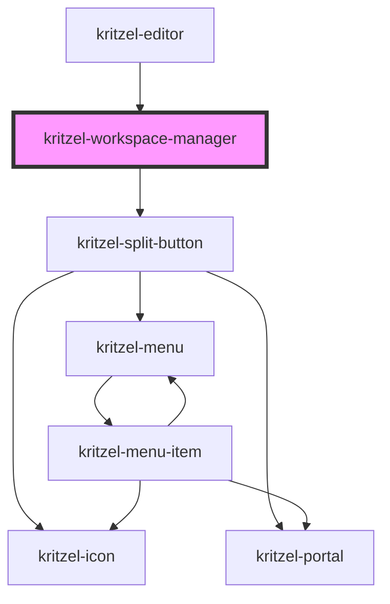

# kritzel-workspace-manager

<!-- Auto Generated Below -->

## Properties

| Property          | Attribute | Description | Type                 | Default     |
| ----------------- | --------- | ----------- | -------------------- | ----------- |
| `activeWorkspace` | --        |             | `KritzelWorkspace`   | `undefined` |
| `workspaces`      | --        |             | `KritzelWorkspace[]` | `[]`        |

## Events

| Event                     | Description | Type                            |
| ------------------------- | ----------- | ------------------------------- |
| `isWorkspaceManagerReady` |             | `CustomEvent<void>`             |
| `workspaceChange`         |             | `CustomEvent<KritzelWorkspace>` |

## Dependencies

### Used by

 - [kritzel-editor](../../core/kritzel-editor)

### Depends on

- [kritzel-split-button](../../shared/kritzel-split-button)

### Graph

----------------------------------------------

*Built with [StencilJS](https://stenciljs.com/)*
