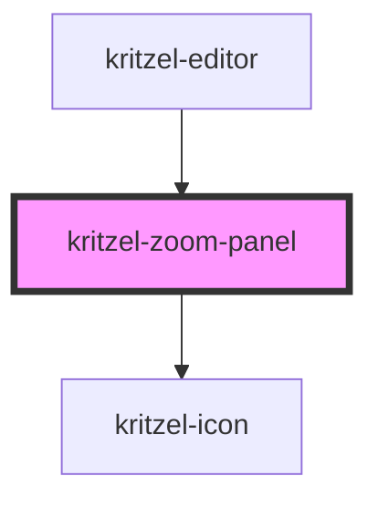

# kritzel-zoom-panel

<!-- Auto Generated Below -->

## Properties

| Property      | Attribute      | Description                             | Type      | Default |
| ------------- | -------------- | --------------------------------------- | --------- | ------- |
| `disabled`    | `disabled`     | Whether both zoom buttons are disabled. | `boolean` | `false` |
| `visible`     | `visible`      | Whether the zoom panel is visible.      | `boolean` | `true`  |
| `zoomPercent` | `zoom-percent` | Current zoom level in percent.          | `number`  | `100`   |

## Events

| Event     | Description                                  | Type                |
| --------- | -------------------------------------------- | ------------------- |
| `zoomIn`  | Emitted when the zoom-in button is clicked.  | `CustomEvent<void>` |
| `zoomOut` | Emitted when the zoom-out button is clicked. | `CustomEvent<void>` |

## Dependencies

### Used by

 - [kritzel-editor](../../core/kritzel-editor)

### Depends on

- [kritzel-icon](../../shared/kritzel-icon)

### Graph

----------------------------------------------

*Built with [StencilJS](https://stenciljs.com/)*
