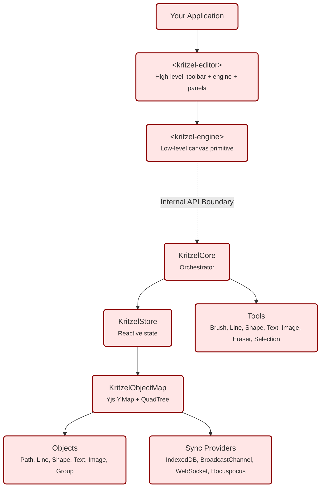

# Overview

Kritzel is a framework-agnostic infinite canvas and collaborative whiteboard engine. It provides web components that work natively in any framework — with first-class wrappers for React, Vue, and Angular.

## Why Kritzel

Kritzel handles the hard parts of canvas-based applications — infinite pan/zoom, hit-testing, CRDT-based collaboration, undo/redo, and cross-browser rendering — so you can focus on your product's domain logic.

The core building blocks of the library are:

- [**Components**](concept-components.md) — two entry points (`<kritzel-editor>` and `<kritzel-engine>`) that let you choose between a ready-made UI and a headless canvas
- [**Tools**](concept-tools.md) — state-machine-based interaction handlers that intercept pointer events and define how users draw, select, or manipulate the canvas
- [**Objects**](concept-objects.md) — the visual building blocks on the canvas (paths, shapes, text, images) with shared 2D spatial properties
- [**Workspaces**](concept-workspaces.md) — containers that manage an entire canvas collection, view state, and configuration
- [**Theming**](theming.md) — built-in light and dark themes with full CSS variable customization
- [**Collaboration**](collaboration.md) — real-time multi-user sync powered by Yjs CRDTs with pluggable transport providers

## Architecture

While only `<kritzel-editor>` or `<kritzel-engine>` are needed to use Kritzel, the following diagram gives a high-level overview of how the internals are structured:

- **Components layer** — Two web components serve as entry points. `<kritzel-editor>` is the high-level, batteries-included component that bundles a toolbar, utility panels, context menus, and settings alongside the canvas. `<kritzel-engine>` is the low-level primitive that exposes only the canvas surface, giving you full control to build custom UI around it.

- **Core orchestrator** — `KritzelCore` sits behind the internal API boundary of the engine component. It coordinates tools, state management, rendering, and event handling. Application code never instantiates it directly — it is created and managed by the component lifecycle.

- **Reactive state** — `KritzelStore` holds the current editor state (active tool, selection, viewport, theme, etc.) as observable signals. Components and tools subscribe to slices of the store they care about, keeping rendering efficient.

- **Object map** — `KritzelObjectMap` is the spatial data structure that manages all canvas objects. It combines a Yjs `Y.Map` for CRDT-based persistence and sync with a QuadTree for fast spatial queries (hit-testing, viewport culling).

- **Tools & Objects** — Tools implement the interaction logic (pointer handlers, cursors, previews) while Objects define the data model and rendering for each shape type. Both are pluggable — custom tools and objects can be registered at runtime.

- **Sync providers** — Persistence and collaboration are handled by swappable providers. IndexedDB and BroadcastChannel work offline, while WebSocket and Hocuspocus enable real-time multi-user collaboration.

