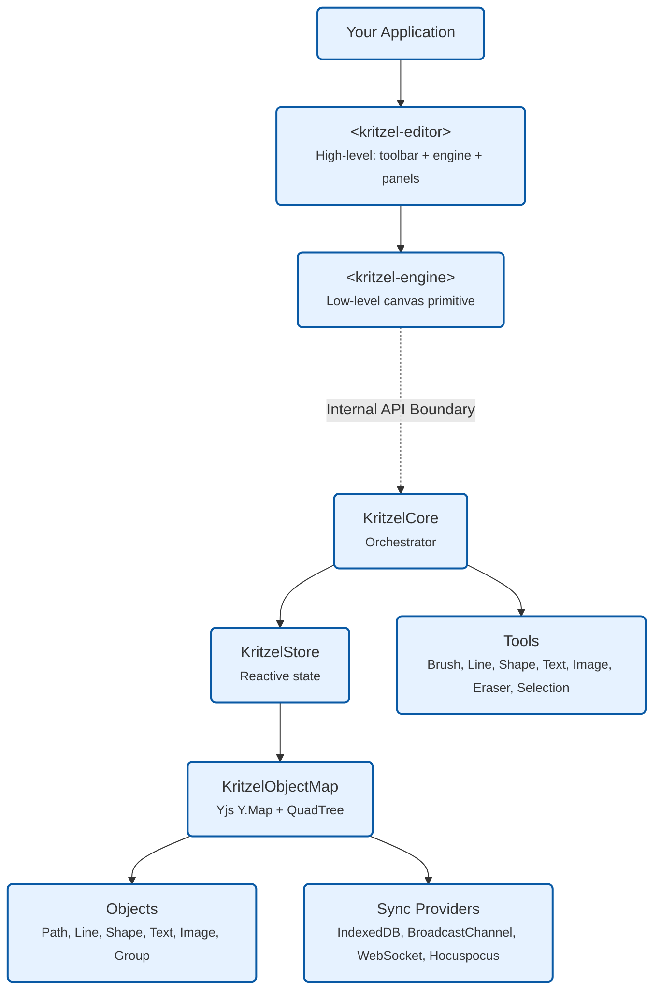

---

sidebar_label: Overview
title: Kritzel for React Overview
description: Add an infinite canvas and collaborative whiteboard to your React app using Kritzel's React wrapper, rich drawing tools, and real-time sync.
keywords:
  - react whiteboard
  - react infinite canvas
  - kritzel
  - collaborative canvas
  - drawing tools
---

# Overview

Kritzel is a framework-agnostic infinite canvas and collaborative whiteboard engine built with [StencilJS](https://stenciljs.com/). It provides web components that work natively in any framework — with first-class wrappers for React, Vue, and Angular.

## Key Features

- **Infinite canvas** — unlimited pan and zoom with configurable viewport boundaries
- **Drawing tools** — brush, line, shape, text, image, and eraser tools out of the box
- **Selection & manipulation** — select, move, resize, rotate, group, align, and reorder objects
- **Real-time collaboration** — Yjs-based sync with pluggable providers (IndexedDB, BroadcastChannel, WebSocket, Hocuspocus)
- **Workspaces** — multiple canvases within a single instance with workspace switching
- **Undo / redo** — full undo/redo stack backed by Yjs
- **Theming** — built-in light and dark themes with full CSS variable customization
- **Export** — capture viewport as PNG or SVG
- **Multi-framework** — native web components with React, Vue, and Angular wrappers

## Architecture

Most applications should use `<kritzel-editor>`, which bundles the canvas engine together with a toolbar, utility panel, context menus, and settings. Use `<kritzel-engine>` directly when you need full control over the UI and want to build your own toolbar and panels.

